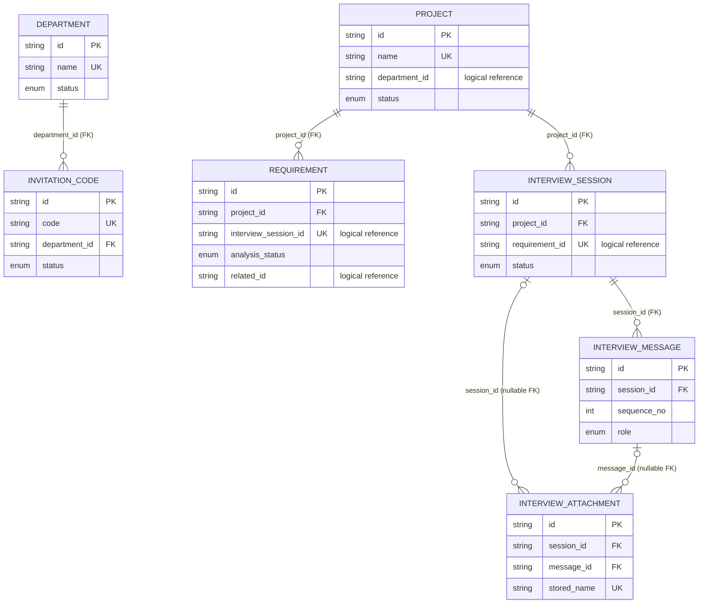

# Backend Code Review Map：Database

> 扫描范围：`app/db/models.py`、`app/db/session.py` 以及 ORM 的 Service 引用。本文只描述当前源码中实际存在的 SQLAlchemy ORM，不把 Pydantic Schema 混称为 Model。

## 术语与阅读约定

- **ORM / Model**：SQLAlchemy 数据库对象。
- **Schema**：Pydantic 数据对象。
- `-`：源码未声明默认值或约束。
- `Python 默认`：在 ORM 对象插入时由 SQLAlchemy 调用，不是数据库 `server_default`。
- 标注为“逻辑引用”的 ID 字段没有数据库外键约束，关系只能由业务代码保证。

## Enum 字典

| Enum | 允许值 | 主要使用位置 |
|---|---|---|
| `ProjectStatus` | `ACTIVE` / `ARCHIVED` | `Project.status` |
| `AnalysisStatus` | `PENDING` / `ANALYZING` / `ANALYZED` / `FAILED` | `Requirement.analysis_status` |
| `RequirementType` | `NEW_FEATURE` / `BUG` / `OPTIMIZATION` | `Requirement.type`、`InterviewSession.request_type` |
| `RequirementPriority` | `P0` / `P1` / `P2` / `P3` | `Requirement.priority` |
| `DepartmentStatus` | `ACTIVE` / `DISABLED` | `Department.status` |
| `InvitationStatus` | `UNUSED` / `USED` / `DISABLED` | `InvitationCode.status` |
| `InterviewStatus` | `DRAFT` / `INTERVIEWING` / `CONFIRMING` / `SUBMITTED` / `ABANDONED` / `FAILED` | `InterviewSession.status` |
| `InterviewMessageRole` | `USER` / `AGENT` / `SYSTEM_EVENT` | `InterviewMessage.role` |
| `InterviewActionType` | `INITIAL` / `ANSWER` / `SKIP` / `UNKNOWN` / `DIRECT_SUMMARY` | `InterviewMessage.action_type` |
| `SourceChannel` | `MANAGEMENT_WEB` / `PRODUCT_WEB` / `MINI_PROGRAM` / `WECHAT` / `WECOM` / `FEISHU` / `OTHER` | `InterviewSession.source_channel` |
| `ProjectResolveMode` | `USER_SELECTED` / `ENTRY_BOUND` / `CHANNEL_MAPPED` | `InterviewSession.project_resolve_mode` |

所有 Enum 列均使用 `Enum(..., native_enum=False)`，即由 SQLAlchemy 以非原生数据库 Enum 方式持久化。

## Department ORM

### Model 基本信息

- Class：`Department`
- 数据库表：`department`
- 主要用途：保存部门及启停状态，并作为邀请码的所属部门。

### 字段表

| 字段 | Python / SQLAlchemy 类型 | 可空 | 默认值 | 主键/外键/索引/唯一约束 | 说明 |
|---|---|---|---|---|---|
| `id` | `str / String(32)` | 否 | `new_id()` | PK | UUID4 的 32 位十六进制 ID |
| `name` | `str / String(100)` | 否 | - | UNIQUE / INDEX | 部门名称 |
| `status` | `DepartmentStatus / Enum` | 否 | `ACTIVE` | INDEX | 部门状态 |
| `created_time` | `datetime / DateTime(timezone=True)` | 否 | `utc_now()` | - | 创建时间 |
| `updated_time` | `datetime / DateTime(timezone=True)` | 否 | `utc_now()`；更新时 `utc_now()` | - | 更新时间 |

### Relationship

| 属性 | 关联 ORM | 关系 | `back_populates` | `cascade` |
|---|---|---|---|---|
| `invitations` | `InvitationCode` | 一对多 | `department` | `all, delete-orphan` |

`Department ORM` → has many `InvitationCode ORM`

`InvitationCode ORM` → belongs to `Department ORM`

## InvitationCode ORM

### Model 基本信息

- Class：`InvitationCode`
- 数据库表：`invitation_code`
- 主要用途：保存部门邀请码、可选使用人和使用状态。

### 字段表

| 字段 | Python / SQLAlchemy 类型 | 可空 | 默认值 | 主键/外键/索引/唯一约束 | 说明 |
|---|---|---|---|---|---|
| `id` | `str / String(32)` | 否 | `new_id()` | PK | 邀请码记录 ID |
| `code` | `str / String(9)` | 否 | - | UNIQUE / INDEX | 业务邀请码，Service 生成格式为 `XXXX-XXXX` |
| `department_id` | `str / String(32)` | 否 | - | FK `department.id` (`RESTRICT`) / INDEX | 所属部门 ID |
| `user_name` | `str \| None / String(50)` | 是 | `None` | INDEX | 可选使用人姓名 |
| `status` | `InvitationStatus / Enum` | 否 | `UNUSED` | INDEX | 邀请码状态 |
| `created_time` | `datetime / DateTime(timezone=True)` | 否 | `utc_now()` | - | 创建时间 |
| `used_time` | `datetime \| None / DateTime(timezone=True)` | 是 | `None` | - | 使用时间；当前扫描范围内未发现 Service 赋值 |

### Relationship

| 属性 | 关联 ORM | 关系 | `back_populates` | `cascade` |
|---|---|---|---|---|
| `department` | `Department` | 多对一 | `invitations` | 未声明 |

## Project ORM

### Model 基本信息

- Class：`Project`
- 数据库表：`project`
- 主要用途：保存项目基础信息和项目上下文，是需求与访谈会话的聚合根。

### 字段表

| 字段 | Python / SQLAlchemy 类型 | 可空 | 默认值 | 主键/外键/索引/唯一约束 | 说明 |
|---|---|---|---|---|---|
| `id` | `str / String(32)` | 否 | `new_id()` | PK | 项目 ID |
| `name` | `str / String(100)` | 否 | - | UNIQUE / INDEX | 项目名称 |
| `description` | `str / Text` | 否 | `""` | - | 简短描述 |
| `project_context` | `str / Text` | 否 | - | - | 供业务与 AI 分析使用的项目上下文 |
| `department_id` | `str \| None / String(32)` | 是 | `None` | INDEX；无 FK | 所属部门逻辑 ID |
| `created_by` | `str \| None / String(32)` | 是 | `None` | 无 FK | 创建人逻辑 ID |
| `status` | `ProjectStatus / Enum` | 否 | `ACTIVE` | INDEX | 项目状态 |
| `created_time` | `datetime / DateTime(timezone=True)` | 否 | `utc_now()` | - | 创建时间 |
| `updated_time` | `datetime / DateTime(timezone=True)` | 否 | `utc_now()`；更新时 `utc_now()` | - | 更新时间 |

### Relationship

| 属性 | 关联 ORM | 关系 | `back_populates` | `cascade` |
|---|---|---|---|---|
| `requirements` | `Requirement` | 一对多 | `project` | `all, delete-orphan` |
| `interview_sessions` | `InterviewSession` | 一对多 | `project` | `all, delete-orphan` |

`Project ORM` → has many `Requirement ORM`

`Project ORM` → has many `InterviewSession ORM`

## InterviewSession ORM

### Model 基本信息

- Class：`InterviewSession`
- 数据库表：`interview_session`
- 主要用途：保存一次需求访谈的来源、结构化提取结果、进度、摘要和最终需求关联。

### 字段表

| 字段 | Python / SQLAlchemy 类型 | 可空 | 默认值 | 主键/外键/索引/唯一约束 | 说明 |
|---|---|---|---|---|---|
| `id` | `str / String(32)` | 否 | `new_id()` | PK | 会话 ID |
| `project_id` | `str / String(32)` | 否 | - | FK `project.id` (`CASCADE`) / INDEX | 所属项目 |
| `created_by` | `str \| None / String(32)` | 是 | `None` | INDEX；无 FK | 创建人逻辑 ID |
| `source_channel` | `SourceChannel / Enum` | 否 | `MANAGEMENT_WEB` | 复合唯一约束成员 | 来源渠道 |
| `source_user_id` | `str \| None / String(100)` | 是 | `None` | - | 外部来源用户 ID |
| `source_message_id` | `str \| None / String(100)` | 是 | `None` | 与 `source_channel` UNIQUE | 来源消息 ID，用于创建幂等 |
| `entry_key` | `str \| None / String(64)` | 是 | `None` | - | 入口标识；当前管理端创建流程未赋值 |
| `project_resolve_mode` | `ProjectResolveMode / Enum` | 否 | `USER_SELECTED` | - | 项目解析方式 |
| `status` | `InterviewStatus / Enum` | 否 | `DRAFT` | INDEX | 会话状态 |
| `raw_content` | `str / Text` | 否 | - | - | 用户原始输入 |
| `request_type` | `RequirementType \| None / Enum` | 是 | `None` | - | AI 判断的需求类型 |
| `structured_data` | `str / Text` | 否 | `"{}"` | - | JSON 字符串；保存 11 个访谈字段及证据 |
| `skipped_fields` | `str / Text` | 否 | `"[]"` | - | JSON 字符串；保存跳过字段名 |
| `completeness_score` | `int / Integer` | 否 | `0` | - | 核心字段完整度分数 |
| `round_count` | `int / Integer` | 否 | `0` | - | 访谈轮数 |
| `consecutive_skip_count` | `int / Integer` | 否 | `0` | - | 连续跳过次数 |
| `consecutive_agent_failures` | `int / Integer` | 否 | `0` | - | 连续 AI 调用失败次数 |
| `stop_reason` | `str \| None / String(40)` | 是 | `None` | - | 进入确认阶段的原因代码 |
| `summary_title` | `str \| None / String(200)` | 是 | `None` | - | 摘要标题 |
| `clarified_content` | `str \| None / Text` | 是 | `None` | - | 根据结构化字段渲染的澄清内容 |
| `requirement_id` | `str \| None / String(32)` | 是 | `None` | UNIQUE；无 FK | 最终需求逻辑 ID |
| `confirm_idempotency_key` | `str \| None / String(64)` | 是 | `None` | 无唯一约束 | 确认请求幂等键；当前 Service 写入但不据此查询 |
| `agent_error_code` | `str \| None / String(50)` | 是 | `None` | - | 最近 AI 错误码 |
| `agent_error_message` | `str \| None / Text` | 是 | `None` | - | 最近 AI 错误信息 |
| `prompt_version` | `str \| None / String(30)` | 是 | `None` | - | 创建时记录的访谈提示词版本 |
| `created_time` | `datetime / DateTime(timezone=True)` | 否 | `utc_now()` | 复合索引成员 | 创建时间 |
| `updated_time` | `datetime / DateTime(timezone=True)` | 否 | `utc_now()`；更新时 `utc_now()` | 复合索引成员 | 更新时间 |

表级约束与索引：

- UNIQUE：`(source_channel, source_message_id)`，名称 `uq_interview_source_message`。
- INDEX：`(created_by, status, updated_time)`。
- INDEX：`(project_id, status, created_time)`。

### Relationship

| 属性 | 关联 ORM | 关系 | `back_populates` | `cascade` / 排序 |
|---|---|---|---|---|
| `project` | `Project` | 多对一 | `interview_sessions` | 未声明 |
| `messages` | `InterviewMessage` | 一对多 | `session` | `all, delete-orphan`；按 `sequence_no` |
| `attachments` | `InterviewAttachment` | 一对多 | `session` | `all, delete-orphan`；按 `created_time` |

## InterviewMessage ORM

### Model 基本信息

- Class：`InterviewMessage`
- 数据库表：`interview_message`
- 主要用途：保存访谈会话中的用户、Agent 或系统消息及动作元数据。

### 字段表

| 字段 | Python / SQLAlchemy 类型 | 可空 | 默认值 | 主键/外键/索引/唯一约束 | 说明 |
|---|---|---|---|---|---|
| `id` | `str / String(32)` | 否 | `new_id()` | PK | 消息 ID |
| `session_id` | `str / String(32)` | 否 | - | FK `interview_session.id` (`CASCADE`) / INDEX / 复合 UNIQUE | 所属会话 |
| `sequence_no` | `int / Integer` | 否 | - | 与 `session_id` UNIQUE | 会话内序号 |
| `role` | `InterviewMessageRole / Enum` | 否 | - | - | 消息角色 |
| `content` | `str / Text` | 否 | - | - | 消息内容 |
| `action_type` | `InterviewActionType \| None / Enum` | 是 | `None` | - | 用户动作类型 |
| `target_field` | `str \| None / String(50)` | 是 | `None` | - | 本轮目标访谈字段 |
| `reason_code` | `str \| None / String(50)` | 是 | `None` | - | 提问或动作原因代码 |
| `client_message_id` | `str \| None / String(64)` | 是 | `None` | 与 `session_id` UNIQUE | 客户端消息 ID，用于消息幂等 |
| `agent_run_id` | `str \| None / String(100)` | 是 | `None` | - | Dify Workflow Run ID |
| `created_time` | `datetime / DateTime(timezone=True)` | 否 | `utc_now()` | - | 创建时间 |

表级唯一约束：

- `(session_id, sequence_no)`，名称 `uq_interview_message_sequence`。
- `(session_id, client_message_id)`，名称 `uq_interview_client_message`。

### Relationship

| 属性 | 关联 ORM | 关系 | `back_populates` | `cascade` / 排序 |
|---|---|---|---|---|
| `session` | `InterviewSession` | 多对一 | `messages` | 未声明 |
| `attachments` | `InterviewAttachment` | 一对多 | `message` | 未声明；按 `created_time` |

## InterviewAttachment ORM

### Model 基本信息

- Class：`InterviewAttachment`
- 数据库表：`interview_attachment`
- 主要用途：记录访谈图片附件在本地和 Dify 中的身份及归属。

### 字段表

| 字段 | Python / SQLAlchemy 类型 | 可空 | 默认值 | 主键/外键/索引/唯一约束 | 说明 |
|---|---|---|---|---|---|
| `id` | `str / String(32)` | 否 | `new_id()` | PK | 附件 ID |
| `session_id` | `str \| None / String(32)` | 是 | `None` | FK `interview_session.id` (`CASCADE`) / INDEX | 绑定会话 |
| `message_id` | `str \| None / String(32)` | 是 | `None` | FK `interview_message.id` (`SET NULL`) / INDEX | 绑定消息 |
| `uploaded_by` | `str \| None / String(32)` | 是 | `None` | INDEX / 复合索引成员；无 FK | 上传人逻辑 ID |
| `original_name` | `str / String(255)` | 否 | - | - | 原始文件名 |
| `stored_name` | `str / String(80)` | 否 | - | UNIQUE | 本地存储文件名 |
| `storage_path` | `str / Text` | 否 | - | - | 本地文件路径 |
| `mime_type` | `str / String(50)` | 否 | - | - | 服务端检测后的 MIME 类型 |
| `size_bytes` | `int / Integer` | 否 | - | - | 文件大小 |
| `sha256` | `str / String(64)` | 否 | - | INDEX | 文件摘要 |
| `dify_upload_file_id` | `str \| None / String(100)` | 是 | `None` | - | Dify 上传文件 ID |
| `dify_user` | `str \| None / String(100)` | 是 | `None` | - | Dify 文件归属 user；用于判断能否复用上传结果 |
| `created_time` | `datetime / DateTime(timezone=True)` | 否 | `utc_now()` | 复合索引成员 | 创建时间 |

表级索引：`(uploaded_by, created_time)`。

`preview_url` 是 Python `@property`，值为 `/api/v1/interviews/attachments/{id}/content`，不是数据库字段。

### Relationship

| 属性 | 关联 ORM | 关系 | `back_populates` | `cascade` |
|---|---|---|---|---|
| `session` | `InterviewSession` | 多对一、可空 | `attachments` | 未声明 |
| `message` | `InterviewMessage` | 多对一、可空 | `attachments` | 未声明 |

## Requirement ORM

### Model 基本信息

- Class：`Requirement`
- 数据库表：`requirement`
- 主要用途：保存原始需求、访谈结果、Dify 分析结果和分析状态。

### 字段表

| 字段 | Python / SQLAlchemy 类型 | 可空 | 默认值 | 主键/外键/索引/唯一约束 | 说明 |
|---|---|---|---|---|---|
| `id` | `str / String(32)` | 否 | `new_id()` | PK | 需求 ID |
| `project_id` | `str / String(32)` | 否 | - | FK `project.id` (`CASCADE`) / INDEX / 复合索引成员 | 所属项目 |
| `raw_content` | `str / Text` | 否 | - | - | 原始需求内容 |
| `interview_session_id` | `str \| None / String(32)` | 是 | `None` | UNIQUE；无 FK | 来源访谈会话逻辑 ID |
| `clarified_content` | `str \| None / Text` | 是 | `None` | - | 访谈澄清内容 |
| `interview_rounds` | `int / Integer` | 否 | `0` | - | 来源访谈轮数 |
| `completeness_score` | `int \| None / Integer` | 是 | `None` | - | 来源访谈完整度 |
| `standard_content` | `str \| None / Text` | 是 | `None` | - | Dify 标准化需求内容 |
| `business_goal` | `str \| None / Text` | 是 | `None` | - | Dify 识别的业务目标 |
| `type` | `RequirementType \| None / Enum` | 是 | `None` | INDEX | 需求类型 |
| `priority` | `RequirementPriority \| None / Enum` | 是 | `None` | INDEX / 复合索引成员 | 优先级 |
| `is_fake` | `bool \| None / Boolean` | 是 | `None` | INDEX | 是否伪需求 |
| `fake_reason` | `str \| None / Text` | 是 | `None` | - | 伪需求判断原因 |
| `is_duplicate` | `bool \| None / Boolean` | 是 | `None` | INDEX | 是否重复需求 |
| `related_id` | `str / String(32)` | 否 | `""` | 无 FK | 关联已有需求逻辑 ID；非重复时为空字符串 |
| `reference_rule` | `str \| None / Text` | 是 | `None` | - | 参考规则 |
| `analysis_summary` | `str \| None / Text` | 是 | `None` | - | AI 分析摘要 |
| `analysis_status` | `AnalysisStatus / Enum` | 否 | `PENDING` | INDEX | 分析状态 |
| `analysis_error_code` | `str \| None / String(50)` | 是 | `None` | - | 分析失败错误码 |
| `analysis_error_message` | `str \| None / Text` | 是 | `None` | - | 分析失败错误信息 |
| `dify_workflow_run_id` | `str \| None / String(100)` | 是 | `None` | - | Dify Workflow Run ID |
| `manual_modify` | `bool / Boolean` | 否 | `False` | - | 人工修改标记；当前扫描范围内未发现置为 `True` 的 Service |
| `created_by` | `str \| None / String(32)` | 是 | `None` | 无 FK | 创建人逻辑 ID |
| `created_time` | `datetime / DateTime(timezone=True)` | 否 | `utc_now()` | 复合索引成员 | 创建时间 |
| `updated_time` | `datetime / DateTime(timezone=True)` | 否 | `utc_now()`；更新时 `utc_now()` | - | 更新时间 |

表级索引：

- `(project_id, created_time)`，名称 `ix_requirement_project_created`。
- `(project_id, priority)`，名称 `ix_requirement_project_priority`。

### Relationship

| 属性 | 关联 ORM | 关系 | `back_populates` | `cascade` |
|---|---|---|---|---|
| `project` | `Project` | 多对一 | `requirements` | 未声明 |

## Database Relationship Overview

### 非数据库约束的逻辑关联

以下关系由 Service 维护，数据库不会自动保证目标存在或级联：

- `Project.department_id` → `Department.id`。
- `Project.created_by`、`Requirement.created_by`、`InterviewSession.created_by`、`InterviewAttachment.uploaded_by` → 当前项目未定义用户 ORM。
- `InterviewSession.requirement_id` ↔ `Requirement.id`。
- `Requirement.interview_session_id` ↔ `InterviewSession.id`。
- `Requirement.related_id` → 另一条 `Requirement.id`；`DifyService` 只允许关联本次提供的候选需求 ID。

## Database 初始化与迁移边界

- `app/db/session.py` 创建 Engine；SQLite 会启用 `PRAGMA foreign_keys=ON` 和 `check_same_thread=False`。
- `init_db()` 调用 `Base.metadata.create_all()`，并在部门为空时初始化“运营部 / 产品部 / 销售部”。
- 当前轻量迁移逻辑只为已有 `requirement` 表补充 `interview_session_id`、`clarified_content`、`interview_rounds`、`completeness_score`，并创建 `interview_session_id` 唯一索引。
- 因此，除上述四列外，后续 ORM 结构变化不会由这段轻量逻辑自动迁移已有数据库；Review 现有部署数据库时需要另行核对实际表结构。
