# Backend Code Review Map：Service

> 扫描范围：`app/services/` 全部 Service，并读取必要的 Router、Schema、ORM、配置和数据库会话代码确认真实数据流。本文关注“输入从哪里来、经过什么对象、下一步到哪里”，不逐行讲解实现。

## Backend Data Flow Quick Reference

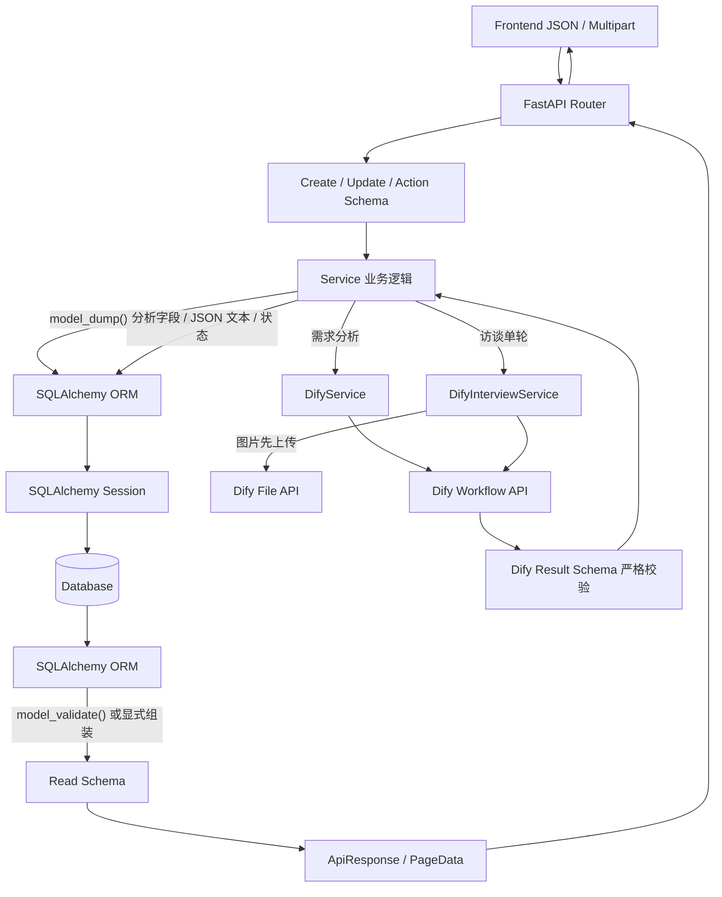

### 核心状态流

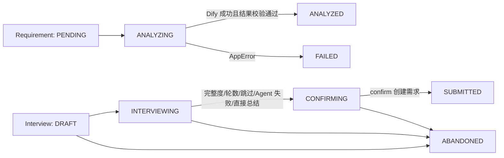

> `InterviewStatus.FAILED` 虽在 Enum 和草稿查询中存在，但当前扫描未发现 Service 将会话状态设置为 `FAILED`；Agent 错误当前通过失败计数和错误字段记录。

## Service Dependency Overview

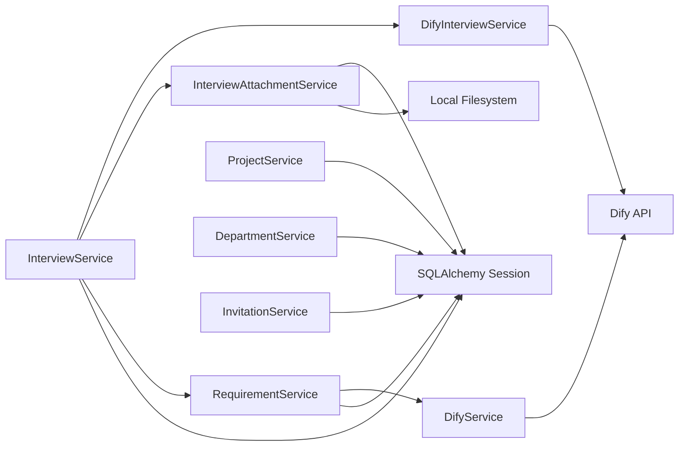

# ProjectService

## Service 职责

管理项目创建和分页列表，并为列表结果统计每个项目的需求数量。项目状态过滤由列表方法完成；当前 Service 没有归档/恢复方法。

## 方法地图

| 方法 | 输入 | 主要操作 | ORM / Model | 外部依赖 | 输出 |
|---|---|---|---|---|---|
| `create` | `ProjectCreate Schema` | Schema `model_dump()` → 构造项目 → 提交；名称唯一冲突转业务冲突错误 | `Project ORM` | SQLAlchemy Session | `ProjectRead Schema` |
| `list` | `page`、`page_size`、`status: str \| None` | 左连接需求并分组计数；可按状态过滤；按创建时间倒序分页 | `Project ORM`、`Requirement ORM` | SQLAlchemy Session | `(list[ProjectRead Schema], total)` |

## Data Flow

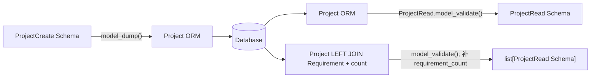

# DepartmentService

## Service 职责

管理部门创建、修改和分页查询。输出时根据 `Project.department_id` 统计项目数。

## 方法地图

| 方法 | 输入 | 主要操作 | ORM / Model | 外部依赖 | 输出 |
|---|---|---|---|---|---|
| `create` | `DepartmentCreate Schema` | 显式取 `name` 构造部门并提交；唯一冲突转业务错误 | `Department ORM` | SQLAlchemy Session | `DepartmentRead Schema` |
| `update` | `department_id`、`DepartmentUpdate Schema` | 查部门；`model_dump(exclude_none=True)` 后逐字段写入；提交 | `Department ORM` | SQLAlchemy Session | `DepartmentRead Schema` |
| `list` | 分页、`keyword`、`DepartmentStatus \| None` | 名称模糊搜索、状态过滤、按创建时间升序分页 | `Department ORM` | SQLAlchemy Session | `(list[DepartmentRead Schema], total)` |
| `_to_read` | `Department ORM` | ORM → Schema；额外查询项目数量并赋给 `project_count` | `Department ORM`、`Project ORM` | SQLAlchemy Session | `DepartmentRead Schema` |

## Data Flow

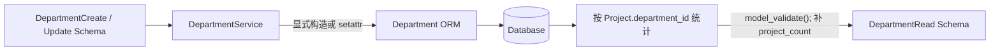

Review 边界：`DepartmentRead.user_count` 未由 `_to_read()` 赋值，因此当前输出使用 Schema 默认值 `0`。

# InvitationService

## Service 职责

为启用部门生成唯一邀请码、查询邀请码、禁用未使用的邀请码，并将所属部门名称加入输出。

## 方法地图

| 方法 | 输入 | 主要操作 | ORM / Model | 外部依赖 | 输出 |
|---|---|---|---|---|---|
| `create` | `InvitationCreate Schema` | 校验部门存在且 `ACTIVE`；生成唯一 `XXXX-XXXX`；构造并提交 | `Department ORM`、`InvitationCode ORM` | SQLAlchemy Session、`secrets` | `InvitationRead Schema` |
| `disable` | `invitation_id` | 查邀请码；已使用则拒绝；否则设为 `DISABLED` | `InvitationCode ORM` | SQLAlchemy Session | `InvitationRead Schema` |
| `list` | 分页、关键字、部门、状态 | code / user_name 模糊搜索；部门和状态过滤；创建时间倒序分页 | `InvitationCode ORM` | SQLAlchemy Session | `(list[InvitationRead Schema], total)` |
| `_unique_code` | 无 | 从去除易混淆字符的字母表随机生成 8 位并查库避重 | `InvitationCode ORM` | SQLAlchemy Session、`secrets` | `str` |
| `_to_read` | `InvitationCode ORM` | ORM 属性加 `department.name` → Pydantic 校验 | `InvitationCode ORM`、`Department ORM` | relationship | `InvitationRead Schema` |

## Data Flow

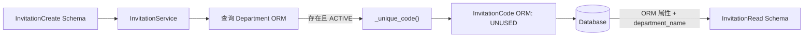

Review 边界：当前 Service 只创建 `UNUSED` 和设置 `DISABLED`；未发现将邀请码设置为 `USED` 或写入 `used_time` 的流程。

# RequirementService

## Service 职责

管理需求创建、访谈转需求、查询列表及 Dify 分析落库。它持有 `DifyService`，负责分析状态机和 AI 结果从 Schema 到 ORM 的写回。

## 方法地图

| 方法 | 输入 | 主要操作 | ORM / Model | 外部依赖 | 输出 |
|---|---|---|---|---|---|
| `create_and_analyze` | `RequirementCreate Schema` | 校验项目 → Schema `model_dump()` 构造需求 → 以 `PENDING` 提交 → 调 `analyze_existing` | `Project ORM`、`Requirement ORM` | `DifyService` | `Requirement ORM` |
| `create_from_interview` | `project_id`、`raw_content`、`interview_session_id`、`clarified_content`、轮数、完整度、`created_by` | 校验项目 → 显式构造访谈来源需求 → 提交 → 调分析 | `Project ORM`、`Requirement ORM` | `DifyService` | `Requirement ORM` |
| `analyze_existing` | `Requirement ORM`、Dify `user` | 写 `ANALYZING` → 查候选需求 → 调 Dify → 成功写十个分析字段和 run ID；业务错误写 `FAILED` 和错误字段 | `Project ORM`、`Requirement ORM` | `DifyService` / Dify API | `Requirement ORM` |
| `get` | `requirement_id` | 主键查询，不存在则报错 | `Requirement ORM` | SQLAlchemy Session | `Requirement ORM` |
| `list` | 分页、项目、关键字、优先级、类型、分析状态、伪需求标记 | 组合过滤；关键字查询原始/标准/业务目标；创建时间倒序分页 | `Requirement ORM` | SQLAlchemy Session | `(list[Requirement ORM], total)` |
| `_candidate_requirements` | `project_id`、`exclude_id` | 查询同项目、已分析、有标准内容的最近需求；排除当前；数量受配置限制 | `Requirement ORM` | Settings、SQLAlchemy Session | `list[{id, standard_content}]` |

## Direct Create and Analyze Data Flow

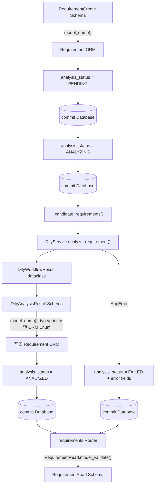

## Interview to Requirement Data Flow

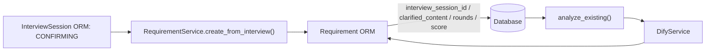

## 状态与提交边界

- 创建需求先独立提交 `PENDING`，之后再进入分析。
- `analyze_existing()` 将 `ANALYZING` 独立提交后才调用外部 Dify。
- Dify 成功：写入分析结果并提交 `ANALYZED`。
- 捕获 `AppError`：写入错误码/信息并提交 `FAILED`，方法返回失败状态 ORM，而不是继续抛出该错误。
- 当前 `except` 只捕获 `AppError`；其他异常不在此状态回写分支内。

# DifyService

## Service 职责

封装需求分析 Workflow 的 HTTP 调用、响应提取和严格 Schema 校验，不直接读写数据库。

## 方法地图

| 方法 | 输入 | 主要操作 | ORM / Model | 外部依赖 | 输出 |
|---|---|---|---|---|---|
| `analyze_requirement` | 项目名、项目上下文、需求内容、候选需求、Dify user | 检查 API Key；构造 blocking Workflow 请求；处理网络/HTTP/业务状态；提取输出；Pydantic 校验；校验 `related_id` 候选范围 | 无 | `httpx.AsyncClient`、Settings、Dify Workflow API | `DifyWorkflowResult` dataclass |
| `_extract_analysis` | Dify `outputs` | 接受十个字段直接位于 outputs，或从 `outputs.result` 的 dict / JSON 字符串中提取 | 无 | `json` | `dict[str, Any]` |

## Data Flow

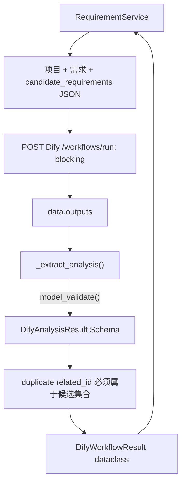

# InterviewAttachmentService

## Service 职责

负责访谈图片的本地落盘、元数据入库、受控读取和绑定消息，并验证文件大小、扩展名、声明 MIME 与文件魔数。

## 方法地图

| 方法 | 输入 | 主要操作 | ORM / Model | 外部依赖 | 输出 |
|---|---|---|---|---|---|
| `upload` | FastAPI `UploadFile`、`uploaded_by` | 清理文件名；分块读取；限制大小/非空；检测真实图片类型；写本地文件；保存摘要与元数据 | `InterviewAttachment ORM` | Local Filesystem、Settings、SQLAlchemy Session | `InterviewAttachment ORM` |
| `get` | `attachment_id` | 主键查询 | `InterviewAttachment ORM` | SQLAlchemy Session | `InterviewAttachment ORM` |
| `content_path` | `InterviewAttachment ORM` | 解析路径；确认仍位于配置目录内且文件存在 | `InterviewAttachment ORM` | Local Filesystem | `Path` |
| `bind_to_message` | 附件 ID、`InterviewSession ORM`、`InterviewMessage ORM`、上传人 | 限制数量；批量查询；校验存在、未跨会话/消息/上传人占用；赋 `session` / `message`；flush | 三个访谈 ORM | SQLAlchemy Session | `list[InterviewAttachment ORM]` |
| `_detect_image_mime` | 文件前部字节 | 按文件签名识别允许的图片类型 | 无 | 无 | `str \| None` |

## Data Flow

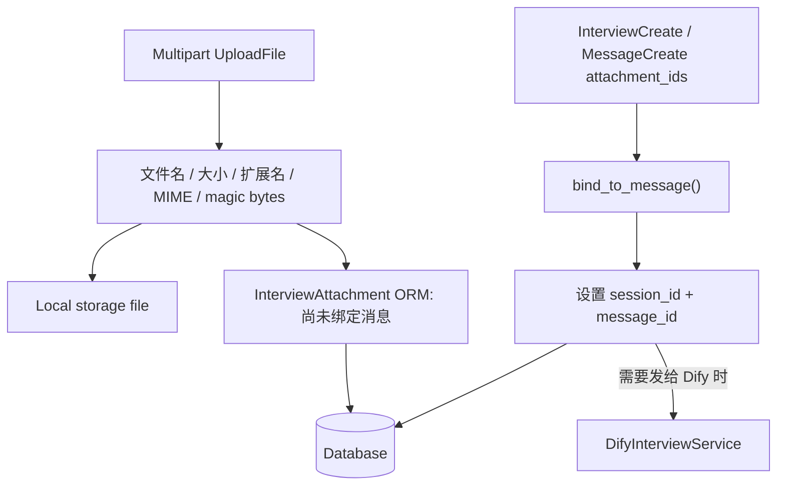

文件写入后若数据库提交失败，Service 会尝试删除刚写入的文件。`content_path()` 还会通过路径边界检查阻止读取配置目录以外的文件。

# DifyInterviewService

## Service 职责

封装访谈 Workflow 和 Dify 文件上传。它把消息历史、当前结构化字段、跳过字段和本轮图片转换为 Dify 输入，并把响应校验为访谈结果 Schema。

## 方法地图

| 方法 | 输入 | 主要操作 | ORM / Model | 外部依赖 | 输出 |
|---|---|---|---|---|---|
| `run_turn` | 项目信息、消息列表、当前字段、跳过字段、轮数、图片附件、Dify user | 准备图片；把复杂输入 JSON 序列化；调用 blocking Workflow；提取并校验响应 | 只读取 `InterviewAttachment ORM` | Dify Workflow API、Settings、`httpx` | `DifyInterviewWorkflowResult` dataclass |
| `_prepare_images` | 图片附件列表、Dify user | 若附件已有且属于同一 Dify user 则复用 file ID，否则上传；生成 Workflow image inputs 和映射 | `InterviewAttachment ORM` | Dify File API | `(image inputs, uploaded_file_ids)` |
| `_upload_image` | 本地路径、文件名、MIME、Dify user | multipart 上传 `/files/upload`，提取返回文件 ID | 无 | Dify File API、Local Filesystem | `str` |
| `_extract_interview` | Dify outputs | 接受顶层结构或 `result` 包装；对可能为 JSON 字符串的嵌套字段逐项解码 | 无 | `json` | `dict[str, Any]` |
| `_decode_json` | 任意值 | 字符串尝试 JSON 解码，非字符串原样返回 | 无 | `json` | `Any` |

## Data Flow

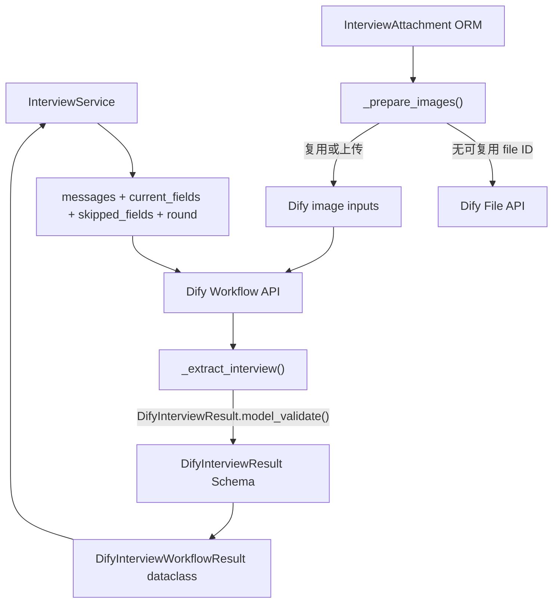

# InterviewService

## Service 职责

访谈业务的编排中心：管理会话与消息幂等、附件绑定、Dify 单轮调用、字段证据合并、问题校验与回退、完整度/停止规则、摘要编辑、确认转需求及会话输出组装。

依赖：`DifyInterviewService`、`InterviewAttachmentService`、`RequirementService`；后者继续依赖 `DifyService`。

## 公共方法地图

| 方法 | 输入 | 主要操作 | ORM / Model | 外部依赖 | 输出 |
|---|---|---|---|---|---|
| `create` | `InterviewCreate Schema` | 按来源渠道+客户端消息 ID 幂等查询；校验项目 `ACTIVE`；建会话和 INITIAL 用户消息；绑定附件；提交；运行 Agent | `Project`、`InterviewSession`、`InterviewMessage`、`InterviewAttachment` ORM | Attachment Service、Dify Interview Service | `InterviewSession ORM` |
| `get` | `session_id` | 主键查询，不存在报错 | `InterviewSession ORM` | Session | `InterviewSession ORM` |
| `answer` | `session_id`、`InterviewMessageCreate Schema` | 校验可继续；按客户端消息 ID 幂等；进入 `INTERVIEWING`；轮数+1；追加 ANSWER；绑定附件；提交；运行 Agent | 会话、消息、附件 ORM | Attachment Service、Dify Interview Service | `InterviewSession ORM` |
| `skip_or_unknown` | `session_id`、`InterviewActionRequest Schema`、`SKIP` 或 `UNKNOWN` | 校验当前问题；幂等；记录跳过字段和用户动作；连续跳过+1；达到 2 次直接确认，否则运行 Agent | 会话、消息 ORM | Dify Interview Service（未提前停止时） | `InterviewSession ORM` |
| `summarize` | `session_id` | 直接进入 `CONFIRMING`，停止原因 `USER_DIRECT_SUMMARY` | `InterviewSession ORM` | Session | `InterviewSession ORM` |
| `update_summary` | `session_id`、`InterviewSummaryUpdate Schema` | 写入/清空人工字段（标记 `USER_EDIT`）；可改标题；重算完整度和澄清内容；提交 | `InterviewSession ORM` | Session | `InterviewSession ORM` |
| `confirm` | `session_id`、`InterviewConfirmRequest Schema` | 已有关联需求则直接返回；否则要求 `CONFIRMING`；写幂等键和澄清内容；调用访谈转需求并分析；再关联需求并设 `SUBMITTED` | `InterviewSession`、`Requirement` ORM | `RequirementService` → `DifyService` | `(InterviewSession ORM, Requirement ORM)` |
| `abandon` | `session_id` | 已提交则拒绝，否则设置 `ABANDONED` | `InterviewSession ORM` | Session | `InterviewSession ORM` |
| `drafts` | `created_by`、`limit` | 查 `DRAFT / INTERVIEWING / CONFIRMING / FAILED`，可按创建人过滤，更新时间倒序 | `InterviewSession ORM` | Session | `list[InterviewSession ORM]` |
| `to_read` | `InterviewSession ORM` | JSON 文本解析为字段/跳过项；重建当前问题；显式组装响应 | 会话、消息、附件 ORM | Pydantic | `InterviewSessionRead Schema` |

## 私有辅助方法地图

| 方法 | 一句话作用 |
|---|---|
| `_run_agent` | 组织 Dify 输入、处理成功/业务错误、合并字段、决定继续提问或进入确认并提交结果。 |
| `_merge_fields` | 仅接受有有效用户消息证据的 AI 字段，保留已有人工编辑，并在无效核心字段过多时拒绝结果。 |
| `_validated_question` | 拒绝已跳过、无须重复询问或包含多个问号的 Dify 问题。 |
| `_fallback_question` | 按源码固定顺序为缺失字段生成本地兜底问题；Bug 类型才考虑 Bug 专属字段。 |
| `_stop_reason` | 根据 Agent 连续失败、连续跳过、最大轮数、完整度和类型必需字段决定停止原因。 |
| `_type_requirements_met` | 判断当前类型的最低字段要求；Bug 需要 `actual_result` 且三个 Bug 字段中至少两个有值。 |
| `_completeness` | 按五个核心字段权重 `15/20/20/25/20` 计算 0–100 完整度。 |
| `_enter_confirming` | 设置 `CONFIRMING`、停止原因，并刷新澄清内容。 |
| `_ensure_can_continue` | 仅阻止 `SUBMITTED` 和 `ABANDONED` 会话继续操作。 |
| `_append_message` | 以当前消息数+1 生成序号并创建会话消息 ORM。 |
| `_empty_fields` | 生成 11 个访谈字段全部为 `None` 的字典。 |
| `_load_fields` | 从 `structured_data` JSON 读取并补齐 11 个字段；解析失败回退为空字段。 |
| `_dump_fields` | 将字段字典序列化为中文可读 JSON 文本。 |
| `_load_skipped` | 从 `skipped_fields` JSON 读取并过滤为合法字段名。 |
| `_messages_for_dify` | 把 ORM 消息整理为 Dify 所需字典列表。 |
| `_render_clarified` | 按中文字段标签把非空结构化字段渲染为 Markdown 文本。 |
| `_current_question` | 从最后一条 Agent 消息重建 `DifyInterviewQuestion Schema`；无有效元数据则返回 `None`。 |

## Create / Answer / Agent Data Flow

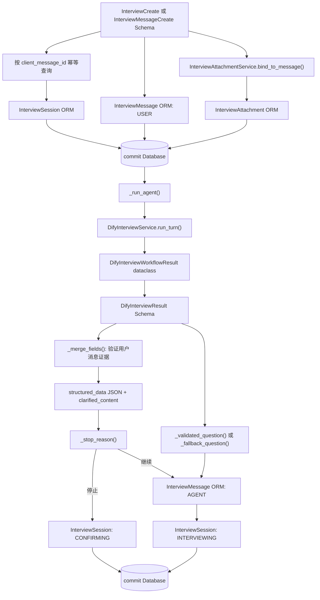

## Schema / JSON / ORM 转换点

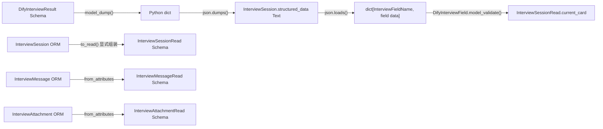

## Confirm Data Flow

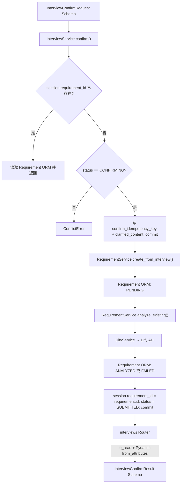

### 访谈停止规则（按当前源码）

| 条件 | 结果 / stop reason |
|---|---|
| 连续 Agent 失败 `>= 2` | `AGENT_FAILURE_LIMIT` |
| 连续跳过 `>= 2` | `CONSECUTIVE_SKIP_LIMIT` |
| Bug 达到 5 轮，其他类型达到 4 轮 | `MAX_ROUNDS` |
| 完整度 `>= 80` 且类型最低字段要求满足 | `COMPLETENESS_REACHED` |
| 用户点击直接总结 | `USER_DIRECT_SUMMARY` |

## Agent 字段证据规则

- AI 输出字段必须标记 `source=USER_INPUT`，且 `evidence_message_ids` 至少包含当前会话中真实存在的用户消息 ID，才会被合并。
- 已由用户在摘要中编辑、标记为 `USER_EDIT` 的字段不会被后续 AI 覆盖。
- Dify Schema 本身允许 `USER_EDIT`，但 Service 不把新的 AI `USER_EDIT` 当作可信用户编辑；只有 Service 的摘要编辑流程会创建该来源。
- 若一轮结果中无效的核心字段达到 2 个，Service 抛出 Dify 响应错误，由 `_run_agent()` 记录 Agent 失败。

# Router Boundary Map

| Router 模块 | Service | Schema → ORM / ORM → Schema 的位置 |
|---|---|---|
| `projects.py` | `ProjectService` | Service 内完成双向转换，Router 只包装响应 |
| `organization.py` | `DepartmentService`、`InvitationService` | Service 内返回 Read Schema |
| `requirements.py` | `RequirementService` | Service 返回 Requirement ORM；Router 使用 `RequirementRead.model_validate()` |
| `interviews.py` | `InterviewService`、`InterviewAttachmentService` | 会话由 `InterviewService.to_read()`；附件依赖 response model 的 `from_attributes`；确认结果同时接收会话 Read Schema 和 Requirement ORM |

# Cross-Service Review Notes

## 已定义但当前未使用或仅预留

- `InterviewActionName` TypeAlias 未发现引用。
- `BatchAnalyzeRequest` / `BatchAnalyzeAccepted` 只用于预留 Router；没有批量分析 Service 数据流。
- `InterviewMessageRole.SYSTEM_EVENT`、`InterviewActionType.DIRECT_SUMMARY` 未发现消息创建使用；直接总结只改变会话状态和 `stop_reason`。
- `SourceChannel` 除 `MANAGEMENT_WEB` 外、`ProjectResolveMode` 除 `USER_SELECTED` 外，当前访谈创建 Service 未使用。
- `InterviewStatus.FAILED` 被草稿列表接受，但当前 Service 未设置该状态。

## 字段已定义但 Service 暂未赋值或未完成生命周期

- `DepartmentRead.user_count` 未统计，保持 `0`。
- `InvitationCode.used_time` 未赋值；`InvitationStatus.USED` 仅在禁用保护判断中读取，未发现状态写入流程。
- `Requirement.manual_modify` 未发现被设置为 `True`。
- `InterviewSession.entry_key` 当前管理端创建流程未赋值。
- `InterviewSession.confirm_idempotency_key` 会写入，但不用于查重或比对；重复确认主要依赖 `session.requirement_id`。

## 容易混淆的命名 / 层边界

- `Department`、`Project`、`Requirement` 等是 SQLAlchemy ORM；带 `Create / Update / Read` 后缀的是 Pydantic Schema。
- `DifyAnalysisResult`、`DifyInterviewResult` 是 Pydantic Schema；`DifyWorkflowResult`、`DifyInterviewWorkflowResult` 则是 Service 文件中的 dataclass。
- `ProjectService` / 组织类 Service 直接返回 Read Schema，但 `RequirementService` 和 `InterviewService` 的多数公共方法返回 ORM，由 Router 或 `to_read()` 再转换；Review 调用方时需先确认返回边界。
- `InterviewSession.structured_data` 与 `skipped_fields` 是数据库 Text，而 Service 层使用 dict/list，API 层又表现为嵌套 Schema / list，三层类型不同。

## 明显数据流边界或无法由当前代码确认的关系

- `Project.department_id`、访谈与需求的双向逻辑 ID、`Requirement.related_id` 以及各 `created_by/uploaded_by` 都没有数据库 FK；其完整性取决于 Service 或外部身份系统。
- `InterviewService.confirm()` 跨多个 commit：先保存会话确认信息，再由 `RequirementService` 创建并分析需求，最后回写 `session.requirement_id` 和 `SUBMITTED`。当前不是单一数据库事务；若中途发生非业务异常，可能出现需求已创建但会话尚未完成反向关联的中间状态。本文只标记该 Review 边界，不修改实现。
- 需求分析失败会返回 `Requirement ORM` 且状态为 `FAILED`；调用方不能只依据 HTTP 成功判断 AI 分析成功，应读取 `analysis_status`。
- `init_db()` 的轻量迁移只覆盖 Requirement 的四个访谈来源字段；无法从当前代码确认既有部署数据库是否与全部 ORM 字段一致，需要对实际数据库另行核验。

## 后续待处理：Requirement Creation / AI Analysis Async Architecture

> 记录日期：2026-10-07
> 类型：产品需求 / 架构决策
> 状态：已记录，待后续设计与处理；当前不修改任何代码，不开始重构或实现。

### 目标行为与约束

1. Requirement 创建与 AI 分析必须解耦，采用“先创建并保存 Requirement，再异步执行 AI 分析”。
2. 创建接口只负责先保存 Requirement，设置 `analysis_status = PENDING`，保存成功后立即向 Client 返回需求创建成功及 `PENDING` 状态。
3. AI 分析通过后台异步任务独立执行，创建请求返回后继续处理。
4. 后台任务开始分析时，更新并保存 `analysis_status = ANALYZING`，再调用 Dify Workflow。
5. AI 分析成功后，保存分析结果及分析字段，并更新 `analysis_status = ANALYZED`。
6. AI 分析失败后，保存错误信息，并更新 `analysis_status = FAILED`。
7. Client 的创建 HTTP Request 不应阻塞等待 Dify Workflow 完成；创建成功与分析成功分别由创建响应和分析状态表达。
8. 具体采用 Background Task、Task Queue、Worker 或其他机制，后续设计时再决定，本记录不选定实现方案。
9. 本次仅记录后续待处理项，不修改任何代码，不开始重构或实现。

目标执行顺序：

```text
用户提交 Requirement
  → 后端保存 Requirement（PENDING）
  → 立即返回 Client：需求创建成功，AI 分析处理中

后台异步任务独立继续执行
  → 保存 ANALYZING
  → 调用 Dify Workflow
  → 成功：保存分析结果及字段，保存 ANALYZED
  → 失败：保存错误信息，保存 FAILED
```

### 期望的 API 行为

- 保存成功后可返回 `HTTP 201 Created`，或根据最终 API 设计确定其他合适状态码。
- 创建响应中 `analysis_status = PENDING`。
- 响应 message 应表达“需求创建成功，AI 分析处理中”，不应等待分析结束后才返回“需求创建及 AI 分析完成”。

### 当前实现与目标的差异

- `RequirementService.create_and_analyze()` 保存 Requirement 后执行 `return await self.analyze_existing(requirement, user=created_by)`，创建请求仍等待分析结束。
- `analyze_existing()` 中继续 `await self.dify.analyze_requirement(...)`，直到 Dify 分析完成或失败后才返回。
- 当前需求分析的 Dify 请求使用 `"response_mode": "blocking"`，后端等待 Workflow 返回结果。
- 因此当前实现满足“先保存 Requirement，再调用 AI”，尚未满足“先保存 Requirement，立即返回 Client，后台异步执行 AI”。以上为当前实现记录，目标行为尚未实施。
