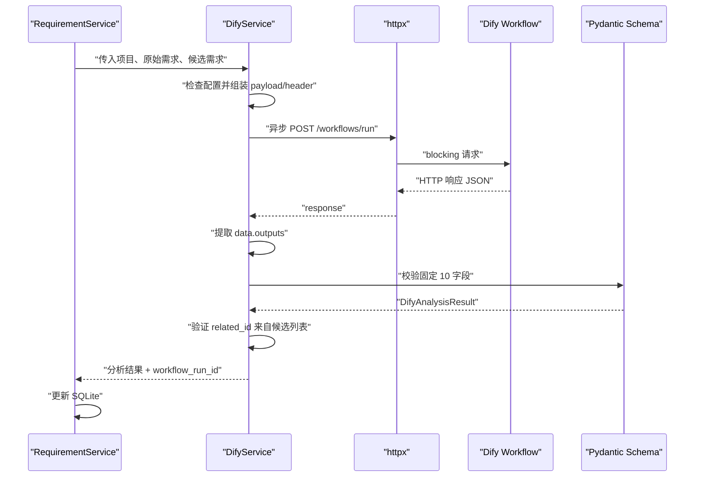

# Dify Workflow 调用封装：从零读懂 `dify_service.py`

这份文档面向刚接触 FastAPI、异步 HTTP 和 Pydantic 的开发者。目标不是让你死记代码，而是让你理解：后端为什么需要单独封装 Dify、一次调用经历了什么、每一层校验在防什么问题，以及出现错误时该从哪里排查。

对应的实际运行文件：`app/services/dify_service.py`。

> 教学文档中的代码与当前项目代码保持一致，但为了便于阅读，被拆成了多个小段并增加了详细注释。真正运行的仍然是 `app/services/dify_service.py`。
>
> 本文中的相对路径和命令均以 `backend/v2.0` 为后端目录；执行命令前请先进入该目录。

## 一、先建立整体认识

Dify Workflow 对后端来说是一个外部 HTTP 服务。我们的后端需要完成五件事：

1. 从配置中取得 Dify 地址、密钥和超时时间；
2. 把项目资料、原始需求和历史候选需求组装成 Dify 认识的 JSON；
3. 发送 HTTP 请求，并区分超时、HTTP 报错和网络连接失败；
4. 从 Dify 的外层响应中取出真正的分析结果；
5. 使用 Pydantic 检查字段、类型、枚举和关联需求 ID，只有合法结果才能交给业务层写入数据库。

完整调用链如下：



这里最重要的边界是：

- `DifyService` 只负责“与 Dify 通信，并交付可信的分析结果”；
- `RequirementService` 负责“需求业务状态和数据库写入”；
- Dify 不直接访问 SQLite，也不能决定 `project_id`、需求 ID 或创建时间等可信业务字段。

## 二、需要先认识的三个数据形态

一次调用中，同一份结果会经历三个形态。

### 1. Python 入参

业务层调用时传入普通 Python 数据：

```python
await dify_service.analyze_requirement(
    project_name="极简 AI 团队需求管理智能体",
    project_context="面向小型研发团队的需求管理工具……",
    raw_content="希望支持批量导入客户需求",
    candidates=[
        {
            "id": "0123456789abcdef0123456789abcdef",
            "standard_content": "支持单条录入客户需求",
        }
    ],
    user="anonymous",
)
```

### 2. 发给 Dify 的 HTTP JSON

代码最终会组装为：

```json
{
  "inputs": {
    "project_name": "极简 AI 团队需求管理智能体",
    "project_context": "面向小型研发团队的需求管理工具……",
    "raw_content": "希望支持批量导入客户需求",
    "candidate_requirements": "[{\"id\": \"0123456789abcdef0123456789abcdef\", \"standard_content\": \"支持单条录入客户需求\"}]"
  },
  "response_mode": "blocking",
  "user": "anonymous"
}
```

请注意：`candidate_requirements` 在 Dify 开始节点中被定义为字符串，因此这里不是直接传 JSON 数组，而是把数组序列化成了“JSON 数组字符串”。

### 3. 后端最终接受的强类型对象

Dify 的输出通过校验后，会变成 `DifyAnalysisResult`：

```python
DifyAnalysisResult(
    standard_content="支持批量导入客户需求，并识别重复数据。",
    business_goal="减少人工录入和核对成本。",
    type="NEW_FEATURE",
    priority="P2",
    is_fake=False,
    fake_reason="存在明确用户、场景和业务价值。",
    is_duplicate=False,
    related_id="",
    reference_rule="TYPE-NEW；PRI-P2；FAKE-NOT",
    analysis_summary="该需求能够降低录入成本，建议按 P2 评估。",
)
```

从这一刻起，业务层可以认为字段名称、类型和主要业务关系已经可信。

## 三、逐段读懂 `dify_service.py`

### 第 1 段：导入依赖

```python
import json
from dataclasses import dataclass
from typing import Any

import httpx
from pydantic import ValidationError

from app.core.config import Settings, get_settings
from app.core.exceptions import DifyError, DifyOutputError, DifyTimeoutError
from app.schemas.dify import DifyAnalysisResult
```

每个导入的作用：

- `json`：在 Python 对象和 JSON 字符串之间转换；
- `dataclass`：快速声明一个主要用于装数据的类；
- `Any`：表示此处暂时还不知道外部数据的具体类型，需要运行时检查；
- `httpx`：发送异步 HTTP 请求；
- `ValidationError`：捕获 Pydantic 校验失败；
- `Settings/get_settings`：读取 `.env` 中的 Dify 配置；
- 三个 Dify 异常类：把底层错误翻译为本项目统一的业务错误；
- `DifyAnalysisResult`：Dify 固定 10 字段对应的 Pydantic 模型。

为什么不在路由函数里直接写 `httpx.post()`？因为路由层应该只负责接收和返回 HTTP 数据。把 Dify 细节放在独立 Service 中，后续更换地址、增加重试或编写测试时，不需要修改路由。

### 第 2 段：取得固定输出字段集合

```python
ANALYSIS_FIELDS = frozenset(DifyAnalysisResult.model_fields)
```

`DifyAnalysisResult.model_fields` 是 Pydantic 提供的字段字典，其键就是：

```text
standard_content
business_goal
type
priority
is_fake
fake_reason
is_duplicate
related_id
reference_rule
analysis_summary
```

`frozenset` 是不可修改集合。这里使用它有两个意图：

1. 不重复手写 10 个字段名，Schema 变化时该集合会自动同步；
2. 后面可以使用集合的 `issubset()`，快速检查 Dify 输出是否包含所有必需字段。

普通 `set` 也能完成检查，但可能被其他代码意外修改；`frozenset` 表达了“这是固定规则”的意图。

### 第 3 段：定义 Service 的返回值

```python
@dataclass(slots=True)
class DifyWorkflowResult:
    analysis: DifyAnalysisResult
    workflow_run_id: str | None = None
```

调用 Dify 后，我们需要返回两类数据：

- `analysis`：经过严格校验、可以写库的 AI 分析结果；
- `workflow_run_id`：Dify 本次运行 ID，发生问题时可用于日志排查。

为什么不直接返回一个字典？

- 类的字段是明确的，编辑器能自动提示；
- 写错 `workflow_run_id` 时更容易被发现；
- 后续可以继续增加 `elapsed_time` 等调用元数据；
- `analysis` 明确要求是 `DifyAnalysisResult`，而不是任意字典。

`slots=True` 表示实例只允许拥有声明过的属性，可减少内存占用，也能避免误写一个不存在的新属性。

### 第 4 段：初始化 Service

```python
class DifyService:
    def __init__(self, settings: Settings | None = None) -> None:
        self.settings = settings or get_settings()
```

正常运行时通常这样创建：

```python
dify = DifyService()
```

由于没有显式传入配置，代码会调用 `get_settings()`，从环境变量和 `.env` 读取配置。

测试时可以这样创建：

```python
test_settings = Settings(
    dify_base_url="http://fake-dify/v1",
    dify_api_key="test-key",
    dify_timeout_seconds=1,
)
dify = DifyService(settings=test_settings)
```

这种“默认使用真实配置，但允许从外部传入替代配置”的写法叫依赖注入。它让代码更容易测试，也避免 Service 内部写死地址或密钥。

### 第 5 段：方法签名

```python
async def analyze_requirement(
    self,
    *,
    project_name: str,
    project_context: str,
    raw_content: str,
    candidates: list[dict[str, str]],
    user: str,
) -> DifyWorkflowResult:
```

逐项理解：

- `async def`：这是异步函数，因为它要等待外部网络响应；
- 调用异步函数时必须使用 `await`；
- 单独出现的 `*`：后面的参数只能按名称传递，不能靠位置猜测；
- `candidates`：当前项目内用于查重的历史候选需求；
- `-> DifyWorkflowResult`：成功时返回前面定义的结果对象。

由于项目上下文和原始需求都是字符串，如果允许位置调用，很容易把二者顺序写反：

```python
# 不够安全：阅读时不知道每个字符串是什么
await dify.analyze_requirement(name, context, content, candidates, user)

# 当前代码强制这样调用，意图清楚
await dify.analyze_requirement(
    project_name=name,
    project_context=context,
    raw_content=content,
    candidates=candidates,
    user=user,
)
```

### 第 6 段：先检查密钥

```python
if not self.settings.dify_api_key:
    raise DifyError("Dify API Key 未配置", code="DIFY_NOT_CONFIGURED")
```

如果密钥为空，继续请求只会得到鉴权失败。这里提前终止，可以给出更准确的错误码。

`raise` 表示抛出异常并停止当前函数。这个异常最终会被需求业务层捕获，把需求标记为 `FAILED`，原始需求仍会保留。

密钥只应放在 `.env`：

```dotenv
DIFY_API_KEY=app-xxxxxxxx
```

不要把真实密钥直接写在 Python 文件或提交到版本库。

### 第 7 段：组装请求正文

```python
payload = {
    "inputs": {
        "project_name": project_name,
        "project_context": project_context,
        "raw_content": raw_content,
        "candidate_requirements": json.dumps(candidates, ensure_ascii=False),
    },
    "response_mode": "blocking",
    "user": user,
}
```

`payload` 是即将转换为 HTTP JSON 的 Python 字典。

#### `inputs`

`inputs` 中的名称必须和 Dify Workflow 开始节点变量名完全一致。名字写错时，Dify 无法把数据传进工作流。

#### `json.dumps(candidates, ensure_ascii=False)`

`candidates` 原本是 Python 列表：

```python
[{"id": "abc", "standard_content": "支持中文内容"}]
```

`json.dumps()` 将它变为 JSON 字符串。`ensure_ascii=False` 让中文保持为中文，而不是变成 `\u652f\u6301` 这样的 Unicode 转义，便于 Dify 日志阅读。

#### `response_mode="blocking"`

blocking 表示：后端发出请求后，保持连接并等待工作流执行结束，然后一次性拿到完整结果。

它适合当前同步创建需求的 MVP 流程。以后做长时间批量分析时，更适合用后台任务或 Dify streaming，而不是让一个前端请求长时间等待。

#### `user`

这是 Dify API 要求的调用方标识，不是鉴权密钥。当前没有用户时使用 `anonymous`，以后可以换成系统用户 ID，便于追踪不同调用来源。

### 第 8 段：组装请求头

```python
headers = {
    "Authorization": f"Bearer {self.settings.dify_api_key}",
    "Content-Type": "application/json",
}
```

HTTP Header 是请求的元信息：

- `Authorization: Bearer ...`：Dify 使用的 API 密钥认证方式；
- `Content-Type: application/json`：告诉 Dify 请求正文是 JSON。

`f"Bearer {变量}"` 是 Python f-string，会把配置中的密钥插入字符串。

### 第 9 段：设置超时并发送异步请求

```python
try:
    timeout = httpx.Timeout(self.settings.dify_timeout_seconds)
    async with httpx.AsyncClient(timeout=timeout) as client:
        response = await client.post(
            self.settings.dify_workflow_url,
            headers=headers,
            json=payload,
        )
        response.raise_for_status()
```

#### `try`

`try` 包住可能失败的代码。网络调用的失败原因很多，我们需要在后面的 `except` 中分类处理。

#### `httpx.Timeout(...)`

如果 `.env` 配置为：

```dotenv
DIFY_TIMEOUT_SECONDS=8
```

那么请求超过约 8 秒仍未完成时，httpx 会抛出超时异常，避免后端一直卡住。

#### `async with httpx.AsyncClient(...)`

`AsyncClient` 是异步 HTTP 客户端。`async with` 会在代码块结束后自动关闭客户端连接，避免资源泄漏。

#### `await client.post(...)`

发送 POST 请求。`await` 的含义是：当前协程等待网络结果时，可以让事件循环处理其他请求，而不是占住整个 FastAPI 服务。

`json=payload` 会让 httpx 自动执行两件事：

1. 把 Python 字典序列化为 JSON；
2. 设置正确的 JSON 请求格式。

#### `response.raise_for_status()`

如果状态码是 2xx，它不会做任何事；如果是 401、404、500 等错误状态码，它会抛出 `HTTPStatusError`，进入对应的异常分支。

### 第 10 段：把底层异常翻译为业务异常

```python
except httpx.TimeoutException as exc:
    raise DifyTimeoutError() from exc
```

表示请求超时。对外转换为统一的：

```text
code = DIFY_TIMEOUT
message = AI 分析超时，请稍后重试
```

```python
except httpx.HTTPStatusError as exc:
    status = exc.response.status_code
    raise DifyError(
        f"Dify Workflow 调用失败（HTTP {status}）",
        code="DIFY_HTTP_ERROR",
        details={"http_status": status},
    ) from exc
```

表示已经连接到 Dify，但 Dify 返回了 HTTP 错误。例如：

- 401：密钥错误或失效；
- 404：API 地址或路径错误；
- 500：Dify 服务内部异常。

```python
except httpx.RequestError as exc:
    raise DifyError(
        "无法连接 Dify Workflow 服务",
        code="DIFY_CONNECTION_ERROR",
    ) from exc
```

表示连一个有效的 HTTP 响应都没收到，常见原因有：

- Dify Docker 容器没有启动；
- 主机名或端口错误；
- 网络拒绝连接；
- DNS 解析失败。

#### `raise ... from exc` 有什么作用？

它建立异常链：上层看到的是本项目定义的业务异常，日志中仍能追溯最初的 httpx 异常。这样既方便前端理解，又不会丢失排障线索。

### 第 11 段：把响应正文解析为 JSON

```python
try:
    body = response.json()
except ValueError as exc:
    raise DifyOutputError("response is not JSON") from exc
```

HTTP 200 不等于业务数据一定正确。代理服务器或错误页面有时会返回 HTML 文本，`response.json()` 无法解析时会抛出 `ValueError`。

这里将其转换为 `DIFY_OUTPUT_INVALID`，防止后续代码把错误页面当成 AI 结果写入数据库。

### 第 12 段：检查 Dify 外层响应

```python
data = body.get("data")
if not isinstance(data, dict):
    raise DifyOutputError("missing data object")
```

Dify blocking Workflow 的成功响应通常类似：

```json
{
  "workflow_run_id": "run-id",
  "task_id": "task-id",
  "data": {
    "id": "run-id",
    "status": "succeeded",
    "outputs": {
      "standard_content": "……"
    }
  }
}
```

所以第一步必须确认 `data` 存在，而且确实是一个对象。使用 `.get()` 而不是 `body["data"]`，是为了在字段缺失时由我们主动返回清楚的格式错误，而不是抛出不易理解的 `KeyError`。

```python
if data.get("status") == "failed" or data.get("error"):
    raise DifyError(
        "Dify Workflow 执行失败",
        code="DIFY_WORKFLOW_FAILED",
        details={"error": str(data.get("error", "unknown"))[:500]},
    )
```

这一层处理“HTTP 请求成功，但 Workflow 自己执行失败”的情况。例如 LLM 节点报错、知识检索失败或代码节点主动停止。

错误详情最多保留 500 个字符，是为了避免异常信息过长，或者把大量外部内容塞进接口响应和日志。

### 第 13 段：提取真正的 AI 输出

```python
outputs = data.get("outputs")
raw_result = self._extract_analysis(outputs)
```

`body` 是整个 Dify API 响应，`data` 是运行数据，`outputs` 才是结束节点配置的输出变量。

此时的 `raw_result` 仍然只是来自外部系统的普通字典，不能直接写数据库。即使它看起来像正确 JSON，也可能字段缺失、类型错误或包含模型虚构内容。

### 第 14 段：使用 Pydantic 强校验

```python
try:
    analysis = DifyAnalysisResult.model_validate(raw_result)
except ValidationError as exc:
    raise DifyOutputError(exc.errors(include_url=False)) from exc
```

`model_validate()` 会一次性验证：

- 10 个必需字段是否齐全；
- 是否出现未知字段；
- 文本是否为空、是否超过长度；
- `type` 是否属于三个固定值；
- `priority` 是否属于 P0 至 P3；
- Boolean 是否真的是 Boolean；
- 重复状态和 `related_id` 是否自洽。

校验成功后得到强类型的 `DifyAnalysisResult`；失败则抛出 `ValidationError`，代码再将它转换为项目统一的 `DifyOutputError`。

这就是所谓的“不要信任外部输入”：即使外部服务也是我们自己的 Dify，也要在进入数据库前建立校验边界。

### 第 15 段：防止模型虚构关联需求 ID

```python
candidate_ids = {item["id"] for item in candidates}
if analysis.is_duplicate and analysis.related_id not in candidate_ids:
    raise DifyOutputError("related_id 不在当前项目候选需求中")
```

Pydantic 只能确认 `related_id` 是长度不超过 32 的字符串，却不知道这个 ID 是否真的存在。

这里先使用集合推导式提取候选 ID：

```python
{"id-1", "id-2", "id-3"}
```

如果 Dify 判断为重复需求，那么它返回的 `related_id` 必须属于本次后端传给它的候选列表。否则可能出现：

- 模型自己编造了一个 ID；
- Dify 误用了其他项目的需求 ID；
- Workflow 输出和输入候选不一致。

这是一条很关键的 AI 幻觉防线，也保证了项目数据隔离。

为什么这里用集合而不是列表？集合判断 `某值是否存在` 通常是 O(1)，列表则需要逐项扫描。候选数很少时差异不大，但集合更准确地表达了“只关心 ID 是否存在”。

### 第 16 段：返回可信结果

```python
return DifyWorkflowResult(
    analysis=analysis,
    workflow_run_id=str(
        body.get("workflow_run_id") or data.get("id") or ""
    ) or None,
)
```

至此所有检查都通过，可以把分析结果交还给 `RequirementService`。

运行 ID 优先从响应顶层 `workflow_run_id` 读取；如果没有，则尝试使用 `data.id`。最后的 `or None` 会把空字符串转成 `None`，让“没有运行 ID”表达得更明确。

`DifyService` 本身不写数据库。后续业务层会：

1. 把 `analysis` 的 10 个字段更新到需求记录；
2. 将状态改为 `ANALYZED`；
3. 保存 `workflow_run_id`；
4. 提交 SQLite 事务。

## 四、读懂 `_extract_analysis()`

这个私有方法的职责是：兼容两种常见的 Dify `outputs` 配置，并提取待校验的分析字典。

### 1. 为什么是静态方法？

```python
@staticmethod
def _extract_analysis(outputs: Any) -> dict[str, Any]:
```

该方法不使用 `self.settings` 等实例状态，只根据传入的 `outputs` 做纯数据转换，所以声明为 `staticmethod`。

方法名前的 `_` 表示它是 Service 内部实现细节，通常不建议其他模块直接调用。

`outputs` 使用 `Any`，是因为它来自外部响应，在检查之前可能是字典、字符串、列表甚至 `None`。返回类型则明确要求是字典。

### 2. 先确认 outputs 是对象

```python
if not isinstance(outputs, dict):
    raise DifyOutputError("missing outputs object")
```

只有字典才有字段名。如果 Dify 返回 `null`、数组或字符串，就直接判定为格式错误。

### 3. 首选设计文档规定的顶层 10 字段

```python
if ANALYSIS_FIELDS.issubset(outputs):
    return {field: outputs[field] for field in ANALYSIS_FIELDS}
```

`A.issubset(B)` 表示集合 A 是否为集合 B 的子集。这里问的是：固定 10 字段是否都存在于 `outputs`？

如果存在，就只取这 10 个字段。Dify 响应中即使还有运行耗时等其他元数据，也不会被错误送入分析 Schema。

标准输出示例：

```json
{
  "data": {
    "outputs": {
      "standard_content": "……",
      "business_goal": "……",
      "type": "NEW_FEATURE",
      "priority": "P2",
      "is_fake": false,
      "fake_reason": "……",
      "is_duplicate": false,
      "related_id": "",
      "reference_rule": "……",
      "analysis_summary": "……"
    }
  }
}
```

### 4. 兼容结果被放进 `result` 的情况

```python
nested = outputs.get("result")
if isinstance(nested, str):
    try:
        nested = json.loads(nested)
    except json.JSONDecodeError as exc:
        raise DifyOutputError("outputs.result is not valid JSON") from exc
if isinstance(nested, dict):
    return nested
raise DifyOutputError("outputs 缺少固定的 10 个分析字段")
```

有时 Dify 结束节点只配置一个 `result` 字段，它可能是：

```json
{
  "outputs": {
    "result": {
      "standard_content": "……"
    }
  }
}
```

也可能是 JSON 字符串：

```json
{
  "outputs": {
    "result": "{\"standard_content\": \"……\"}"
  }
}
```

如果是字符串，`json.loads()` 会尝试将其还原为 Python 字典。解析失败、不是字典或两种格式都不存在时，统一抛出输出格式异常。

兼容逻辑是为了提高联调容错能力，但推荐的 Dify 配置仍然是：结束节点直接返回 10 个顶层变量，这与设计文档完全一致，也更容易排查。

## 五、Pydantic Schema 为什么重要

真正负责字段约束的是 `app/schemas/dify.py`。

### 1. 禁止额外字段并启用严格类型

```python
model_config = ConfigDict(extra="forbid", strict=True)
```

- `extra="forbid"`：出现第 11 个未知字段时拒绝结果；
- `strict=True`：不进行宽松的自动类型转换。

例如严格模式会拒绝：

```json
{
  "is_fake": "false"
}
```

字符串 `"false"` 在 Python 中不是 Boolean `false`。如果宽松转换，模型输出错误可能被悄悄掩盖；严格模式会让问题在接口联调阶段立即暴露。

### 2. 枚举约束

```python
type: Literal["NEW_FEATURE", "BUG", "OPTIMIZATION"]
priority: Literal["P0", "P1", "P2", "P3"]
```

Dify 如果返回 `FEATURE`、`P4` 或中文“高优先级”，都会校验失败。数据库因此不会出现前端无法识别的未知状态。

### 3. 字符串长度约束

```python
standard_content: str = Field(min_length=1, max_length=4000)
analysis_summary: str = Field(min_length=1, max_length=500)
```

这既阻止空结果，也防止异常超长文本进入数据库和页面。

### 4. 跨字段关系校验

```python
@model_validator(mode="after")
def validate_related_id(self) -> "DifyAnalysisResult":
    if self.is_duplicate and not self.related_id:
        raise ValueError("is_duplicate=true 时 related_id 不能为空")
    if not self.is_duplicate and self.related_id:
        raise ValueError("is_duplicate=false 时 related_id 必须为空字符串")
    return self
```

单字段都正确，不代表字段组合正确。这里约束：

| `is_duplicate` | `related_id` | 是否合法 |
| --- | --- | --- |
| `true` | 当前候选中的有效 ID | 合法 |
| `true` | 空字符串 | 非法 |
| `false` | 空字符串 | 合法 |
| `false` | 任意 ID | 非法 |

`mode="after"` 表示先完成每个字段自身的类型校验，再使用已经构造好的模型对象检查字段之间的关系。

## 六、异常为什么要分这么多类

当前异常层次是：

```text
AppError
└── DifyError                 HTTP 502
    ├── DifyTimeoutError      DIFY_TIMEOUT
    └── DifyOutputError       DIFY_OUTPUT_INVALID
```

主要错误码及排查方向：

| 错误码 | 意义 | 优先检查 |
| --- | --- | --- |
| `DIFY_NOT_CONFIGURED` | 未配置 API Key | `.env` 中的 `DIFY_API_KEY` |
| `DIFY_TIMEOUT` | 请求超过配置时间 | 模型耗时、Dify 日志、超时配置 |
| `DIFY_HTTP_ERROR` | Dify 返回非 2xx | 地址、密钥、HTTP 状态码 |
| `DIFY_CONNECTION_ERROR` | 无法建立 HTTP 连接 | Docker、端口、网络 |
| `DIFY_WORKFLOW_FAILED` | HTTP 成功但工作流失败 | Dify 运行日志和失败节点 |
| `DIFY_OUTPUT_INVALID` | 返回结果不符合 Schema | 结束节点输出、字段类型、枚举、关联 ID |

分类型的价值是：业务层和前端不需要理解 httpx 的底层异常，也能决定该如何展示和重试。

例如当前需求创建流程会捕获这些 `AppError`，然后：

```python
requirement.analysis_status = AnalysisStatus.FAILED
requirement.analysis_error_code = exc.code
requirement.analysis_error_message = exc.message
```

所以即使 AI 失败，用户刚提交的 `raw_content` 仍在 SQLite 中，不会因为外部服务故障而丢失。

## 七、配置代码是如何提供地址的

`app/core/config.py` 中定义了：

```python
dify_base_url: str = "http://127.0.0.1/v1"
dify_api_key: str = ""
dify_workflow_path: str = "/workflows/run"
dify_timeout_seconds: float = Field(default=8.0, gt=0, le=300)
```

对应 `.env`：

```dotenv
DIFY_BASE_URL=http://127.0.0.1/v1
DIFY_API_KEY=app-your-workflow-api-key
DIFY_WORKFLOW_PATH=/workflows/run
DIFY_TIMEOUT_SECONDS=8
```

完整 URL 由属性拼接：

```python
@property
def dify_workflow_url(self) -> str:
    return f"{self.dify_base_url.rstrip('/')}/{self.dify_workflow_path.lstrip('/')}"
```

`rstrip('/')` 删除基础地址末尾的斜杠，`lstrip('/')` 删除路径开头的斜杠，之后手动添加一个 `/`。这样以下两种配置都不会产生双斜杠：

```text
http://127.0.0.1/v1/ + /workflows/run
http://127.0.0.1/v1  + workflows/run
```

最终都会得到：

```text
http://127.0.0.1/v1/workflows/run
```

## 八、如何手动调试一次 Dify 调用

### 第 1 步：确认 Dify 服务和配置

先准备 `.env`，不要修改 `.env.example` 来存真实密钥：

```bash
cp .env.example .env
```

然后填写实际地址和密钥。

### 第 2 步：先用 curl 排除 Python 代码问题

将示例中的地址和密钥替换为实际值：

```bash
curl -X POST 'http://127.0.0.1/v1/workflows/run' \
  -H 'Authorization: Bearer app-xxxxxxxx' \
  -H 'Content-Type: application/json' \
  -d '{
    "inputs": {
      "project_name": "测试项目",
      "project_context": "面向研发团队的需求管理工具，当前处于 MVP 阶段。",
      "raw_content": "希望支持批量导入客户需求",
      "candidate_requirements": "[]"
    },
    "response_mode": "blocking",
    "user": "debug-user"
  }'
```

如果 curl 都无法调用成功，应先检查 Dify，而不是修改 FastAPI 代码。

### 第 3 步：观察返回层级

重点确认：

```text
data
└── outputs
    ├── standard_content
    ├── business_goal
    ├── type
    ├── priority
    ├── is_fake
    ├── fake_reason
    ├── is_duplicate
    ├── related_id
    ├── reference_rule
    └── analysis_summary
```

如果 10 个字段出现在 `outputs.result` 中，当前后端也能兼容；但建议最终把 Dify 结束节点调整为顶层 10 字段。

### 第 4 步：通过 FastAPI 创建需求

```bash
source .venv/bin/activate
uvicorn app.main:app --reload
```

先创建项目，再把项目返回的 32 位 ID 放入需求请求：

```bash
curl -X POST 'http://127.0.0.1:8000/api/v1/requirements' \
  -H 'Content-Type: application/json' \
  -d '{
    "project_id": "这里替换成真实项目ID",
    "raw_content": "希望支持批量导入客户需求"
  }'
```

成功时观察：

```json
{
  "code": "OK",
  "data": {
    "analysis_status": "ANALYZED",
    "dify_workflow_run_id": "……"
  }
}
```

失败但原始需求已保存时观察：

```json
{
  "code": "AI_ANALYSIS_FAILED",
  "data": {
    "analysis_status": "FAILED",
    "analysis_error_code": "DIFY_TIMEOUT",
    "analysis_error_message": "AI 分析超时，请稍后重试"
  }
}
```

## 九、常见误区

### 误区 1：HTTP 200 就直接写数据库

HTTP 200 只说明成功收到了响应，不保证 Workflow 成功，更不保证 AI 字段合法。必须继续检查 `data.status`、`outputs` 和 Pydantic Schema。

### 误区 2：模型返回了 JSON，就认为数据可信

合法 JSON 只代表语法正确。`priority="P9"`、`is_fake="不是"` 也能出现在合法 JSON 中，所以还需要字段和业务规则校验。

### 误区 3：给超时设置一个很大的数字

超时过大只会把故障变成长时间等待。当前单条分析目标小于 10 秒，因此默认 8 秒符合 MVP 设计；如果真实模型稳定耗时更长，应同时优化 Workflow、调整产品交互并评估异步任务，而不是只放大超时。

### 误区 4：把所有异常都写成 `except Exception`

这样会失去错误类别，前端和日志无法判断是密钥错误、连接失败、超时还是输出非法。当前代码按故障阶段分类，排查效率更高。

### 误区 5：相信 Dify 返回的任意 `related_id`

大模型可能生成一个格式正确但不存在的 ID，所以必须确认它来自当前项目的候选列表。

## 十、你可以用这几个小练习检验理解

### 练习 1：预测异常类型

假设 Dify 地址端口写错，连接被拒绝。代码会进入哪个 `except`？

答案：`httpx.RequestError`，最终转换为 `DIFY_CONNECTION_ERROR`。

### 练习 2：识别类型错误

Dify 返回：

```json
{"is_duplicate": "false", "related_id": ""}
```

即使含义看起来正确，为什么仍会失败？

答案：Schema 启用了 `strict=True`，字符串 `"false"` 不是 Boolean `false`。

### 练习 3：理解两层关联 ID 校验

为什么 Pydantic 已经校验了 `related_id`，Service 还要再次校验？

答案：Pydantic 校验“字段格式和字段关系”，Service 校验“这个 ID 是否属于本次当前项目的真实候选数据”。二者解决的问题不同。

### 练习 4：理解失败不丢数据

Dify 超时时，为什么需求仍能在需求列表中看到？

答案：`RequirementService` 在调用 Dify 前已经保存原始需求；发生异常时只把分析状态更新为 `FAILED`，不会删除需求。

## 十一、掌握这份代码后，下一步可以学什么

建议按以下顺序继续：

1. 使用真实 Dify 地址进行一次 curl 联调，观察真实响应结构；
2. 在 Swagger 中创建项目和需求，对比 Dify 日志与 SQLite 数据；
3. 学习 `RequirementService.create_and_analyze()`，理解业务状态如何从 `PENDING` 变成 `ANALYZING/ANALYZED/FAILED`；
4. 给 Dify HTTP 调用补充结构化日志和耗时统计；
5. 再学习有限次数重试，但只重试超时、连接错误和部分 5xx，不要盲目重试所有错误；
6. 最后把批量分析改为后台异步任务，避免几十条需求占用一个前端请求。

当你能够清楚回答下面这个问题，就已经真正理解了这份封装：

> 为什么一次 Dify 调用不能只写成 `response = requests.post(...); return response.json()`？

完整答案应该包含：异步等待、超时、鉴权、网络错误分类、Dify 外层状态、固定 Schema 校验、跨字段校验、候选 ID 防幻觉、运行 ID 溯源，以及失败时不污染数据库。
