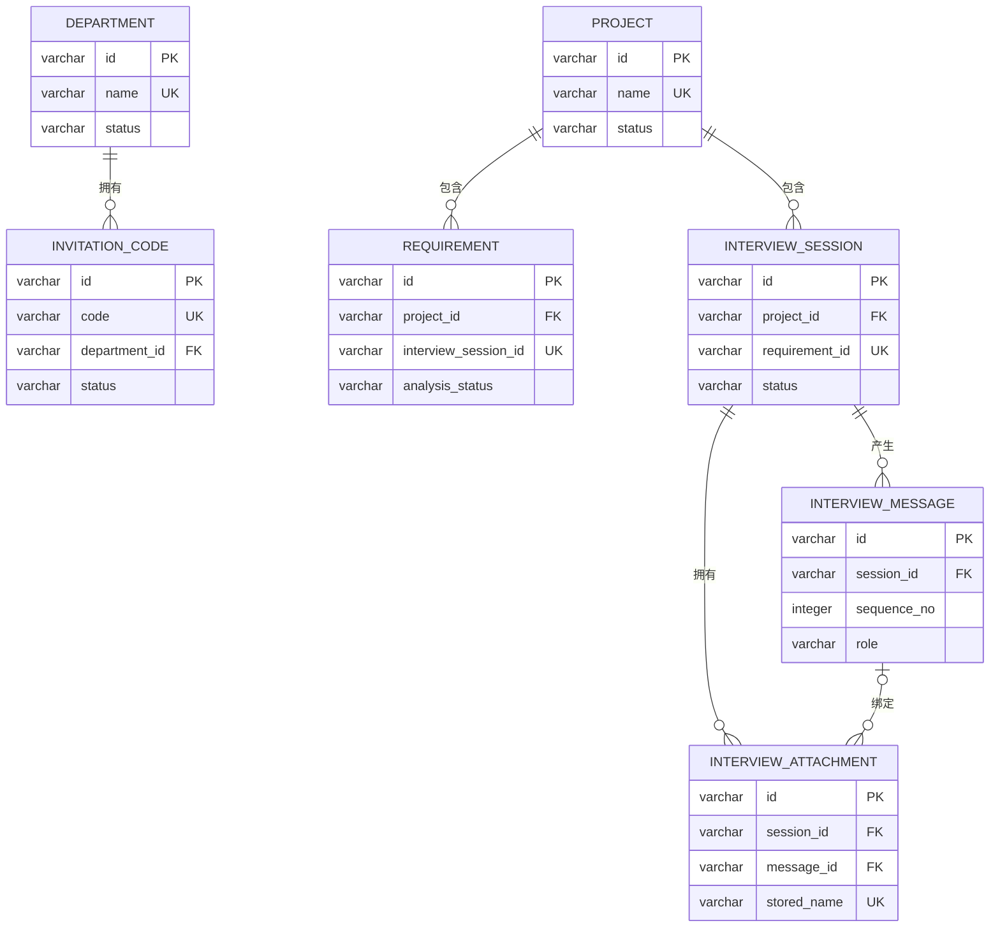

# SQLite 数据库设计（V2.0）

本文档以 `backend/v2.0/app/db/models.py` 为准，描述当前 SQLAlchemy 模型实际创建的表、字段、约束、索引和关系。

## 一、总体约定

- 当前数据库为 SQLite，默认文件为 `backend/v2.0/data/requirements.db`。
- 所有主键均为 32 位 UUID hex 字符串，由 `uuid.uuid4().hex` 生成。
- 时间字段使用带时区语义的 `DATETIME`，应用层按 UTC 写入。
- 枚举通过 `Enum(..., native_enum=False)` 保存为字符串，而不是数据库原生枚举。
- `structured_data`、`skipped_fields` 等结构化内容当前以 JSON 字符串形式保存在 `TEXT` 字段中。
- SQLite 连接建立后会执行 `PRAGMA foreign_keys=ON`，使外键删除策略生效。
- 未声明 `ForeignKey` 的 ID 字段属于逻辑关联，数据库不会自动校验目标记录是否存在，也不会自动级联。

## 二、表关系

说明：`interview_session.requirement_id` 与 `requirement.interview_session_id` 是业务层维护的一对一逻辑关联，当前模型没有为它们声明数据库外键。

## 三、枚举定义

| 枚举 | 可选值 | 使用字段 |
| --- | --- | --- |
| `ProjectStatus` | `ACTIVE`、`ARCHIVED` | `project.status` |
| `AnalysisStatus` | `PENDING`、`ANALYZING`、`ANALYZED`、`FAILED` | `requirement.analysis_status` |
| `RequirementType` | `NEW_FEATURE`、`BUG`、`OPTIMIZATION` | `requirement.type`、`interview_session.request_type` |
| `RequirementPriority` | `P0`、`P1`、`P2`、`P3` | `requirement.priority` |
| `DepartmentStatus` | `ACTIVE`、`DISABLED` | `department.status` |
| `InvitationStatus` | `UNUSED`、`USED`、`DISABLED` | `invitation_code.status` |
| `InterviewStatus` | `DRAFT`、`INTERVIEWING`、`CONFIRMING`、`SUBMITTED`、`ABANDONED`、`FAILED` | `interview_session.status` |
| `InterviewMessageRole` | `USER`、`AGENT`、`SYSTEM_EVENT` | `interview_message.role` |
| `InterviewActionType` | `INITIAL`、`ANSWER`、`SKIP`、`UNKNOWN`、`DIRECT_SUMMARY` | `interview_message.action_type` |
| `SourceChannel` | `MANAGEMENT_WEB`、`PRODUCT_WEB`、`MINI_PROGRAM`、`WECHAT`、`WECOM`、`FEISHU`、`OTHER` | `interview_session.source_channel` |
| `ProjectResolveMode` | `USER_SELECTED`、`ENTRY_BOUND`、`CHANNEL_MAPPED` | `interview_session.project_resolve_mode` |

## 四、数据表

### 4.1 `department` 部门表

| 字段 | 类型 | 可空 | 默认值 | 约束/说明 |
| --- | --- | --- | --- | --- |
| `id` | VARCHAR(32) | 否 | UUID hex | 主键 |
| `name` | VARCHAR(100) | 否 | 无 | 唯一、索引，部门名称 |
| `status` | VARCHAR | 否 | `ACTIVE` | 枚举 `DepartmentStatus`，索引 |
| `created_time` | DATETIME | 否 | 当前 UTC 时间 | 创建时间 |
| `updated_time` | DATETIME | 否 | 当前 UTC 时间 | 更新时自动刷新 |

关系与删除行为：

- 一个部门对应多个邀请码。
- ORM 关系配置为 `cascade="all, delete-orphan"`。
- `invitation_code.department_id` 的数据库外键使用 `ON DELETE RESTRICT`，直接在数据库删除仍有关联邀请码的部门会被阻止。

### 4.2 `invitation_code` 邀请码表

| 字段 | 类型 | 可空 | 默认值 | 约束/说明 |
| --- | --- | --- | --- | --- |
| `id` | VARCHAR(32) | 否 | UUID hex | 主键 |
| `code` | VARCHAR(9) | 否 | 无 | 唯一、索引，邀请码 |
| `department_id` | VARCHAR(32) | 否 | 无 | 外键 → `department.id`，索引，`ON DELETE RESTRICT` |
| `user_name` | VARCHAR(50) | 是 | `NULL` | 使用人姓名，索引 |
| `status` | VARCHAR | 否 | `UNUSED` | 枚举 `InvitationStatus`，索引 |
| `created_time` | DATETIME | 否 | 当前 UTC 时间 | 创建时间 |
| `used_time` | DATETIME | 是 | `NULL` | 实际使用时间 |

### 4.3 `project` 项目表

| 字段 | 类型 | 可空 | 默认值 | 约束/说明 |
| --- | --- | --- | --- | --- |
| `id` | VARCHAR(32) | 否 | UUID hex | 主键 |
| `name` | VARCHAR(100) | 否 | 无 | 唯一、索引，项目名称 |
| `description` | TEXT | 否 | 空字符串 | 项目简介 |
| `project_context` | TEXT | 否 | 无 | 传给 Dify 的完整项目上下文 |
| `department_id` | VARCHAR(32) | 是 | `NULL` | 部门业务 ID，索引；当前未声明外键 |
| `created_by` | VARCHAR(32) | 是 | `NULL` | 创建人业务 ID；当前未声明外键 |
| `status` | VARCHAR | 否 | `ACTIVE` | 枚举 `ProjectStatus`，索引 |
| `created_time` | DATETIME | 否 | 当前 UTC 时间 | 创建时间 |
| `updated_time` | DATETIME | 否 | 当前 UTC 时间 | 更新时自动刷新 |

关系与删除行为：

- 一个项目包含多个需求和多个访谈会话。
- 两个 ORM 关系均配置 `cascade="all, delete-orphan"`。
- `requirement.project_id` 与 `interview_session.project_id` 均使用 `ON DELETE CASCADE`。

### 4.4 `interview_session` 访谈会话表

| 字段 | 类型 | 可空 | 默认值 | 约束/说明 |
| --- | --- | --- | --- | --- |
| `id` | VARCHAR(32) | 否 | UUID hex | 主键 |
| `project_id` | VARCHAR(32) | 否 | 无 | 外键 → `project.id`，索引，`ON DELETE CASCADE` |
| `created_by` | VARCHAR(32) | 是 | `NULL` | 创建人业务 ID，索引；当前未声明外键 |
| `source_channel` | VARCHAR | 否 | `MANAGEMENT_WEB` | 枚举 `SourceChannel`，访谈来源渠道 |
| `source_user_id` | VARCHAR(100) | 是 | `NULL` | 外部渠道用户标识 |
| `source_message_id` | VARCHAR(100) | 是 | `NULL` | 外部渠道消息标识 |
| `entry_key` | VARCHAR(64) | 是 | `NULL` | 入口绑定键 |
| `project_resolve_mode` | VARCHAR | 否 | `USER_SELECTED` | 枚举 `ProjectResolveMode`，项目识别方式 |
| `status` | VARCHAR | 否 | `DRAFT` | 枚举 `InterviewStatus`，索引 |
| `raw_content` | TEXT | 否 | 无 | 用户首次提交的文字；纯图片访谈可保存为空字符串，但不能为 `NULL` |
| `request_type` | VARCHAR | 是 | `NULL` | 枚举 `RequirementType`，访谈中识别出的需求类型 |
| `structured_data` | TEXT | 否 | `{}` | 当前已抽取字段的 JSON 字符串 |
| `skipped_fields` | TEXT | 否 | `[]` | 已跳过或标记不清楚字段的 JSON 数组字符串 |
| `completeness_score` | INTEGER | 否 | `0` | 当前信息完整度 |
| `round_count` | INTEGER | 否 | `0` | 已完成的访谈轮数 |
| `consecutive_skip_count` | INTEGER | 否 | `0` | 连续跳过/不清楚次数 |
| `consecutive_agent_failures` | INTEGER | 否 | `0` | 连续 Agent 调用失败次数 |
| `stop_reason` | VARCHAR(40) | 是 | `NULL` | 停止追问原因码 |
| `summary_title` | VARCHAR(200) | 是 | `NULL` | 需求总结标题 |
| `clarified_content` | TEXT | 是 | `NULL` | 访谈澄清后的完整需求内容 |
| `requirement_id` | VARCHAR(32) | 是 | `NULL` | 唯一，提交后生成的需求业务 ID；当前未声明外键 |
| `confirm_idempotency_key` | VARCHAR(64) | 是 | `NULL` | 确认提交的幂等键 |
| `agent_error_code` | VARCHAR(50) | 是 | `NULL` | 最近一次访谈 Agent 错误码 |
| `agent_error_message` | TEXT | 是 | `NULL` | 可展示的 Agent 错误信息 |
| `prompt_version` | VARCHAR(30) | 是 | `NULL` | 本次访谈使用的提示词版本 |
| `created_time` | DATETIME | 否 | 当前 UTC 时间 | 创建时间 |
| `updated_time` | DATETIME | 否 | 当前 UTC 时间 | 更新时自动刷新 |

表级约束和索引：

- 唯一约束 `uq_interview_source_message(source_channel, source_message_id)`，用于防止同一渠道消息重复创建会话；`source_message_id` 为 `NULL` 时不形成普通的非空值冲突。
- 唯一约束：`requirement_id`。
- 复合索引 `ix_interview_creator_status_updated(created_by, status, updated_time)`，用于按创建人和状态查询最近会话。
- 复合索引 `ix_interview_project_status_created(project_id, status, created_time)`，用于项目内按状态查询访谈。
- 单列索引：`project_id`、`created_by`、`status`。

关系与删除行为：

- 会话按 `sequence_no` 升序拥有多条消息，删除会话时消息级联删除。
- 会话按 `created_time` 拥有多个附件，删除会话时附件级联删除。

### 4.5 `interview_message` 访谈消息表

| 字段 | 类型 | 可空 | 默认值 | 约束/说明 |
| --- | --- | --- | --- | --- |
| `id` | VARCHAR(32) | 否 | UUID hex | 主键 |
| `session_id` | VARCHAR(32) | 否 | 无 | 外键 → `interview_session.id`，索引，`ON DELETE CASCADE` |
| `sequence_no` | INTEGER | 否 | 无 | 会话内消息顺序号 |
| `role` | VARCHAR | 否 | 无 | 枚举 `InterviewMessageRole` |
| `content` | TEXT | 否 | 无 | 消息正文；图片消息可保存为空字符串，但不能为 `NULL` |
| `action_type` | VARCHAR | 是 | `NULL` | 枚举 `InterviewActionType` |
| `target_field` | VARCHAR(50) | 是 | `NULL` | 本轮追问或操作针对的结构化字段 |
| `reason_code` | VARCHAR(50) | 是 | `NULL` | 系统事件、跳过或失败原因码 |
| `client_message_id` | VARCHAR(64) | 是 | `NULL` | 客户端消息幂等标识 |
| `agent_run_id` | VARCHAR(100) | 是 | `NULL` | 对应的 Dify/Agent 运行 ID |
| `created_time` | DATETIME | 否 | 当前 UTC 时间 | 创建时间 |

表级约束：

- 唯一约束 `uq_interview_message_sequence(session_id, sequence_no)`，保证会话内顺序号不重复。
- 唯一约束 `uq_interview_client_message(session_id, client_message_id)`，防止同一客户端消息重复处理；`client_message_id` 为 `NULL` 时可存在多条记录。

### 4.6 `interview_attachment` 访谈图片附件表

| 字段 | 类型 | 可空 | 默认值 | 约束/说明 |
| --- | --- | --- | --- | --- |
| `id` | VARCHAR(32) | 否 | UUID hex | 主键，附件 ID |
| `session_id` | VARCHAR(32) | 是 | `NULL` | 外键 → `interview_session.id`，索引，`ON DELETE CASCADE` |
| `message_id` | VARCHAR(32) | 是 | `NULL` | 外键 → `interview_message.id`，索引，`ON DELETE SET NULL` |
| `uploaded_by` | VARCHAR(32) | 是 | `NULL` | 上传人业务 ID，索引；用于避免跨用户占用附件 |
| `original_name` | VARCHAR(255) | 否 | 无 | 用户上传时的原文件名 |
| `stored_name` | VARCHAR(80) | 否 | 无 | 服务端生成的唯一文件名，唯一约束 |
| `storage_path` | TEXT | 否 | 无 | 服务端存储路径，不通过普通响应直接返回 |
| `mime_type` | VARCHAR(50) | 否 | 无 | 当前服务只接受 `image/png`、`image/jpeg`、`image/webp` |
| `size_bytes` | INTEGER | 否 | 无 | 图片字节数；当前服务层限制单张最大 10 MB |
| `sha256` | VARCHAR(64) | 否 | 无 | 内容摘要，索引 |
| `dify_upload_file_id` | VARCHAR(100) | 是 | `NULL` | Dify `/files/upload` 返回的文件 ID |
| `dify_user` | VARCHAR(100) | 是 | `NULL` | 上传 Dify 时使用的 `interview:{session_id}` 用户标识 |
| `created_time` | DATETIME | 否 | 当前 UTC 时间 | 创建时间 |

索引：

- 复合索引 `ix_interview_attachment_uploader_created(uploaded_by, created_time)`。
- 单列索引：`session_id`、`message_id`、`uploaded_by`、`sha256`。

附件生命周期：

1. 图片先上传为 `session_id=NULL`、`message_id=NULL` 的未绑定附件。
2. 创建访谈或回答问题时，通过 `attachment_ids` 将附件同时绑定到会话和一条用户消息。
3. 删除消息时只将 `message_id` 设为 `NULL`；附件仍归属于会话。
4. 删除会话时附件随会话级联删除。
5. 图片文件默认保存在 `backend/v2.0/data/uploads/interviews`，数据库只保存元数据与路径。

`preview_url` 是模型计算属性，格式为 `/api/v1/interviews/attachments/{id}/content`，不是数据库字段。

### 4.7 `requirement` 需求表

| 字段 | 类型 | 可空 | 默认值 | 约束/说明 |
| --- | --- | --- | --- | --- |
| `id` | VARCHAR(32) | 否 | UUID hex | 主键 |
| `project_id` | VARCHAR(32) | 否 | 无 | 外键 → `project.id`，索引，`ON DELETE CASCADE` |
| `raw_content` | TEXT | 否 | 无 | 用户原始输入 |
| `interview_session_id` | VARCHAR(32) | 是 | `NULL` | 唯一，来源访谈会话业务 ID；当前未声明外键 |
| `clarified_content` | TEXT | 是 | `NULL` | 访谈澄清后的需求内容 |
| `interview_rounds` | INTEGER | 否 | `0` | 来源访谈轮数；直接创建需求时为 0 |
| `completeness_score` | INTEGER | 是 | `NULL` | 来源访谈的信息完整度 |
| `standard_content` | TEXT | 是 | `NULL` | Dify 字段 1：标准化需求内容 |
| `business_goal` | TEXT | 是 | `NULL` | Dify 字段 2：业务目标 |
| `type` | VARCHAR | 是 | `NULL` | Dify 字段 3：枚举 `RequirementType`，索引 |
| `priority` | VARCHAR | 是 | `NULL` | Dify 字段 4：枚举 `RequirementPriority`，索引 |
| `is_fake` | BOOLEAN | 是 | `NULL` | Dify 字段 5：是否伪需求，索引 |
| `fake_reason` | TEXT | 是 | `NULL` | Dify 字段 6：伪需求判定原因 |
| `is_duplicate` | BOOLEAN | 是 | `NULL` | Dify 字段 7：是否重复需求，索引 |
| `related_id` | VARCHAR(32) | 否 | 空字符串 | Dify 字段 8：关联需求业务 ID；无重复时为空字符串，当前未声明外键 |
| `reference_rule` | TEXT | 是 | `NULL` | Dify 字段 9：规则溯源 |
| `analysis_summary` | TEXT | 是 | `NULL` | Dify 字段 10：页面展示的 AI 总结 |
| `analysis_status` | VARCHAR | 否 | `PENDING` | 枚举 `AnalysisStatus`，索引 |
| `analysis_error_code` | VARCHAR(50) | 是 | `NULL` | 最近一次分析错误码 |
| `analysis_error_message` | TEXT | 是 | `NULL` | 可安全展示的失败原因 |
| `dify_workflow_run_id` | VARCHAR(100) | 是 | `NULL` | Dify Workflow 运行 ID |
| `manual_modify` | BOOLEAN | 否 | `false` | 是否经过人工修正 |
| `created_by` | VARCHAR(32) | 是 | `NULL` | 创建人业务 ID；当前未声明外键 |
| `created_time` | DATETIME | 否 | 当前 UTC 时间 | 创建时间 |
| `updated_time` | DATETIME | 否 | 当前 UTC 时间 | 更新时自动刷新 |

索引：

- 复合索引 `ix_requirement_project_created(project_id, created_time)`，支持项目内按时间查询。
- 复合索引 `ix_requirement_project_priority(project_id, priority)`，支持项目优先级泳道查询。
- 单列索引：`project_id`、`type`、`priority`、`is_fake`、`is_duplicate`、`analysis_status`。
- 唯一约束：`interview_session_id`，保证一场访谈最多生成一条正式需求。

AI 字段允许为 `NULL`，因为原始需求需要先保存，AI 调用可能仍在处理中或已经失败。只有 `DifyAnalysisResult` 完整校验通过后，10 个固定输出字段才会统一写入。

## 五、删除规则汇总

| 父记录删除 | 子记录处理 | 数据库约束 |
| --- | --- | --- |
| `department` | 存在邀请码时限制直接删除 | `invitation_code.department_id ON DELETE RESTRICT` |
| `project` | 删除其需求 | `requirement.project_id ON DELETE CASCADE` |
| `project` | 删除其访谈会话，并继续删除会话消息和附件 | `interview_session.project_id ON DELETE CASCADE` |
| `interview_session` | 删除其消息 | `interview_message.session_id ON DELETE CASCADE` |
| `interview_session` | 删除其附件 | `interview_attachment.session_id ON DELETE CASCADE` |
| `interview_message` | 保留附件，仅清空附件的消息关联 | `interview_attachment.message_id ON DELETE SET NULL` |

## 六、当前模型边界

- `project.department_id`、各表的 `created_by/uploaded_by` 尚未关联用户或部门外键。
- `interview_session.requirement_id` 与 `requirement.interview_session_id` 由业务层维护一对一关系，数据库未建立交叉外键。
- `requirement.related_id` 保存关联需求 ID，但未声明自关联外键。
- 完整度、访谈轮数、文件大小等业务范围主要由 Schema 和 Service 校验，数据库模型当前未声明 `CHECK` 约束。
- 当前使用 `Base.metadata.create_all()` 创建新表；`session.py` 只对 V1.1 的 `requirement` 表执行少量 V2.0 字段补齐。后续生产化迁移建议使用 Alembic 管理版本。
