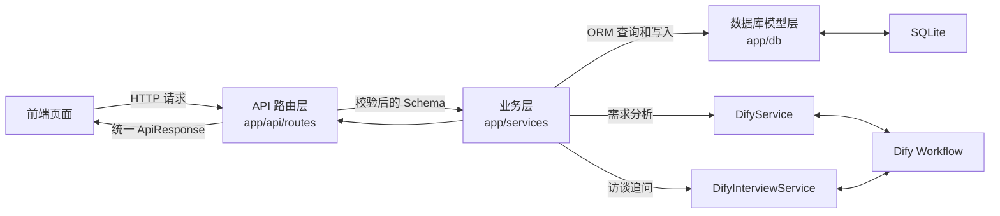
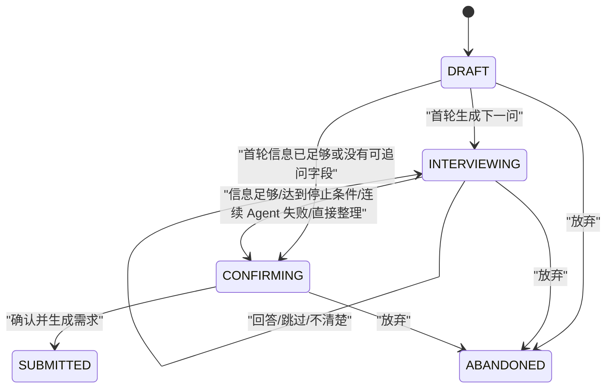
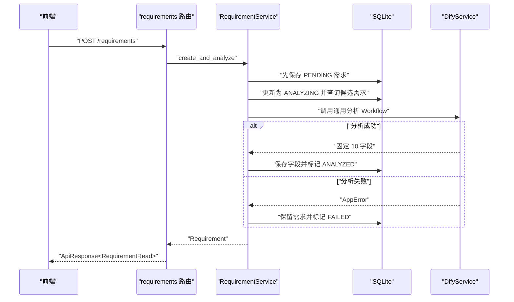
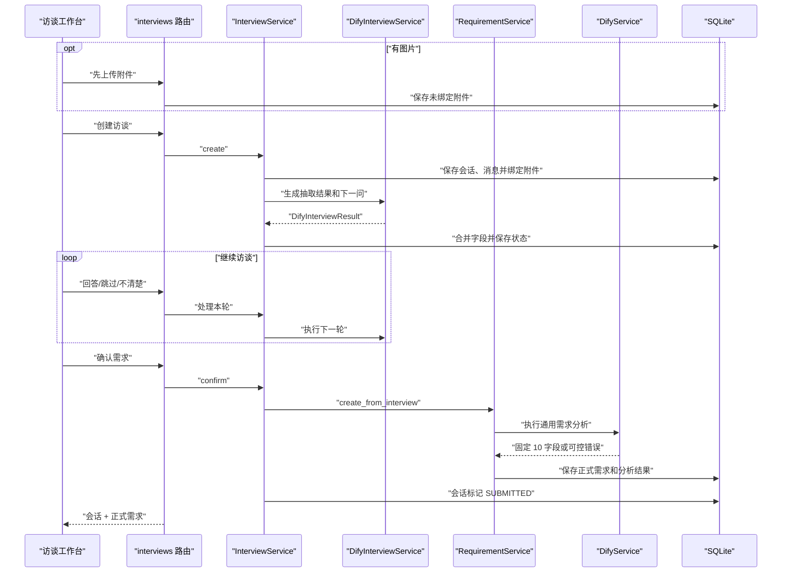

# 极简 AI 团队需求管理智能体：后端文件分层与字段说明

这份文档面向刚开始阅读后端代码的开发者。阅读目标是：

1. 知道每个文件属于哪一层；
2. 知道每一层应该做什么、不应该做什么；
3. 理解项目、组织、需求和访谈模块之间的关系；
4. 能够顺着一次“直接提交需求”或“访谈后提交需求”的流程找到代码；
5. 修改功能时，知道应该修改哪个文件。

本文只解释当前代码已经实现的内容，不代表后续规划功能已经完成。

本文中的相对路径和命令均以 `backend/v2.0` 为后端目录。数据库字段的完整定义另见 `docs/database-design.md`。

---

## 一、先用一句话理解整个后端

前端把请求发送给路由层，路由层用 Schema 校验数据，再把工作交给 Service；Service 查询或修改数据库，必要时调用 Dify；最后把数据库对象转换成响应 Schema 返回给前端。



可以把它想象成一家餐厅：

| 项目模块 | 餐厅类比 | 主要作用 |
| --- | --- | --- |
| API 路由层 | 服务员 | 接收请求、调用对应业务、返回结果 |
| Schema 层 | 订单格式 | 规定请求和响应的数据格式 |
| Service 层 | 厨师 | 执行业务规则、事务流程和外部调用 |
| 数据库模型层 | 仓库货架定义 | 规定表、字段、关系、索引和约束 |
| 数据库 Session | 仓库管理员 | 管理连接、会话、建表和轻量迁移 |
| Dify Service | 外部供应商接口 | 调用两个 Dify Workflow 并校验结果 |
| Core 层 | 全局规则 | 管理配置、路径和统一异常 |
| `main.py` | 餐厅总入口 | 创建应用、挂载中间件和注册路由 |

---

## 二、项目目录结构

当前后端主要目录如下：

```text
app/
├── main.py                              # FastAPI 应用总入口
├── openapi.json                         # 供前端生成类型的 OpenAPI 文件
│
├── core/                                # 全局基础能力
│   ├── config.py                        # 环境变量、稳定路径和应用配置
│   └── exceptions.py                    # 自定义业务异常
│
├── db/                                  # 数据库层
│   ├── base.py                          # SQLAlchemy Declarative Base
│   ├── session.py                       # 引擎、Session、建表与轻量迁移
│   └── models.py                        # 7 张表、枚举、关系和索引
│
├── schemas/                             # Pydantic 数据合同层
│   ├── common.py                        # 通用响应、分页和 ORM 转换
│   ├── project.py                       # 项目请求和响应
│   ├── organization.py                  # 部门、邀请码请求和响应
│   ├── requirement.py                   # 需求请求和响应
│   ├── interview.py                     # 访谈请求、会话、消息和附件响应
│   └── dify.py                          # 两个 Dify Workflow 的严格输出合同
│
├── services/                            # 业务逻辑层
│   ├── project_service.py               # 项目创建和分页查询
│   ├── organization_service.py          # 部门和邀请码业务
│   ├── requirement_service.py           # 需求保存、筛选和 AI 分析
│   ├── interview_attachment_service.py  # 图片校验、存储、绑定和预览
│   ├── interview_service.py             # 访谈状态机和确认提交主流程
│   ├── dify_service.py                  # 通用需求分析 Workflow
│   └── dify_interview_service.py        # 对话式访谈 Workflow 和图片上传
│
└── api/
    ├── router.py                        # 汇总所有业务路由
    └── routes/
        ├── health.py                    # 健康检查
        ├── projects.py                  # 项目接口
        ├── organization.py              # 部门和邀请码接口
        ├── requirements.py              # 需求接口
        └── interviews.py                # 访谈、附件和确认接口
```

后端目录 `backend/v2.0` 还有：

```text
.env.example                             # 环境变量模板
pyproject.toml                           # 项目元数据和开发依赖
requirements.txt                         # 固定版本依赖清单
scripts/generate_openapi.py              # 生成两份 OpenAPI 文件
tests/                                   # 自动化测试
docs/                                    # 接口、数据库和教学文档
data/                                    # 本地数据库与上传文件，Git 忽略
```

---

## 三、最容易混淆的三个概念

### 1. 数据库 Model 和 Pydantic Schema 不是同一个东西

项目中有两类看起来很像的“模型”：

| 类型 | 示例 | 主要用途 |
| --- | --- | --- |
| SQLAlchemy 数据库模型 | `db/models.py` 中的 `Requirement` | 对应 SQLite 表，负责持久化 |
| Pydantic 数据模型 | `schemas/requirement.py` 中的 `RequirementCreate` | 校验 HTTP 请求和响应 |

数据库模型回答的是：

> SQLite 的 `requirement` 表有哪些列？

Pydantic Schema 回答的是：

> 创建需求时前端允许传哪些字段？返回详情时后端应该给前端哪些字段？

前端不会直接操作 SQLAlchemy Model，数据库也不会直接存储 Pydantic Schema。

### 2. `Create` 是请求，`Read` 是响应

当前项目遵循以下命名习惯：

| 后缀 | 数据方向 | 示例 |
| --- | --- | --- |
| `Create` | 前端 → 后端 | `RequirementCreate`、`InterviewCreate` |
| `Update` | 前端 → 后端 | `DepartmentUpdate`、`InterviewSummaryUpdate` |
| `Request` | 前端 → 后端 | `BatchAnalyzeRequest`、`InterviewConfirmRequest` |
| `Read` | 后端 → 前端 | `RequirementRead`、`InterviewSessionRead` |
| `Result` | 内部或组合结果 | `DifyAnalysisResult`、`InterviewConfirmResult` |

`Read` 中可能包含数据库里没有的计算字段。例如 `ProjectRead.requirement_count`、`DepartmentRead.project_count` 和 `InterviewAttachmentRead.preview_url`。

### 3. 路由层不应该写复杂业务

路由函数应该保持很薄，只做：

1. 接收和校验参数；
2. 获取数据库 Session；
3. 调用 Service；
4. 组装标准响应。

“先保存需求 → 调用 Dify → 处理失败 → 更新分析结果”属于 `RequirementService`；“保存消息 → 合并字段 → 判断是否停止追问 → 确认生成需求”属于 `InterviewService`。这些流程不应该堆在路由函数中。

---

# 第一层：数据库模型层

## 文件一：数据库结构 `app/db/models.py`

### 文件定位

定义当前全部 7 张表：

| Model | 数据表 | 作用 |
| --- | --- | --- |
| `Department` | `department` | 部门资料与状态 |
| `InvitationCode` | `invitation_code` | 内部人员邀请码 |
| `Project` | `project` | 项目资料和项目上下文 |
| `InterviewSession` | `interview_session` | 一次完整需求访谈的状态 |
| `InterviewMessage` | `interview_message` | 访谈中的用户、Agent 和系统消息 |
| `InterviewAttachment` | `interview_attachment` | 访谈图片元数据与绑定关系 |
| `Requirement` | `requirement` | 正式需求及通用 AI 分析结果 |

这个文件还定义 11 组枚举，包括项目状态、分析状态、需求类型、优先级、部门/邀请码状态、访谈状态、消息角色、动作类型、来源渠道和项目识别方式。

### 公共函数

- `utc_now()`：生成带 UTC 时区的当前时间。
- `new_id()`：生成 32 位 UUID hex 主键。

### 关键关系

- 部门一对多邀请码；邀请码外键删除策略为 `RESTRICT`。
- 项目一对多需求、项目一对多访谈会话，删除项目时数据库级联删除。
- 会话一对多消息、一对多附件，删除会话时级联删除。
- 删除单条消息时，附件保留，但 `message_id` 设为 `NULL`。
- `interview_session.requirement_id`、`requirement.interview_session_id` 和 `requirement.related_id` 当前是业务 ID，不是数据库外键。

字段、约束、索引和删除规则的完整说明见 `docs/database-design.md`。

## 文件二：数据库基类 `app/db/base.py`

只定义 SQLAlchemy 2.x 的 `DeclarativeBase`：

```python
class Base(DeclarativeBase):
    pass
```

所有数据库 Model 都继承它。这个文件不放业务逻辑，也不负责创建表。

## 文件三：数据库连接与初始化 `app/db/session.py`

### 主要职责

- 从 `Settings` 读取数据库 URL。
- 为 SQLite 文件自动创建父目录。
- 创建 SQLAlchemy `engine` 和 `SessionLocal`。
- SQLite 使用 `check_same_thread=False`。
- 每次 SQLite 连接时启用 `PRAGMA foreign_keys=ON`。
- 通过 `get_db()` 为 FastAPI 路由提供 Session。
- 通过 `init_db()` 创建表并初始化默认部门。

### 轻量迁移

`_migrate_v2_sqlite_requirement_columns()` 只负责给早期 V1.1 `requirement` 表补充以下字段和索引：

- `interview_session_id`
- `clarified_content`
- `interview_rounds`
- `completeness_score`
- `ux_requirement_interview_session_id`

它不是完整迁移框架。新表由 `Base.metadata.create_all()` 创建，后续正式环境建议改用 Alembic。

---

# 第二层：Schema 数据合同层

## 文件四：通用响应结构 `app/schemas/common.py`

- `ApiResponse[T]`：统一返回 `code/message/data/request_id`。
- `PageData[T]`：统一分页返回 `items/total/page/page_size`。
- `ORMModel`：启用 `from_attributes=True`，允许从 SQLAlchemy 对象生成响应。

## 文件五：项目数据合同 `app/schemas/project.py`

### `ProjectCreate`

接收项目名称、简介、项目上下文、部门 ID 和创建人 ID。名称及上下文会去除首尾空白，并拒绝纯空白值。

### `ProjectRead`

返回项目完整资料，并增加 Service 计算的 `requirement_count`。该字段不属于 `project` 表。

## 文件六：组织与邀请码数据合同 `app/schemas/organization.py`

- `DepartmentCreate`：创建部门，名称最长 100 字符。
- `DepartmentUpdate`：可修改部门名称或 `ACTIVE/DISABLED` 状态。
- `DepartmentRead`：返回部门资料，并包含计算字段 `user_count`、`project_count`。
- `InvitationCreate`：指定 32 位部门 ID，可选填使用人姓名。
- `InvitationRead`：返回邀请码、部门名称、状态及使用时间。

当前 `user_count` 保留为默认值 0；项目数量由 `DepartmentService` 实时统计。

## 文件七：需求数据合同 `app/schemas/requirement.py`

- `RequirementCreate`：直接创建需求，要求项目 ID、非空原始内容和可选创建人。
- `RequirementRead`：返回原始内容、访谈来源字段、10 个 Dify 分析字段、分析状态和错误信息。
- `BatchAnalyzeRequest`：接收 1～50 个不重复的 32 位需求 ID。
- `BatchAnalyzeAccepted`：批量分析预留接口的接收结果。

## 文件八：访谈数据合同 `app/schemas/interview.py`

### 输入结构

- `InterviewCreate`：创建访谈，文字与图片附件至少提供一项，最多 5 个附件。
- `InterviewMessageCreate`：回答问题，文字与图片附件至少提供一项。
- `InterviewActionRequest`：跳过/不清楚动作的客户端幂等 ID。
- `InterviewSummaryUpdate`：人工编辑结构化字段和总结标题，拒绝未知字段。
- `InterviewConfirmRequest`：确认生成需求的幂等键。

### 输出结构

- `InterviewMessageRead`：消息正文、角色、动作、目标字段、Agent 运行 ID 和附件。
- `InterviewAttachmentRead`：附件元数据和预览 URL，不返回磁盘路径。
- `InterviewSessionRead`：当前卡片、完整度、轮数、问题、消息和错误状态。
- `InterviewConfirmResult`：组合返回会话与正式需求。
- `InterviewDraftRead`：未完成访谈的轻量列表项。

## 文件九：Dify 严格输出合同 `app/schemas/dify.py`

### 通用需求分析合同

`DifyAnalysisResult` 使用严格模式并禁止额外字段，要求 Dify 一次性返回固定 10 字段。跨字段规则包括：

- `is_duplicate=true` 时 `related_id` 必须有值；
- `is_duplicate=false` 时 `related_id` 必须为空字符串。

### 访谈合同

- `DifyInterviewField`：字段值、证据消息 ID、来源。
- `DifyInterviewFields`：11 个可抽取字段。
- `DifyInterviewQuestion`：下一问、目标字段和原因码。
- `DifyInterviewResult`：需求类型、抽取结果、下一问、标题和校验状态。

访谈输出同样使用严格模式、禁止额外字段；`validation_ok=false` 会直接判定 Workflow 输出无效。

---

# 第三层：全局 Core 层

## 文件十：应用配置与稳定路径 `app/core/config.py`

### `Settings`

配置分为四组：

| 配置组 | 主要字段 |
| --- | --- |
| 应用 | `app_name`、`app_env`、`debug`、`api_v1_prefix` |
| 数据库 | `database_url` |
| 通用分析 Dify | `dify_base_url`、`dify_api_key`、Workflow 路径、超时和候选数量 |
| 访谈 Dify/图片 | 独立 API Key、Workflow 路径、提示词版本、图片输入名、存储目录和大小/数量限制 |

### 路径规则

`BACKEND_ROOT` 固定为 `backend/v2.0`。因此：

- `.env` 固定从 `backend/v2.0/.env` 读取；
- 相对 SQLite 路径固定相对于 `backend/v2.0`；
- 相对图片目录固定相对于 `backend/v2.0`；
- 配置为绝对路径时保持原值。

这样从其他目录启动时不会误读配置或生成另一份数据库。

### URL 属性与缓存

- `dify_workflow_url`：组合通用分析 Workflow URL。
- `dify_interview_workflow_url`：组合访谈 Workflow URL。
- `get_settings()`：使用 `lru_cache`，进程内只构造一次配置对象。

## 文件十一：统一业务异常 `app/core/exceptions.py`

| 异常 | 默认 HTTP 状态 | 作用 |
| --- | --- | --- |
| `AppError` | 500 | 所有可控业务异常的基类 |
| `NotFoundError` | 404 | 项目、需求、会话等不存在 |
| `ConflictError` | 409 | 名称冲突、状态冲突、幂等冲突 |
| `InvalidImageError` | 400，可覆盖 | 图片格式、大小或内容无效 |
| `DifyError` | 502 | Dify 配置、HTTP、网络或执行错误 |
| `DifyTimeoutError` | 502 | 通用分析超时 |
| `DifyOutputError` | 502 | 通用分析输出不符合合同 |
| `DifyInterviewTimeoutError` | 502 | 访谈调用超时，内容已保存 |
| `DifyInterviewOutputError` | 502 | 访谈输出或图片上传响应无效 |

路由不需要分别捕获这些异常，`main.py` 会统一转换为标准响应。

---

# 第四层：Service 业务逻辑层

## 文件十二：项目业务 `app/services/project_service.py`

- `create()`：创建项目；捕获唯一约束错误并转换为“项目名称已存在”。
- `list()`：按状态分页查询，并通过外连接统计每个项目的需求数量。

## 文件十三：部门与邀请码业务 `app/services/organization_service.py`

### `DepartmentService`

- 创建、编辑、分页筛选部门；
- 处理部门名称唯一冲突；
- 实时统计部门下项目数量。

### `InvitationService`

- 为启用状态的部门生成 `XXXX-XXXX` 邀请码；
- 排除容易混淆的字符；
- 按关键字、部门、状态分页筛选；
- 已使用的邀请码不能停用。

当前服务没有实现邀请码核销或用户注册流程。

## 文件十四：需求保存与分析 `app/services/requirement_service.py`

### 两种创建入口

- `create_and_analyze()`：从需求管理页直接创建。
- `create_from_interview()`：把已确认访谈转换为正式需求。

两者都会先保存 `PENDING` 需求，再调用 `analyze_existing()`：

1. 状态更新为 `ANALYZING`；
2. 查询同项目最近已分析的候选需求；
3. 优先使用 `clarified_content` 调用 Dify；
4. AI 失败时保留需求并记录错误，状态改为 `FAILED`；
5. 成功时写入固定 10 字段和 Workflow 运行 ID，状态改为 `ANALYZED`。

`list()` 支持项目、关键字、优先级、类型、分析状态和伪需求筛选。

## 文件十五：访谈图片附件业务 `app/services/interview_attachment_service.py`

### 上传校验

- 仅允许 PNG、JPEG、WEBP；
- 同时检查扩展名、Content-Type 和文件魔数；
- 默认单张最大 10 MB；
- 文件名使用附件 ID，避免直接使用用户文件名。

### 生命周期

- `upload()`：保存本地文件与未绑定附件记录。
- `bind_to_message()`：校验归属后绑定到会话和用户消息。
- `get()/content_path()`：安全查询和预览，阻止路径逃逸。

## 文件十六：通用需求分析 Dify 客户端 `app/services/dify_service.py`

### 输入

向 Workflow 发送项目名称、项目上下文、需求内容和候选需求 JSON；使用 `blocking` 模式。

### 输出与安全边界

- 只接受 `data.outputs` 顶层固定 10 字段；
- 兼容结果放在 `outputs.result` 的常见配置；
- 使用 `DifyAnalysisResult` 严格校验；
- 重复需求的 `related_id` 必须来自当前项目候选列表；
- 区分超时、HTTP 错误、网络错误、Workflow 失败和输出错误。

HTTP 客户端使用 `trust_env=False`，避免本机代理环境变量干扰本地 Dify。

## 文件十七：访谈 Dify 客户端 `app/services/dify_interview_service.py`

- `run_turn()`：发送历史消息、当前字段、跳过字段、动作、轮数和渠道。
- `_prepare_images()`：复用同一会话已上传到 Dify 的文件 ID。
- `_upload_image()`：必要时先调用 Dify `/files/upload`。
- `_extract_interview()`：读取访谈输出并兼容 JSON 字符串。
- `DifyInterviewResult`：最终负责严格结构校验。

Dify 用户标识固定为 `interview:{session_id}`，避免不同会话错误复用图片文件。

## 文件十八：访谈状态机与主流程 `app/services/interview_service.py`

这是 V2.0 最核心的业务文件，负责：

- 创建访谈和第一条用户消息；
- 保存回答、跳过、不清楚和系统事件；
- 绑定图片附件；
- 调用访谈 Dify Workflow；
- 合并字段并保留用户手工编辑优先级；
- 计算完整度、轮数、连续跳过和连续失败；
- 决定继续追问或进入 `CONFIRMING`；
- 人工编辑总结；
- 幂等确认并生成正式需求；
- 放弃会话、查询草稿和组装详情响应。

主要状态流转：



`FAILED` 已保留在枚举和草稿查询范围中，但当前 `InterviewService` 不会主动把会话写成该状态；连续两次 Agent 失败会进入 `CONFIRMING`，确保用户仍可检查并提交已保存的信息。

---

# 第五层：API 路由层

## 文件十九：API 路由汇总 `app/api/router.py`

把业务路由挂载到统一前缀下：

| 路由模块 | 前缀 |
| --- | --- |
| 健康检查 | `/health` |
| 项目 | `/projects` |
| 需求 | `/requirements` |
| 访谈 | `/interviews` |
| 部门 | `/departments` |
| 邀请码 | `/invitations` |

`main.py` 再为整个 `api_router` 添加配置中的 `/api/v1` 前缀。

## 文件二十：健康检查接口 `app/api/routes/health.py`

- `GET /api/v1/health`
- 返回统一 `ApiResponse`，用于确认 FastAPI 进程可访问。

## 文件二十一：项目接口 `app/api/routes/projects.py`

- `POST /api/v1/projects`：创建项目。
- `GET /api/v1/projects`：按状态分页查询项目。

## 文件二十二：部门与邀请码接口 `app/api/routes/organization.py`

### 部门

- `POST /api/v1/departments`
- `GET /api/v1/departments`
- `PATCH /api/v1/departments/{department_id}`

### 邀请码

- `POST /api/v1/invitations`
- `GET /api/v1/invitations`
- `POST /api/v1/invitations/{invitation_id}/disable`

## 文件二十三：需求接口 `app/api/routes/requirements.py`

- `POST /api/v1/requirements`：直接创建并同步分析需求。
- `GET /api/v1/requirements`：分页、筛选和搜索。
- `GET /api/v1/requirements/{requirement_id}`：需求详情。
- `GET /api/v1/requirements/{requirement_id}/interview`：回查关联访谈。
- `POST /api/v1/requirements/batch-analyze`：返回 202 的预留接口，不执行真实批量任务。

需求已保存但 AI 失败时，HTTP 响应仍带需求数据，业务 `code` 为 `AI_ANALYSIS_FAILED`。

## 文件二十四：访谈与附件接口 `app/api/routes/interviews.py`

| 方法和路径 | 作用 |
| --- | --- |
| `POST /api/v1/interviews` | 创建访谈并执行第一轮 |
| `GET /api/v1/interviews/drafts` | 查询未完成访谈 |
| `POST /api/v1/interviews/attachments` | 上传图片附件 |
| `GET /api/v1/interviews/attachments/{id}/content` | 预览图片 |
| `GET /api/v1/interviews/{session_id}` | 查询会话详情 |
| `POST /api/v1/interviews/{session_id}/messages` | 回答当前问题 |
| `POST /api/v1/interviews/{session_id}/actions/skip` | 跳过当前问题 |
| `POST /api/v1/interviews/{session_id}/actions/unknown` | 标记为不清楚 |
| `POST /api/v1/interviews/{session_id}/actions/summarize` | 按当前信息整理 |
| `PATCH /api/v1/interviews/{session_id}/summary` | 编辑需求总结 |
| `POST /api/v1/interviews/{session_id}/confirm` | 确认并创建正式需求 |
| `POST /api/v1/interviews/{session_id}/abandon` | 放弃访谈 |

---

# 第六层：应用入口与辅助文件

## 文件二十五：FastAPI 应用入口 `app/main.py`

- `lifespan()`：启动时调用 `init_db()`。
- 创建 FastAPI 应用并读取名称、调试状态。
- 配置本地前端开发所需 CORS。
- `add_request_id`：沿用或生成请求 ID，并写入响应头。
- 统一处理 `AppError`、Pydantic 请求校验错误和 FastAPI `HTTPException`。
- 注册 `api_router`。

统一错误正文仍使用 `code/message/data/request_id`，必要时增加 `details`。

## 文件二十六：OpenAPI 生成工具 `scripts/generate_openapi.py`

从当前 FastAPI 应用生成两份接口合同：

- `app/openapi.json`：供前端 `openapi-typescript` 生成类型。
- `docs/openapi-v2.0-apifox.json`：供 Apifox 导入。

脚本为每个接口补充中文标题、版本标签和说明；新增接口但未添加元数据时会直接报错，避免文档静默遗漏。

## 文件二十七：环境变量模板 `.env.example`

包含数据库、两个 Dify Workflow 和访谈图片限制的示例配置。真实 API Key 只能写入本地 `.env`，不能写回模板或提交到 Git。

## 文件二十八：Python 项目配置 `pyproject.toml`

定义项目名称、Python 版本范围、运行依赖、开发测试依赖和 pytest 配置。开发环境推荐安装：

```bash
python -m pip install -e '.[dev]'
```

## 文件二十九：固定依赖清单 `requirements.txt`

为不使用 editable install 的本地部署提供固定版本依赖。修改依赖时应同步核对 `pyproject.toml`，避免两套清单漂移。

## 文件三十：自动化测试 `tests/`

当前测试覆盖：

- 项目、需求、部门和邀请码接口；
- Dify 通用分析输出校验；
- 访谈 Dify 输出校验；
- 访谈主流程、幂等和异常分支；
- 图片上传、绑定、预览和 Dify 图片合同；
- 配置路径不受启动目录影响。

测试命令：

```bash
python -m pytest -q
```

测试数据库与上传目录位于 `tests/` 临时路径，测试结束后清理，不写入正式 `data/requirements.db`。

## 包标记文件：各目录下的 `__init__.py`

这些文件主要用于声明 Python 包。当前大多为空，不承载业务逻辑。

---

# 请求链路

## 直接提交需求



关键原则：AI 不可用时原始需求不能丢失。

## 访谈后提交需求



## 查询需求列表

1. 路由校验分页和筛选参数；
2. `RequirementService.list()` 组合 SQLAlchemy 条件；
3. 同时查询总数和当前页；
4. 按创建时间倒序；
5. 转换为 `RequirementRead` 并放入 `PageData`。

---

# 修改功能时应该找哪个文件

| 修改目标 | 优先查看 |
| --- | --- |
| 新增数据库字段、关系、索引 | `app/db/models.py`、迁移方案、`docs/database-design.md` |
| 修改项目请求或响应 | `app/schemas/project.py` |
| 修改部门或邀请码结构 | `app/schemas/organization.py` |
| 修改需求请求或响应 | `app/schemas/requirement.py` |
| 修改访谈请求、卡片或消息响应 | `app/schemas/interview.py` |
| 修改 Dify 固定输出 | `app/schemas/dify.py`、Dify Workflow、测试、OpenAPI |
| 修改项目业务 | `app/services/project_service.py` |
| 修改部门或邀请码业务 | `app/services/organization_service.py` |
| 修改需求分析流程 | `app/services/requirement_service.py`、`dify_service.py` |
| 修改访谈规则或停止条件 | `app/services/interview_service.py` |
| 修改图片上传 | `app/services/interview_attachment_service.py`、`dify_interview_service.py` |
| 新增或调整 API | 对应 `app/api/routes/*.py` 与 `app/api/router.py` |
| 修改错误格式 | `app/core/exceptions.py`、`app/main.py` |
| 修改数据库或上传路径 | `app/core/config.py` |
| 更新接口合同 | `scripts/generate_openapi.py` 后重新生成前端类型 |

---

# 当前代码边界

## 已实现

- 项目创建、分页和状态筛选；
- 部门创建、编辑、筛选；
- 邀请码生成、查询和停用；
- 直接提交需求、同步 Dify 分析、失败保底；
- 需求分页、搜索和组合筛选；
- 对话式需求访谈、图片输入、跳过/不清楚、总结编辑；
- 访谈确认生成正式需求并继续执行通用分析；
- 从需求回查访谈详情；
- SQLite 持久化、统一异常、请求 ID 和 OpenAPI 生成。

## 尚未真正实现

- 登录鉴权、用户表和邀请码核销注册流程；
- 部门真实用户数量统计；
- 项目编辑、归档操作接口；
- 后台异步批量分析任务；
- 对象存储，当前图片保存在本地目录；
- Alembic 数据库版本迁移；
- 完整操作日志和权限控制；
- 生产环境部署、监控和重试队列。

---

# 推荐阅读顺序

## 第一次阅读

1. `app/main.py`
2. `app/api/router.py`
3. 选择一组路由，例如 `app/api/routes/interviews.py`
4. 对应的 `app/schemas/interview.py`
5. `app/services/interview_service.py`
6. `app/db/models.py`
7. 两个 Dify Service 和 `app/schemas/dify.py`

## 阅读每个函数时问自己四个问题

1. 输入来自哪里？
2. 输入在哪一层校验？
3. 数据库在哪一步提交？
4. 失败时会抛出什么异常、是否会丢数据？

## 一句话速查

```text
main.py          负责组装应用
api/routes       负责接收和返回 HTTP
schemas          负责数据合同与校验
services         负责业务流程
db/models.py     负责数据库结构
db/session.py    负责连接和 Session
core/config.py   负责环境配置与稳定路径
core/exceptions  负责可控业务异常
```
