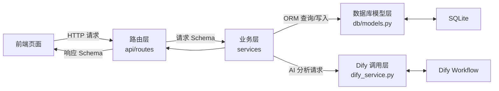
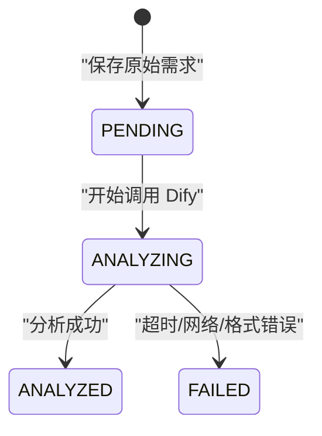
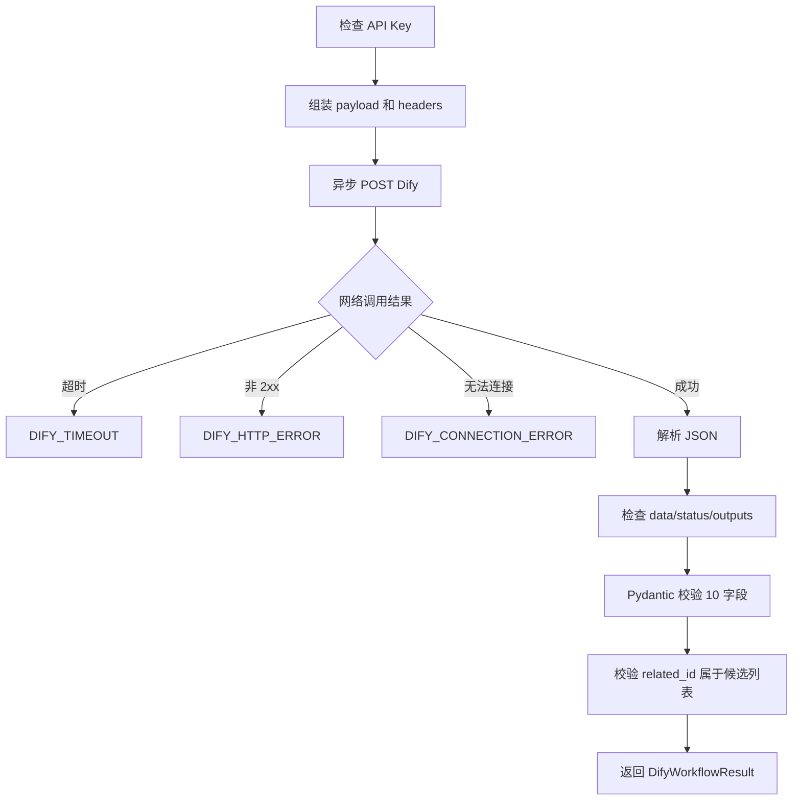
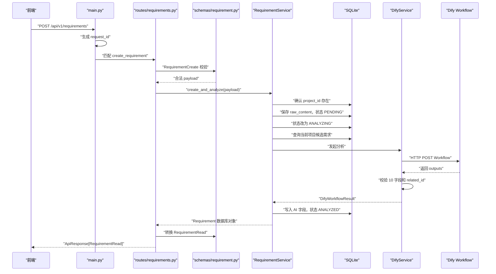

# 极简 AI 团队需求管理智能体：后端文件分层与字段说明

这份文档面向刚开始阅读后端代码的开发者。阅读目标是：

1. 知道每个文件属于哪一层；
2. 知道每一层应该做什么、不应该做什么；
3. 理解项目表、需求表以及 API 数据模型中的每个字段；
4. 能够顺着一次“提交新需求”的流程找到对应代码；
5. 修改代码时，知道应该修改哪个文件。

本文只解释当前代码已经实现的内容，不代表后续规划功能已经完成。

本文中的相对路径和命令均以 `backend/v2.0` 为后端目录。

---

## 一、先用一句话理解整个后端

前端把请求发送给路由层，路由层用 Schema 校验数据，再把工作交给 Service；Service 查询或修改数据库，必要时调用 Dify；最后把数据库对象转换成响应 Schema 返回给前端。



可以把它想象成一家餐厅：

| 项目模块       | 餐厅类比       | 主要作用                                       |
| -------------- | -------------- | ---------------------------------------------- |
| 路由层         | 服务员         | 接收请求、确认要调用哪个业务、把结果返回给前端 |
| Schema 层      | 订单格式       | 规定前端必须传什么、后端必须返回什么           |
| Service 层     | 厨师           | 执行业务步骤和规则                             |
| 数据库模型层   | 仓库货架定义   | 规定数据库有哪些表、字段和关系                 |
| 数据库 Session | 仓库管理员     | 负责打开、提交、回滚、关闭数据库连接           |
| Dify Service   | 外部供应商接口 | 把需求交给 Dify 分析，并检查返回结果           |
| Core 层        | 全局规则       | 管理配置、统一异常等公共能力                   |
| `main.py`    | 餐厅总入口     | 组装所有模块并启动应用                         |

---

## 二、项目目录结构

当前后端主要目录如下：

```text
app/
├── main.py                         # FastAPI 应用总入口
│
├── core/                           # 全局基础能力
│   ├── config.py                   # 环境变量和应用配置
│   └── exceptions.py               # 自定义异常
│
├── db/                             # 数据库层
│   ├── base.py                     # SQLAlchemy 模型共同父类
│   ├── session.py                  # 数据库引擎、会话、建表
│   └── models.py                   # 数据库表和枚举
│
├── schemas/                        # API 数据合同/Pydantic 校验层
│   ├── common.py                   # 通用响应和分页结构
│   ├── project.py                  # 项目请求、响应结构
│   ├── requirement.py              # 需求请求、响应结构
│   └── dify.py                     # Dify 固定输出结构
│
├── services/                       # 业务逻辑层
│   ├── project_service.py          # 项目业务
│   ├── requirement_service.py      # 需求业务和 AI 分析流程
│   └── dify_service.py             # Dify HTTP 调用封装
│
└── api/                            # HTTP 路由层
    ├── router.py                   # 汇总所有子路由
    └── routes/
        ├── health.py               # 健康检查接口
        ├── projects.py             # 项目接口
        └── requirements.py         # 需求接口
```

后端目录 `backend/v2.0` 还有：

```text
.env.example                        # 环境变量示例
pyproject.toml                      # Python 项目和依赖声明
tests/                              # 自动化测试
docs/                               # 教学和设计文档
```

---

## 三、最容易混淆的三个概念

### 1. 数据库 Model 和 Pydantic Schema 不是同一个东西

项目中有两类看起来很像的“模型”：

| 类型                  | 示例                                                  | 主要用途                       |
| --------------------- | ----------------------------------------------------- | ------------------------------ |
| SQLAlchemy 数据库模型 | `db/models.py` 中的 `Requirement`                 | 对应 SQLite 表，负责数据库读写 |
| Pydantic 数据模型     | `schemas/requirement.py` 中的 `RequirementCreate` | 校验 HTTP 请求和响应           |

数据库模型回答的是：

> SQLite 的 `requirement` 表有哪些列？

Pydantic Schema 回答的是：

> 创建需求时前端允许传哪些字段？返回详情时后端应该给前端哪些字段？

前端不会直接操作 SQLAlchemy 的 `Requirement`，数据库也不会直接存储 `RequirementCreate`。

### 2. `Create` 是请求，`Read` 是响应

当前项目遵循以下命名习惯：

| 后缀         | 数据方向               | 例子                                           |
| ------------ | ---------------------- | ---------------------------------------------- |
| `Create`   | 前端 → 后端           | `RequirementCreate`                          |
| `Request`  | 前端 → 后端           | `BatchAnalyzeRequest`                        |
| `Read`     | 后端 → 前端           | `RequirementRead`                            |
| `Accepted` | 后端 → 前端           | `BatchAnalyzeAccepted`                       |
| `Result`   | 某个内部服务的处理结果 | `DifyAnalysisResult`、`DifyWorkflowResult` |

因此：

- `RequirementCreate` 是前端创建需求时传给后端的数据；
- `RequirementRead` 不是前端传给后端的数据，而是后端返回给前端的数据；
- 当前 `RequirementRead` 只有 `project_id`，没有 `project_name`。前端如果需要项目名称，可以从项目列表映射，或者后续扩展详情响应。

### 3. 路由层不应该写复杂业务

路由函数应该很薄，只做：

1. 接收和校验参数；
2. 获取数据库 Session；
3. 调用 Service；
4. 组装标准响应。

“保存原始需求 → 找候选需求 → 调用 Dify → 处理失败 → 更新结果”属于业务流程，应该放在 `RequirementService`，而不是堆在路由函数中。

---

# 第一层：数据库模型层

## 四、文件一：`app/db/models.py`

### 文件定位

这个文件只定义数据库结构：

- 有哪些数据表；
- 每张表有哪些字段；
- 字段类型、是否允许为空、默认值；
- 表与表之间如何关联；
- 有哪些固定枚举；
- 有哪些查询索引。

它不负责：

- 接收前端请求；
- 调用 Dify；
- 决定创建需求的业务步骤；
- 返回 HTTP 响应。

### 1. `utc_now()`

```python
def utc_now() -> datetime:
    return datetime.now(timezone.utc)
```

作用：生成当前 UTC 时间。

项目使用它为 `created_time` 和 `updated_time` 提供默认值。

为什么使用 UTC：

- 不绑定服务器所在时区；
- 将来部署到不同地区时，数据库时间仍然统一；
- 前端展示时可以转换为北京时间或用户本地时间。

它返回的是“带时区信息的当前时间”，不是字符串。

### 2. `new_id()`

```python
def new_id() -> str:
    return uuid.uuid4().hex
```

作用：生成 32 位 UUID 字符串，作为项目和需求的主键。

示例：

```text
98ddc1e877cc4a91b8dfd6e1cac76b52
```

使用 `.hex` 后没有短横线，长度固定为 32。

为什么不用数据库自增数字：

- ID 不容易被猜测；
- 不同环境生成时不容易冲突；
- 将来做数据迁移或服务拆分更方便。

### 3. `ProjectStatus`

```python
class ProjectStatus(str, enum.Enum):
    ACTIVE = "ACTIVE"
    ARCHIVED = "ARCHIVED"
```

这是项目状态枚举。

| 枚举值       | 含义             |
| ------------ | ---------------- |
| `ACTIVE`   | 正常使用中的项目 |
| `ARCHIVED` | 已归档项目       |

使用枚举可以避免数据库出现 `active`、`正常`、`启用中` 等不统一写法。

### 4. `AnalysisStatus`

```python
class AnalysisStatus(str, enum.Enum):
    PENDING = "PENDING"
    ANALYZING = "ANALYZING"
    ANALYZED = "ANALYZED"
    FAILED = "FAILED"
```

这是需求的 AI 分析状态，不是需求是否采纳的业务状态。

| 枚举值        | 含义                             |
| ------------- | -------------------------------- |
| `PENDING`   | 原始需求已保存，尚未开始 AI 分析 |
| `ANALYZING` | 后端正在调用 Dify                |
| `ANALYZED`  | AI 返回合法结果并已保存          |
| `FAILED`    | AI 调用或结果校验失败            |

状态流转：



当前模型尚未包含原型中的“待采纳、已采纳、已实现、不采纳”等需求管理状态。这些属于另一组业务状态，后续需要单独增加字段，不能与 `analysis_status` 混用。

### 5. `RequirementType`

```python
class RequirementType(str, enum.Enum):
    NEW_FEATURE = "NEW_FEATURE"
    BUG = "BUG"
    OPTIMIZATION = "OPTIMIZATION"
```

| 枚举值           | 含义                           |
| ---------------- | ------------------------------ |
| `NEW_FEATURE`  | 新功能需求                     |
| `BUG`          | 已有能力发生错误               |
| `OPTIMIZATION` | 功能可用，但需要改善体验或效率 |

该字段由 Dify 分析生成。

### 6. `RequirementPriority`

```python
class RequirementPriority(str, enum.Enum):
    P0 = "P0"
    P1 = "P1"
    P2 = "P2"
    P3 = "P3"
```

| 枚举值 | 大致含义                             |
| ------ | ------------------------------------ |
| `P0` | 核心流程阻断、重大风险，需要紧急处理 |
| `P1` | 高价值或高影响需求                   |
| `P2` | 常规需求或一般优化                   |
| `P3` | 边缘需求、个性化建议或低收益事项     |

数据库只限制值必须属于 P0～P3，详细判定规则位于 Dify 的 RAG 知识库中。

---

## 五、`Project`：项目表

```python
class Project(Base):
    __tablename__ = "project"
```

`Project` 是 Python 类，`project` 是 SQLite 中真实的表名。

### 字段说明

| 字段                | 类型              | 是否可空 | 来源                   | 作用                       |
| ------------------- | ----------------- | -------- | ---------------------- | -------------------------- |
| `id`              | 32 位字符串       | 否       | 后端自动生成           | 项目唯一 ID                |
| `name`            | 最长 100 字符     | 否       | 前端创建项目时传入     | 项目名称                   |
| `description`     | 长文本            | 否       | 前端传入，可为空字符串 | 给用户看的简短项目介绍     |
| `project_context` | 长文本            | 否       | 前端传入               | 给 Dify 使用的完整项目背景 |
| `department_id`   | 32 位字符串       | 是       | 前端可选传入           | 预留所属部门 ID            |
| `created_by`      | 32 位字符串       | 是       | 前端可选传入           | 预留创建人用户 ID          |
| `status`          | `ProjectStatus` | 否       | 默认`ACTIVE`         | 项目是否正常使用或归档     |
| `created_time`    | 时间              | 否       | 后端自动生成           | 项目创建时间               |
| `updated_time`    | 时间              | 否       | 后端自动维护           | 项目最后更新时间           |
| `requirements`    | 关系列表          | —       | SQLAlchemy 自动加载    | 该项目下关联的需求对象     |

### `description` 和 `project_context` 的区别

这是两个容易混淆的字段：

- `description`：给页面和用户看的简短说明；
- `project_context`：给 AI 分析使用的详细背景。

例如：

```text
description:
面向小型团队的 AI 需求管理工具。

project_context:
项目面向 5～20 人研发团队，核心流程是成员提交需求、
AI 分析、负责人筛选和需求池管理。当前处于 MVP 阶段，
暂不包含排期和研发任务管理……
```

Dify 判断优先级时需要完整上下文，因此不能只传一个模糊的项目名称。

### 字段配置关键词

以 `name` 为例：

```python
name = mapped_column(
    String(100),
    unique=True,
    nullable=False,
    index=True,
)
```

| 配置               | 含义                       |
| ------------------ | -------------------------- |
| `String(100)`    | 最长 100 字符的字符串列    |
| `unique=True`    | 项目名称不能重复           |
| `nullable=False` | 数据库不允许存 NULL        |
| `index=True`     | 为此字段建立索引，加快查询 |

### `requirements` 关系

```python
requirements = relationship(
    back_populates="project",
    cascade="all, delete-orphan",
)
```

作用：建立“一个项目拥有多个需求”的一对多关系。

- `project.requirements` 可以访问该项目关联的需求；
- `requirement.project` 可以访问需求所属项目；
- `cascade="all, delete-orphan"` 表示项目对象被删除时，关联需求也跟随处理。

---

## 六、`Requirement`：需求表

```python
class Requirement(Base):
    __tablename__ = "requirement"
```

该表既保存用户提交的原始内容，也保存 Dify 的 10 个分析字段和分析过程状态。

### A. 业务可信字段

这些字段由后端维护，不允许 Dify 决定：

| 字段             | 类型            | 来源               | 作用              |
| ---------------- | --------------- | ------------------ | ----------------- |
| `id`           | 32 位字符串     | 后端自动生成       | 需求唯一 ID       |
| `project_id`   | 32 位字符串     | 前端传入，后端验证 | 需求所属项目      |
| `raw_content`  | 长文本          | 前端传入           | 用户原始需求内容  |
| `created_by`   | 32 位字符串或空 | 前端可选传入       | 预留需求提交人 ID |
| `created_time` | 时间            | 后端生成           | 创建时间          |
| `updated_time` | 时间            | 后端维护           | 最后更新时间      |

`project_id` 是外键：

```python
ForeignKey("project.id", ondelete="CASCADE")
```

含义：

- 它必须指向 `project` 表中的项目；
- 项目删除时，其需求可以级联删除；
- SQLite 连接时通过 `PRAGMA foreign_keys=ON` 开启了外键约束。

### B. Dify 固定输出的 10 个字段

这 10 个字段与 Dify Workflow 返回字段严格同名：

| 序号 | 字段                 | 类型            | 作用                                  |
| ---- | -------------------- | --------------- | ------------------------------------- |
| 1    | `standard_content` | 文本或 NULL     | AI 整理后的标准需求文案               |
| 2    | `business_goal`    | 文本或 NULL     | 需求背后的业务目标和真实诉求          |
| 3    | `type`             | 枚举或 NULL     | `NEW_FEATURE/BUG/OPTIMIZATION`      |
| 4    | `priority`         | 枚举或 NULL     | `P0/P1/P2/P3`                       |
| 5    | `is_fake`          | Boolean 或 NULL | 是否为伪需求                          |
| 6    | `fake_reason`      | 文本或 NULL     | 真伪判定事实和规则依据                |
| 7    | `is_duplicate`     | Boolean 或 NULL | 是否与历史需求重复                    |
| 8    | `related_id`       | 最长 32 字符    | 关联的重复需求 ID，无重复时为空字符串 |
| 9    | `reference_rule`   | 文本或 NULL     | 本次判断引用的知识库规则              |
| 10   | `analysis_summary` | 文本或 NULL     | 给页面展示的简洁 AI 总结              |

为什么大多数字段允许为 NULL：

1. 用户提交需求后，后端先保存 `raw_content`；
2. 此时 Dify 可能还没有返回；
3. Dify 也可能超时或输出错误；
4. 因此分析字段必须允许暂时为空。

只有 Dify 结果通过完整校验后，这 10 个字段才会被更新。

#### `raw_content` 和 `standard_content`

```text
raw_content:
客服那边客户很多，希望能批量导一下，重复的别再录了。

standard_content:
面向客服人员，支持批量导入客户信息，并在导入过程中识别和阻止重复数据写入。
```

前者保留用户原话，后者用于需求管理和后续评审。

#### `is_fake` 和 `fake_reason`

- `is_fake=true`：AI 判断该需求可能缺少真实场景或业务价值；
- `is_fake=false`：AI 判断它是具有明确问题和价值的真实需求；
- 无论真假，`fake_reason` 都必须解释判断依据。

#### `is_duplicate` 和 `related_id`

它们必须组合使用：

| `is_duplicate` | `related_id`                    |
| ---------------- | --------------------------------- |
| `false`        | 必须是空字符串                    |
| `true`         | 必须是本次候选列表中的真实需求 ID |

#### `reference_rule`

用于回答：

> AI 为什么得出这个结论？

示例：

```text
TYPE-NEW；PRI-P2；FAKE-NOT
```

它是 AI 分析可追溯性的核心字段。

#### `analysis_summary`

这是适合直接放到需求详情页“AI 建议”区域的短文本，不应该包含内部推理过程。

### C. AI 调用管理字段

| 字段                       | 类型               | 作用                       |
| -------------------------- | ------------------ | -------------------------- |
| `analysis_status`        | `AnalysisStatus` | 当前 AI 分析状态           |
| `analysis_error_code`    | 字符串或 NULL      | 机器可识别的失败类型       |
| `analysis_error_message` | 文本或 NULL        | 给用户或日志看的错误说明   |
| `dify_workflow_run_id`   | 字符串或 NULL      | Dify 本次运行 ID，方便排障 |
| `manual_modify`          | Boolean            | 是否经过人工修正，目前预留 |

错误字段示例：

```json
{
  "analysis_status": "FAILED",
  "analysis_error_code": "DIFY_TIMEOUT",
  "analysis_error_message": "AI 分析超时，请稍后重试"
}
```

`analysis_error_code` 适合程序判断，`analysis_error_message` 适合人阅读。

### D. 表索引

```python
Index("ix_requirement_project_created", "project_id", "created_time")
Index("ix_requirement_project_priority", "project_id", "priority")
```

索引用于加快常用查询：

- 查询某项目的需求并按创建时间排序；
- 查询某项目的某一优先级需求。

索引不改变数据内容，只影响查询性能和少量写入成本。

---

## 七、文件二：`app/db/base.py`

```python
class Base(DeclarativeBase):
    pass
```

这是所有 SQLAlchemy 数据库模型的共同父类。

`Project(Base)` 和 `Requirement(Base)` 继承它之后，SQLAlchemy 才能收集这些表的元数据并创建表。

这个文件很短是正常的。它的作用类似“告诉 SQLAlchemy：继承 Base 的类都是数据库表定义”。

---

## 八、文件三：`app/db/session.py`

### 文件定位

这个文件负责数据库连接生命周期：

- 根据配置创建数据库目录；
- 创建 SQLAlchemy Engine；
- 创建 Session 工厂；
- 为每个 HTTP 请求提供数据库 Session；
- 应用启动时创建数据表；
- 开启 SQLite 外键约束。

### 1. `engine`

```python
engine = create_engine(
    settings.database_url,
    connect_args=connect_args,
    pool_pre_ping=True,
)
```

Engine 可以理解为应用与数据库之间的连接管理器。

它知道数据库地址，也负责建立和维护连接，但业务代码通常不直接拿 Engine 做查询。

### 2. `check_same_thread=False`

SQLite 默认限制一个连接只能在创建它的线程使用。FastAPI 会在不同线程处理同步数据库操作，因此需要：

```python
{"check_same_thread": False}
```

它不是关闭数据库安全，而是允许 SQLAlchemy 正确管理 SQLite 连接。

### 3. `SessionLocal`

```python
SessionLocal = sessionmaker(
    bind=engine,
    autoflush=False,
    expire_on_commit=False,
)
```

它是创建数据库 Session 的工厂。

Session 可以理解为一次数据库工作上下文：

- 查询；
- 新增对象；
- 修改对象；
- `commit()` 提交；
- `rollback()` 回滚；
- `close()` 关闭。

### 4. `enable_sqlite_foreign_keys()`

```python
cursor.execute("PRAGMA foreign_keys=ON")
```

SQLite 默认可能不执行外键约束，这段代码保证每次新连接建立时都开启外键检查。

### 5. `get_db()`

```python
def get_db():
    db = SessionLocal()
    try:
        yield db
    finally:
        db.close()
```

这是 FastAPI 数据库依赖。

流程：

1. HTTP 请求开始时创建 Session；
2. 路由和 Service 使用它访问数据库；
3. 请求结束后，无论成功还是失败，都执行 `close()`。

路由中的：

```python
db: DbSession
```

最终就是从 `get_db()` 得到 Session。

### 6. `init_db()`

```python
Base.metadata.create_all(bind=engine)
```

应用启动时根据 `models.py` 创建不存在的数据表。

注意：

- 它适合当前 MVP；
- 它不会自动完成复杂的表结构升级；
- 后续字段变更应接入 Alembic 数据库迁移。

---

# 第二层：Schema 数据合同层

## 九、文件四：`app/schemas/common.py`

### 文件定位

这里放所有模块都会使用的 Pydantic 基础结构。

### 1. `ApiResponse`

```python
class ApiResponse(BaseModel, Generic[T]):
    code: str = "OK"
    message: str = "success"
    data: T
    request_id: str | None = None
```

它定义所有成功接口的统一外壳。

| 字段           | 作用                                         |
| -------------- | -------------------------------------------- |
| `code`       | 业务结果码，如`OK`、`AI_ANALYSIS_FAILED` |
| `message`    | 给调用方看的说明                             |
| `data`       | 实际业务数据，类型由不同接口决定             |
| `request_id` | 本次请求追踪 ID                              |

`T` 是泛型占位符：

```python
ApiResponse[ProjectRead]
```

表示 `data` 是一个项目。

```python
ApiResponse[PageData[RequirementRead]]
```

表示 `data` 是一个分页需求列表。

### 2. `PageData`

```python
class PageData(BaseModel, Generic[T]):
    items: list[T]
    total: int
    page: int
    page_size: int
```

| 字段          | 作用                |
| ------------- | ------------------- |
| `items`     | 当前页的数据        |
| `total`     | 满足条件的总记录数  |
| `page`      | 当前页码，从 1 开始 |
| `page_size` | 每页数量            |

注意：`total` 不是当前页条数，而是全部匹配记录数。

### 3. `ORMModel`

```python
class ORMModel(BaseModel):
    model_config = ConfigDict(from_attributes=True)
```

它允许 Pydantic 从 SQLAlchemy 对象属性读取数据。

因此可以写：

```python
RequirementRead.model_validate(requirement)
```

把数据库 `Requirement` 对象转换为 API 响应 `RequirementRead`。

---

## 十、文件五：`app/schemas/project.py`

### 文件定位

这个文件定义“项目相关 API 的输入和输出格式”，不是数据库表。

### 1. `ProjectCreate`

前端创建项目时传给后端。

| 字段                | 必填 | 限制                        | 作用                        |
| ------------------- | ---- | --------------------------- | --------------------------- |
| `name`            | 是   | 1～100 字符、不能全为空格   | 项目名称                    |
| `description`     | 否   | 最长 2000，默认空字符串     | 简短项目介绍                |
| `project_context` | 是   | 1～10000 字符、不能全为空格 | Dify 分析使用的详细项目背景 |
| `department_id`   | 否   | 最长 32                     | 预留所属部门                |
| `created_by`      | 否   | 最长 32                     | 预留创建人                  |

前端不需要传：

- `id`：后端生成；
- `status`：数据库默认 `ACTIVE`；
- `created_time`：后端生成；
- `updated_time`：后端生成。

`reject_blank()` 会先执行 `.strip()` 去除首尾空格，再阻止只有空格的名称或上下文。

### 2. `ProjectRead`

后端返回项目给前端时使用。

| 字段                  | 作用           |
| --------------------- | -------------- |
| `id`                | 项目 ID        |
| `name`              | 项目名称       |
| `description`       | 项目简介       |
| `project_context`   | 项目完整背景   |
| `department_id`     | 所属部门 ID    |
| `created_by`        | 创建人 ID      |
| `status`            | 项目状态       |
| `requirement_count` | 项目下需求数量 |
| `created_time`      | 创建时间       |
| `updated_time`      | 更新时间       |

特别注意：

`requirement_count` 不是 `project` 表中的真实列。它由 `ProjectService.list()` 查询需求数量后动态填入。

---

## 十一、文件六：`app/schemas/requirement.py`

### 文件定位

这里定义需求 API 的输入和输出合同。

严格来说，它不是“前端传给后端的文件”，而是：

- 一部分模型描述前端传给后端的数据；
- 一部分模型描述后端返回给前端的数据。

### 1. `RequirementCreate`

前端提交新需求时传给后端。

| 字段            | 必填 | 限制                        | 作用                 |
| --------------- | ---- | --------------------------- | -------------------- |
| `project_id`  | 是   | 必须为 32 字符              | 指定需求属于哪个项目 |
| `raw_content` | 是   | 1～10000 字符，不能全为空格 | 用户原始需求内容     |
| `created_by`  | 否   | 最长 32                     | 预留提交人 ID        |

示例：

```json
{
  "project_id": "98ddc1e877cc4a91b8dfd6e1cac76b52",
  "raw_content": "希望客服可以批量导入客户信息",
  "created_by": null
}
```

这里不包含项目名称。前端选择项目后传项目 ID，后端再根据 ID 查询项目名称和上下文。

前端也不传 Dify 的 10 个字段，因为这些字段由 AI 生成。

### 2. `RequirementRead`

后端把需求详情或需求列表项返回给前端时使用。

它包含：

#### 基础字段

| 字段            | 作用        |
| --------------- | ----------- |
| `id`          | 需求 ID     |
| `project_id`  | 所属项目 ID |
| `raw_content` | 原始需求    |

#### Dify 字段

| 字段                 | 作用        |
| -------------------- | ----------- |
| `standard_content` | 标准化需求  |
| `business_goal`    | 业务目标    |
| `type`             | 需求类型    |
| `priority`         | 优先级      |
| `is_fake`          | 是否伪需求  |
| `fake_reason`      | 真伪依据    |
| `is_duplicate`     | 是否重复    |
| `related_id`       | 重复需求 ID |
| `reference_rule`   | 引用规则    |
| `analysis_summary` | AI 总结     |

#### 分析和管理字段

| 字段                       | 作用         |
| -------------------------- | ------------ |
| `analysis_status`        | 分析状态     |
| `analysis_error_code`    | 分析错误码   |
| `analysis_error_message` | 分析错误说明 |
| `dify_workflow_run_id`   | Dify 运行 ID |
| `manual_modify`          | 是否人工修改 |
| `created_by`             | 创建人 ID    |
| `created_time`           | 创建时间     |
| `updated_time`           | 更新时间     |

当前它不包含：

- 项目名称；
- 创建人姓名和头像；
- 需求“待采纳/已采纳/已实现/不采纳”状态；
- 操作日志；
- AI 置信度。

这些在原型中可能出现，但当前后端模型尚未实现。不能因为页面上有展示，就误以为 API 已经返回。

### 3. `BatchAnalyzeRequest`

前端发起批量 AI 分析时传给后端。

```python
requirement_ids: list[str] = Field(min_length=1, max_length=50)
```

规则：

- 最少 1 条；
- 最多 50 条；
- ID 不能重复；
- 每个 ID 必须为 32 字符。

示例：

```json
{
  "requirement_ids": [
    "11111111111111111111111111111111",
    "22222222222222222222222222222222"
  ]
}
```

### 4. `BatchAnalyzeAccepted`

后端接受批量分析请求后返回给前端。

| 字段        | 作用                   |
| ----------- | ---------------------- |
| `task_id` | 批量任务 ID            |
| `total`   | 请求中的需求总数       |
| `status`  | 当前固定为`RESERVED` |
| `message` | 告知该能力仍为预留     |

当前批量接口只返回占位结果，没有真正创建任务、调用 Dify 或更新需求。

---

## 十二、文件七：`app/schemas/dify.py`

### 文件定位

这个文件是 Dify 返回结果与后端之间的“安全检查门”。

Dify 是外部计算服务，即使工作流由我们配置，返回结果也不能未经校验直接写入 SQLite。

### `DifyAnalysisResult`

它严格对应 Dify 固定输出的 10 个字段。

```python
model_config = ConfigDict(extra="forbid", strict=True)
```

含义：

- `extra="forbid"`：禁止出现未知的第 11 个字段；
- `strict=True`：不允许把错误类型悄悄转换成正确类型。

例如：

```json
{"is_fake": "false"}
```

字符串 `"false"` 不是 Boolean `false`，严格模式会拒绝。

### 字段限制

| 字段                 | 限制               |
| -------------------- | ------------------ |
| `standard_content` | 1～4000 字符       |
| `business_goal`    | 1～2000 字符       |
| `type`             | 只能是三个固定枚举 |
| `priority`         | 只能是 P0～P3      |
| `is_fake`          | 必须是 Boolean     |
| `fake_reason`      | 1～2000 字符       |
| `is_duplicate`     | 必须是 Boolean     |
| `related_id`       | 最长 32 字符       |
| `reference_rule`   | 1～2000 字符       |
| `analysis_summary` | 1～500 字符        |

### `validate_related_id()`

这是跨字段校验：

```python
if self.is_duplicate and not self.related_id:
    ...
if not self.is_duplicate and self.related_id:
    ...
```

它保证重复状态和关联 ID 不矛盾。

但它只能检查“有没有 ID”，无法确认 ID 真实存在。真实存在性由 `DifyService` 再检查一次。

---

# 第三层：全局 Core 层

## 十三、文件八：`app/core/config.py`

### 文件定位

集中管理所有可配置项，避免把数据库地址、Dify 密钥、超时时间散落在代码中。

### `Settings` 字段

| 字段                     | 默认值                               | 作用                           |
| ------------------------ | ------------------------------------ | ------------------------------ |
| `app_name`             | 极简 AI 团队需求管理智能体           | FastAPI/Swagger 中显示的应用名 |
| `app_env`              | `development`                      | 当前运行环境标识               |
| `debug`                | `False`                            | 是否开启调试模式               |
| `api_v1_prefix`        | `/api/v1`                          | 所有 V1 API 的统一前缀         |
| `database_url`         | `sqlite:///./data/requirements.db` | SQLite 文件地址                |
| `dify_base_url`        | `http://127.0.0.1/v1`              | Dify API 基础地址              |
| `dify_api_key`         | 空                                   | Dify Workflow API Key          |
| `dify_workflow_path`   | `/workflows/run`                   | Workflow 调用路径              |
| `dify_timeout_seconds` | `8.0`                              | 单次 Dify 调用超时秒数         |
| `dify_candidate_limit` | `30`                               | 最多传给 Dify 的历史候选需求数 |

`dify_timeout_seconds` 被限制在 0～300 秒之间，`dify_candidate_limit` 被限制在 0～100 之间。

### `.env` 加载规则

```python
model_config = SettingsConfigDict(
    env_file=BACKEND_ROOT / ".env",
    env_file_encoding="utf-8",
    extra="ignore",
    case_sensitive=False,
)
```

含义：

- 固定读取 `backend/v2.0/.env`，不依赖终端当前目录；
- 使用 UTF-8；
- `.env` 中多余字段不会报错；
- 环境变量名不区分大小写。

真实密钥应放在 `.env`，不能放进 `.env.example` 或 Python 文件。

SQLite 数据库和访谈图片目录如果配置为相对路径，也会固定以 `backend/v2.0` 为基准；环境变量中配置的绝对路径则保持不变。

### `dify_workflow_url`

将：

```text
dify_base_url + dify_workflow_path
```

安全拼接为：

```text
http://127.0.0.1/v1/workflows/run
```

### `get_settings()`

```python
@lru_cache
def get_settings() -> Settings:
    return Settings()
```

`lru_cache` 让配置只创建一次，避免每个请求都重新读取 `.env`。

如果运行过程中修改 `.env`，通常需要重启应用才能加载新配置。

---

## 十四、文件九：`app/core/exceptions.py`

### 文件定位

统一定义业务异常，让 Service 不需要直接拼 HTTP JSON。

### 1. `AppError`

所有自定义业务异常的父类。

| 属性            | 作用                   |
| --------------- | ---------------------- |
| `message`     | 给人看的错误消息       |
| `code`        | 给程序判断的业务错误码 |
| `status_code` | 应返回的 HTTP 状态码   |
| `details`     | 可选的详细信息         |

### 2. `NotFoundError`

```text
code = NOT_FOUND
HTTP = 404
```

用于项目或需求不存在。

### 3. `ConflictError`

```text
code = CONFLICT
HTTP = 409
```

当前用于项目名称重复。

### 4. `DifyError`

```text
HTTP = 502
```

表示后端作为网关调用 Dify 时发生异常。

### 5. `DifyTimeoutError`

```text
code = DIFY_TIMEOUT
message = AI 分析超时，请稍后重试
```

专门表示 Dify 调用超时。

### 6. `DifyOutputError`

```text
code = DIFY_OUTPUT_INVALID
message = AI 返回结果格式不符合约定
```

表示 Dify 返回了数据，但结构、类型或业务关系不合法。

异常类只描述错误。如何把异常转换为 HTTP 响应，由 `main.py` 的异常处理器负责。

---

# 第四层：Service 业务逻辑层

## 十五、文件十：`app/services/project_service.py`

### 文件定位

负责项目相关业务和数据库查询。

### 1. `__init__(db)`

```python
def __init__(self, db: Session):
    self.db = db
```

路由把当前请求的数据库 Session 交给 Service。

### 2. `create(payload)`

创建项目的完整流程：

1. `payload.model_dump()` 把 `ProjectCreate` 转成字典；
2. `Project(**...)` 创建数据库模型；
3. `db.add()` 把对象加入当前事务；
4. `db.commit()` 提交到 SQLite；
5. 如果名称重复，回滚并抛出 `ConflictError`；
6. `db.refresh()` 从数据库刷新自动生成字段；
7. 转成 `ProjectRead` 返回。

`rollback()` 很重要。提交失败后不回滚，当前 Session 可能无法继续使用。

### 3. `list(page, page_size, status)`

负责分页查询项目。

除了项目字段，它还通过：

```python
func.count(Requirement.id)
```

计算每个项目的需求数量。

为什么使用 `outerjoin`：

- 普通 `join` 会漏掉没有需求的项目；
- `outerjoin` 会保留需求数为 0 的项目。

最终返回：

```python
(items, total)
```

- `items`：当前页项目；
- `total`：全部匹配项目数。

---

## 十六、文件十一：`app/services/requirement_service.py`

### 文件定位

这是当前项目最核心的业务文件，负责：

- 创建需求；
- 管理 AI 分析状态；
- 查询需求详情；
- 查询和筛选需求列表；
- 为 Dify 准备当前项目的历史候选需求。

### 1. `__init__(db, dify)`

```python
self.db = db
self.dify = dify or DifyService()
self.settings = get_settings()
```

| 属性         | 作用                     |
| ------------ | ------------------------ |
| `db`       | 当前请求的数据库 Session |
| `dify`     | Dify 调用服务            |
| `settings` | 读取候选数量等配置       |

允许传入自定义 `dify`，主要是为了自动化测试时替换真实 Dify。

### 2. `create_and_analyze(payload)`

这是“提交新需求并进行 AI 分析”的完整流程。

#### 第一步：确认项目存在

```python
project = self.db.get(Project, payload.project_id)
```

如果项目不存在，抛出 `NotFoundError`，避免保存一个没有所属项目的需求。

#### 第二步：先保存原始需求

```python
requirement = Requirement(
    **payload.model_dump(),
    analysis_status=AnalysisStatus.PENDING,
)
```

然后提交数据库。

为什么一定先保存：

- Dify 可能超时；
- Dify 可能暂时不可用；
- 用户的原始需求不能因外部 AI 故障而丢失。

#### 第三步：状态改为分析中

```python
requirement.analysis_status = AnalysisStatus.ANALYZING
```

并清空上一次错误字段。

当前“新建需求”是同步等待 Dify，因此前端通常会在同一个 HTTP 请求结束时收到最终状态。该状态仍然有利于数据库记录和后续异步改造。

#### 第四步：查询候选需求

```python
candidates = self._candidate_requirements(...)
```

只从当前项目取最近的已分析需求，用于 Dify 查重。

#### 第五步：调用 Dify

传入：

- 项目名称；
- 项目上下文；
- 原始需求；
- 当前项目候选需求；
- 调用用户标识。

#### 第六步：处理 AI 失败

```python
except AppError as exc:
    requirement.analysis_status = FAILED
    requirement.analysis_error_code = exc.code
    requirement.analysis_error_message = exc.message
```

失败后：

- 原始需求保留；
- AI 字段不写入假数据；
- 状态标记为失败；
- 接口仍可以把需求记录返回给前端。

#### 第七步：保存 AI 成功结果

```python
for field, value in analysis.model_dump().items():
    setattr(requirement, field, value)
```

由于 Dify Schema 字段名和数据库字段名完全一致，可以循环赋值，不需要手写 10 次。

`type` 和 `priority` 会先从字符串转换为数据库枚举。

最后：

- 状态改为 `ANALYZED`；
- 清空错误；
- 保存 Dify 运行 ID；
- 提交数据库。

### 3. `get(requirement_id)`

根据需求 ID 查询详情。

不存在时抛出：

```text
NOT_FOUND / HTTP 404
```

### 4. `list(...)`

负责需求池查询。

当前支持：

| 条件       | 查询字段                                       |
| ---------- | ---------------------------------------------- |
| 项目       | `project_id`                                 |
| 关键词     | `raw_content/standard_content/business_goal` |
| 优先级     | `priority`                                   |
| 类型       | `type`                                       |
| 分析状态   | `analysis_status`                            |
| 是否伪需求 | `is_fake`                                    |

关键词会进行模糊匹配。

```python
keyword.replace("%", r"\%").replace("_", r"\_")
```

是为了避免用户输入的 `%`、`_` 被 SQL 当作模糊查询通配符。

分页公式：

```text
跳过数量 = (page - 1) × page_size
```

例如第 3 页、每页 20 条，需要跳过前 40 条。

### 5. `_candidate_requirements(project_id, exclude_id)`

这是内部私有方法，用于准备 Dify 查重候选。

筛选规则：

1. 必须属于当前项目；
2. 排除正在分析的当前需求；
3. 必须已经 `ANALYZED`；
4. 必须有 `standard_content`；
5. 按更新时间从新到旧；
6. 最多取 `dify_candidate_limit` 条。

最终返回：

```json
[
  {
    "id": "历史需求ID",
    "standard_content": "历史标准化需求"
  }
]
```

这样可以保证 Dify 不跨项目查重，也不会接收到全部数据库数据。

---

## 十七、文件十二：`app/services/dify_service.py`

### 文件定位

负责所有 Dify HTTP 通信细节：

- 读取 Dify 配置；
- 组装请求；
- 加入 API Key；
- 设置超时；
- 发送异步请求；
- 分类处理网络错误；
- 解析 Dify 响应；
- 用 Schema 校验固定 10 字段；
- 防止虚构 `related_id`；
- 返回可写库的结果。

它不负责：

- 创建需求；
- 修改 `analysis_status`；
- 写 SQLite；
- 返回 FastAPI 的统一响应。

### 1. `ANALYSIS_FIELDS`

```python
ANALYSIS_FIELDS = frozenset(DifyAnalysisResult.model_fields)
```

自动取得 Dify Schema 的 10 个字段名，用于检查 `outputs` 是否完整。

### 2. `DifyWorkflowResult`

Service 内部返回对象：

| 字段                | 作用                           |
| ------------------- | ------------------------------ |
| `analysis`        | 已通过 Pydantic 校验的 AI 结果 |
| `workflow_run_id` | Dify 运行 ID                   |

### 3. `analyze_requirement(...)`

入参：

| 参数                | 作用                 |
| ------------------- | -------------------- |
| `project_name`    | 当前项目名称         |
| `project_context` | 当前项目详细背景     |
| `raw_content`     | 原始需求             |
| `candidates`      | 当前项目历史候选需求 |
| `user`            | Dify 调用方标识      |

调用步骤：



### 4. 请求正文 `payload`

```json
{
  "inputs": {
    "project_name": "项目名称",
    "project_context": "项目背景",
    "raw_content": "原始需求",
    "candidate_requirements": "[]"
  },
  "response_mode": "blocking",
  "user": "anonymous"
}
```

`candidate_requirements` 是 JSON 数组字符串，因为 Dify 开始节点把它定义为字符串。

`blocking` 表示当前 HTTP 请求会等待 Workflow 完成。

### 5. 请求头 `headers`

```text
Authorization: Bearer Dify-API-Key
Content-Type: application/json
```

### 6. 错误分类

| 场景                       | 错误码                    |
| -------------------------- | ------------------------- |
| 没有 API Key               | `DIFY_NOT_CONFIGURED`   |
| 请求超时                   | `DIFY_TIMEOUT`          |
| Dify 返回 401/404/500 等   | `DIFY_HTTP_ERROR`       |
| 网络无法连接               | `DIFY_CONNECTION_ERROR` |
| Workflow 自身状态失败      | `DIFY_WORKFLOW_FAILED`  |
| JSON、字段或关联 ID 不合法 | `DIFY_OUTPUT_INVALID`   |

### 7. `_extract_analysis(outputs)`

兼容两种 Dify 输出形式：

推荐格式：

```json
{
  "outputs": {
    "standard_content": "...",
    "business_goal": "...",
    "type": "NEW_FEATURE"
  }
}
```

兼容格式：

```json
{
  "outputs": {
    "result": {
      "standard_content": "...",
      "business_goal": "..."
    }
  }
}
```

也兼容 `result` 是 JSON 字符串的情况。

### 8. `candidate_ids` 检查

```python
if analysis.is_duplicate and analysis.related_id not in candidate_ids:
    raise DifyOutputError(...)
```

即使模型生成了一个格式正确的 32 位 ID，只要它不属于当前项目本次候选列表，就拒绝写库。

这是防止 AI 幻觉和跨项目错误关联的重要保护。

更细的逐行教学请参阅：

`docs/Dify调用封装教学指南.md`

---

# 第五层：API 路由层

## 十八、文件十三：`app/api/router.py`

### 文件定位

把各个模块的子路由汇总为一个 `api_router`。

| 子路由   | 前缀              | 标签             |
| -------- | ----------------- | ---------------- |
| 健康检查 | 无模块前缀        | `health`       |
| 项目     | `/projects`     | `projects`     |
| 需求     | `/requirements` | `requirements` |

`main.py` 又统一加上 `/api/v1`，所以完整地址为：

```text
/api/v1/health
/api/v1/projects
/api/v1/requirements
```

---

## 十九、文件十四：`app/api/routes/health.py`

提供：

```http
GET /api/v1/health
```

响应：

```json
{
  "code": "OK",
  "message": "success",
  "data": {"status": "ok"},
  "request_id": "..."
}
```

用于判断 FastAPI 服务是否已经启动。

它当前只检查 Web 服务可响应，没有检查 SQLite 或 Dify 是否可用。

---

## 二十、文件十五：`app/api/routes/projects.py`

### `DbSession`

```python
DbSession = Annotated[Session, Depends(get_db)]
```

表示路由参数需要一个数据库 Session，FastAPI 会自动调用 `get_db()` 提供。

### 1. 创建项目

```http
POST /api/v1/projects
```

请求模型：`ProjectCreate`
响应模型：`ApiResponse[ProjectRead]`
成功 HTTP 状态码：`201 Created`

路由只做三件事：

1. 接收已经校验的 `payload`；
2. 调用 `ProjectService(db).create(payload)`；
3. 包装为统一响应。

### 2. 查询项目列表

```http
GET /api/v1/projects
```

查询参数：

| 参数          | 默认值 | 限制                |
| ------------- | ------ | ------------------- |
| `page`      | 1      | 最小 1              |
| `page_size` | 20     | 1～100              |
| `status`    | 空     | `ACTIVE/ARCHIVED` |

返回分页项目列表，并包含每个项目的 `requirement_count`。

---

## 二十一、文件十六：`app/api/routes/requirements.py`

### 1. 新建需求

```http
POST /api/v1/requirements
```

请求模型：`RequirementCreate`
响应模型：`ApiResponse[RequirementRead]`
HTTP 状态码：`201 Created`

路由调用：

```python
await RequirementService(db).create_and_analyze(payload)
```

如果 AI 成功：

```text
code = OK
message = 需求创建及 AI 分析完成
```

如果 AI 失败：

```text
code = AI_ANALYSIS_FAILED
message = 需求已保存，但 AI 分析失败，可稍后重新分析
```

注意：AI 失败时 HTTP 仍是 201，因为“创建需求”这件事成功了，只是附加的 AI 分析失败。前端应同时检查业务 `code` 和 `analysis_status`。

### 2. 查询需求列表

```http
GET /api/v1/requirements
```

支持参数：

| 参数                | 作用                         |
| ------------------- | ---------------------------- |
| `project_id`      | 只看某个项目                 |
| `page`            | 页码                         |
| `page_size`       | 每页数量                     |
| `keyword`         | 搜索原文、标准内容和业务目标 |
| `priority`        | 筛选 P0～P3                  |
| `type`            | 筛选需求类型                 |
| `analysis_status` | 筛选分析状态                 |
| `is_fake`         | 筛选是否伪需求               |

路由中的变量叫 `requirement_type`，但使用：

```python
Query(alias="type")
```

因此前端实际传的查询参数仍然是：

```text
?type=BUG
```

这样避免 Python 代码中的 `type` 与内置类型函数重名。

### 3. 查询需求详情

```http
GET /api/v1/requirements/{requirement_id}
```

根据路径中的 32 位需求 ID 查询。

当前路径参数本身没有在路由层限制为 32 位，但查不到时会返回 404。后续可以增加格式校验。

### 4. 批量 AI 分析预留

```http
POST /api/v1/requirements/batch-analyze
```

当前只：

1. 校验 1～50 个需求 ID；
2. 生成临时 `task_id`；
3. 返回 `202 Accepted` 和 `RESERVED`。

它尚未：

- 检查这些需求是否存在；
- 创建批量任务数据库记录；
- 后台调用 Dify；
- 返回真实进度；
- 更新需求结果。

因此这是“接口形状预留”，不是可用的批量分析功能。

---

# 第六层：应用入口

## 二十二、文件十七：`app/main.py`

### 文件定位

这是 FastAPI 应用总入口。启动命令中的：

```bash
uvicorn app.main:app --reload
```

含义是：

- 打开 `app/main.py`；
- 找到里面名为 `app` 的 FastAPI 对象；
- 由 Uvicorn 启动 Web 服务。

### 1. `lifespan()`

```python
@asynccontextmanager
async def lifespan(_: FastAPI):
    init_db()
    yield
```

应用启动时调用 `init_db()` 创建不存在的数据表。

`yield` 之前是启动逻辑，`yield` 之后可以放关闭逻辑；当前没有额外关闭操作。

### 2. 创建 FastAPI 应用

```python
app = FastAPI(
    title=settings.app_name,
    version="0.1.0",
    debug=settings.debug,
    lifespan=lifespan,
)
```

这些信息会显示在 Swagger/OpenAPI 中。

### 3. CORS 中间件

允许以下前端地址跨域调用后端：

```text
http://localhost:3000
http://127.0.0.1:3000
```

浏览器把端口不同也视为不同来源，因此本地前端 3000 端口访问后端 8000 端口需要 CORS。

部署到其他域名时需要更新允许列表。

### 4. `add_request_id`

为每次请求提供唯一追踪 ID。

流程：

1. 如果前端传了 `X-Request-ID`，沿用它；
2. 否则后端生成 UUID；
3. 放入 `request.state.request_id`；
4. 同时写入响应 Header；
5. API JSON 响应也包含它。

当用户反馈错误时，可以用 request ID 查对应日志。当前还没有完成结构化日志记录，但追踪 ID 已预留。

### 5. `error_body()`

统一错误响应结构：

```json
{
  "code": "错误码",
  "message": "错误说明",
  "data": null,
  "details": null,
  "request_id": "..."
}
```

### 6. 三类异常处理器

#### `AppError`

处理项目自定义异常，如：

- 项目不存在；
- 项目名称重复；
- Dify 超时；
- Dify 输出非法。

#### `RequestValidationError`

处理 FastAPI/Pydantic 请求参数错误，返回 HTTP 422。

例如：

- `project_id` 不是 32 字符；
- `raw_content` 只有空格；
- `page=0`；
- `priority=P9`。

#### `HTTPException`

处理 FastAPI 标准 HTTP 异常。

### 7. 注册路由

```python
app.include_router(
    api_router,
    prefix=settings.api_v1_prefix,
)
```

给所有汇总路由加上 `/api/v1`。

---

# 第七层：辅助文件

## 二十三、各目录下的 `__init__.py`

这些文件内容很少，主要作用是告诉 Python 对应目录是一个可导入的包。

例如有了：

```text
app/services/__init__.py
```

就能使用：

```python
from app.services.dify_service import DifyService
```

它们目前没有业务逻辑，不需要重点阅读。

---

## 二十四、`.env.example`

它是环境变量模板，告诉开发者需要配置哪些值。

正确使用方式：

```bash
cp .env.example .env
```

然后只修改 `.env`。

注意：

- `.env.example` 可以提交版本管理；
- `.env` 包含真实密钥，已经被 `.gitignore` 忽略；
- 当前目录最初没有真实 Dify 地址和密钥，需要你自行填写。

---

## 二十五、`pyproject.toml`

这是 Python 项目说明和依赖配置。

主要声明：

- 项目名称和版本；
- Python 版本要求；
- FastAPI、SQLAlchemy、httpx、Pydantic 等运行依赖；
- pytest 等开发依赖；
- 测试目录和打包配置。

安装命令：

```bash
pip install -e '.[dev]'
```

`-e` 表示可编辑安装，修改本地源码后无需重复安装项目。

---

## 二十六、`tests/`

自动化测试用于验证：

- 项目和需求接口可以正常工作；
- Dify 模拟成功时能保存 10 个字段；
- Dify 超时时原始需求不会丢失；
- 非法请求返回统一格式；
- Dify Schema 拒绝错误字段和矛盾关联 ID。

运行：

```bash
source .venv/bin/activate
pytest -q
```

测试中会模拟 Dify，不会真的消耗模型调用。

---

# 第八部分：跟踪一次完整请求

## 二十七、提交新需求时，代码按什么顺序执行

假设前端发送：

```http
POST /api/v1/requirements
Content-Type: application/json
```

```json
{
  "project_id": "98ddc1e877cc4a91b8dfd6e1cac76b52",
  "raw_content": "希望支持批量导入客户需求"
}
```

完整流程：



如果 Dify 超时：

1. `DifyService` 抛出 `DifyTimeoutError`；
2. `RequirementService` 捕获 `AppError`；
3. 状态改成 `FAILED`；
4. 保存错误码和消息；
5. 原始需求仍存在；
6. 路由返回 `AI_ANALYSIS_FAILED`。

---

## 二十八、查询需求列表时，代码按什么顺序执行

请求：

```http
GET /api/v1/requirements?project_id=...&priority=P1&page=1&page_size=20
```

流程：

1. `main.py` 生成 request ID；
2. `routes/requirements.py` 校验查询参数；
3. 路由调用 `RequirementService.list()`；
4. Service 根据非空参数生成 SQLAlchemy filters；
5. 执行总数查询；
6. 执行当前页查询；
7. 数据库对象转换成 `RequirementRead`；
8. 包装成 `PageData`；
9. 再包装成 `ApiResponse`；
10. 返回前端。

响应结构：

```json
{
  "code": "OK",
  "message": "success",
  "data": {
    "items": [],
    "total": 0,
    "page": 1,
    "page_size": 20
  },
  "request_id": "..."
}
```

---

# 第九部分：修改功能时应该找哪个文件

## 二十九、快速定位表

| 你想做的事情                 | 优先修改的文件                                      |
| ---------------------------- | --------------------------------------------------- |
| 给需求表增加数据库字段       | `db/models.py`，并添加数据库迁移                  |
| 让前端创建需求时多传一个字段 | `schemas/requirement.py` 的 `RequirementCreate` |
| 让需求详情多返回一个字段     | `RequirementRead`，必要时调整查询                 |
| 修改创建需求的业务步骤       | `services/requirement_service.py`                 |
| 修改 Dify 入参或响应解析     | `services/dify_service.py`                        |
| 修改 Dify 字段校验           | `schemas/dify.py`                                 |
| 新增需求筛选条件             | 路由参数 +`RequirementService.list()`             |
| 修改接口 URL                 | `api/routes/*.py` 或 `api/router.py`            |
| 修改统一响应格式             | `schemas/common.py` 和 `main.py`                |
| 新增业务错误类型             | `core/exceptions.py`                              |
| 修改数据库地址或超时时间     | `.env` / `core/config.py`                       |
| 修改跨域前端地址             | `main.py`                                         |
| 新增真正的批量任务           | 新建任务表、Schema、Service，并修改批量路由         |

增加一个字段通常不只改一个文件。例如增加需求业务状态 `decision_status`，可能需要：

1. `db/models.py`：增加数据库列和枚举；
2. 数据库迁移：更新已有 SQLite；
3. `schemas/requirement.py`：决定创建时是否允许传、详情是否返回；
4. `requirement_service.py`：增加业务规则和筛选；
5. `routes/requirements.py`：增加查询参数或修改接口；
6. `tests/`：增加测试。

---

# 第十部分：当前代码已经实现和尚未实现的边界

## 三十、已经实现

- SQLite 项目表和需求表；
- 创建项目；
- 分页查询项目；
- 创建需求并同步调用 Dify；
- Dify 超时、连接、HTTP、Workflow 和输出异常处理；
- Dify 固定 10 字段严格校验；
- 项目内历史候选需求查重输入；
- 需求列表分页、搜索和组合筛选；
- 需求详情；
- 统一成功及错误响应；
- 请求 ID；
- 批量接口形状预留；
- 自动化测试。

## 三十一、尚未真正实现

- 登录、注册和鉴权；
- 用户表、部门表及真实外键；
- 原型中的创建人姓名和头像；
- 待采纳、已采纳、已实现、不采纳状态；
- 编辑需求和人工修正接口；
- 单条重新分析接口；
- 真正的批量异步分析和进度查询；
- 操作日志表与接口；
- AI 原始输出日志和调用耗时；
- Alembic 数据库迁移；
- Dify 知识库管理；
- 云端部署。

理解这个边界很重要：代码里有字段或预留接口，不等于完整功能已经可用。

---

# 十一部分：推荐阅读顺序

## 三十二、第一次阅读

按下面顺序阅读，不要直接从 `main.py` 一行一行硬啃：

1. 本文“一、整体后端”和“三、三个概念”；
2. `db/models.py`：先认识系统保存什么；
3. `schemas/project.py`、`schemas/requirement.py`：看前后端交换什么；
4. `services/requirement_service.py`：看需求业务流程；
5. `services/dify_service.py`：看外部 AI 调用；
6. `api/routes/requirements.py`：看这些业务如何变成接口；
7. `main.py`：看应用如何组装；
8. `config.py`、`exceptions.py`、`session.py`：补充公共基础设施。

## 三十三、阅读每个函数时问自己四个问题

1. 它接收什么数据？
2. 它返回什么数据？
3. 它会不会修改数据库或调用外部服务？
4. 它失败时抛出什么异常，谁负责处理？

例如 `create_and_analyze()`：

| 问题             | 答案                                              |
| ---------------- | ------------------------------------------------- |
| 接收什么         | `RequirementCreate`                             |
| 返回什么         | 数据库`Requirement` 对象                        |
| 是否修改外部状态 | 写 SQLite、调用 Dify                              |
| 失败如何处理     | 项目不存在向上抛异常；Dify 错误转为需求`FAILED` |

当你能用这四个问题描述每个函数，就已经掌握了项目的主要结构。

---

## 三十四、一句话速查

| 文件                                | 一句话作用                         |
| ----------------------------------- | ---------------------------------- |
| `main.py`                         | 创建并组装 FastAPI 应用            |
| `core/config.py`                  | 管理`.env` 和全局配置            |
| `core/exceptions.py`              | 定义统一业务异常                   |
| `db/base.py`                      | 提供数据库模型共同父类             |
| `db/session.py`                   | 管理数据库连接和 Session           |
| `db/models.py`                    | 定义 SQLite 表、字段、枚举和关系   |
| `schemas/common.py`               | 定义统一响应和分页结构             |
| `schemas/project.py`              | 定义项目 API 输入输出              |
| `schemas/requirement.py`          | 定义需求 API 输入输出              |
| `schemas/dify.py`                 | 严格校验 Dify 的 10 个输出字段     |
| `services/project_service.py`     | 执行项目创建和列表查询             |
| `services/requirement_service.py` | 执行需求保存、分析和查询业务       |
| `services/dify_service.py`        | 调用 Dify 并把返回结果变成可信对象 |
| `api/router.py`                   | 汇总所有路由                       |
| `api/routes/health.py`            | 提供健康检查                       |
| `api/routes/projects.py`          | 提供项目 HTTP 接口                 |
| `api/routes/requirements.py`      | 提供需求 HTTP 接口                 |

如果只记住一个原则，请记住：

> Schema 负责“数据长什么样”，Service 负责“事情怎么做”，数据库 Model 负责“数据怎么存”，Route 负责“外部怎么访问”。
