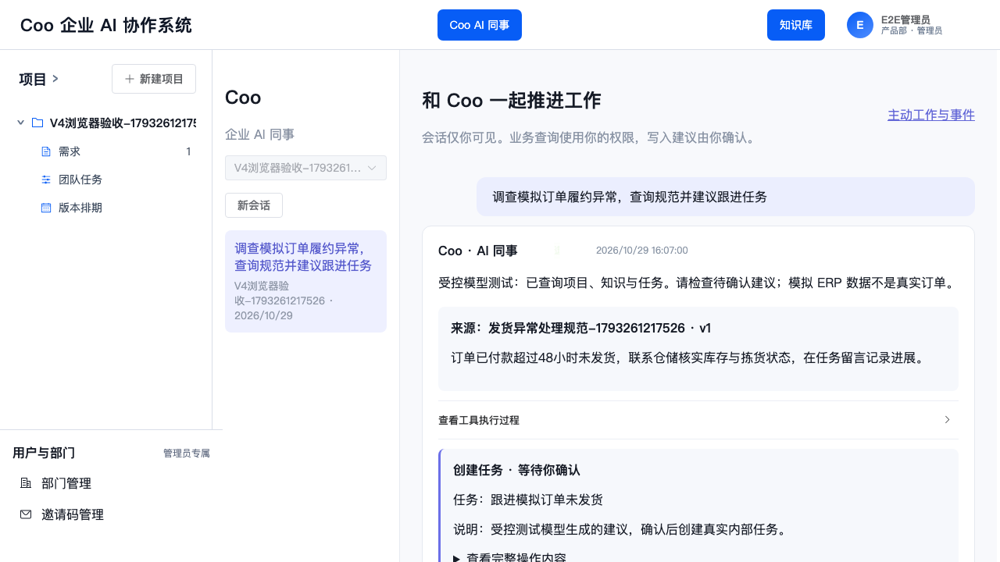
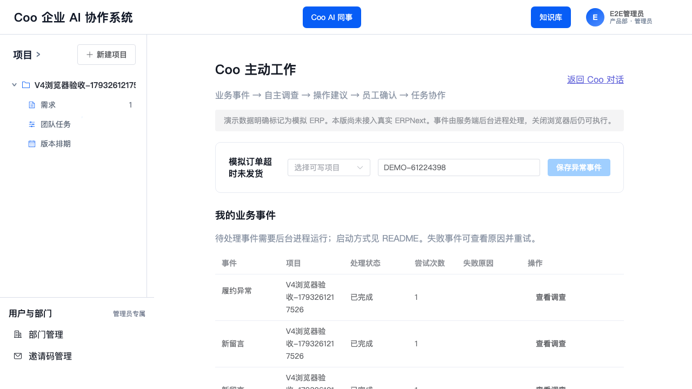

# Coo V4 交付与验收记录

验收日期：2026-10-29（Asia/Shanghai）。开发分支：`codex/coo-v4`。本次为现有仓库的增量开发，沿用本地已经完成的 `backend/`、`frontend/` 目录迁移。各阶段提交及依赖传播见 [IMPLEMENTATION.md](IMPLEMENTATION.md)。

## 实际交付

| 范围 | 结果与实现边界 |
|---|---|
| 原有业务 | 保留账号/部门/项目成员、需求、团队任务、版本排期、甘特图及权限；原任务 revision 和泳道校验继续由原 Service 执行 |
| 访谈下线 | 移除工作台/记录入口与前端路由；后端不再注册访谈及需求关联访谈查询；源码、历史表、0001–0006 迁移保留 |
| 任务留言 | 独立 TaskComment 表，真实 task_id/project_id；支持回复、历史分页、作者/时间、明确 AI 身份、项目权限、归档只读和任务删除级联 |
| 知识库 | 分类、创建编辑、UTF-8 文本上传、重叠分段预览、Embedding、草稿/发布/版本恢复、有效期、停启用、失败旧版保护、迟到发布结果隔离 |
| 检索 | SQLite 保存向量；Python 关键词/向量召回、RRF 融合、可选标准或 DashScope 原生 Rerank、阈值、召回测试、来源白名单与实时权限/有效性复验 |
| 需求分析 | 默认调用 Coo 确定性工作流；保留十字段严格结构、同项目候选校验、状态与失败保存；前台按钮和 Agent 共用；同一需求分析互斥 |
| Coo 自主运行 | 真实兼容模型 HTTP 接口、Tool Calling 决策循环；最大轮次/时间/上下文/Token 预算；私人会话、运行/工具/用量记录；无规则替代模式 |
| 业务工具 | list_projects、get_project_context、list_requirements、get_requirement、analyze_requirement、list_tasks、get_task、list_task_comments、create_task_comment、create_task、update_task、search_knowledge、get_simulated_order |
| 写入确认 | 创建任务、更新任务状态及 Agent 发起的需求分析默认待确认；留言仅本轮明确授权时自动执行。确认重验权限、调用原服务；创建/更新/留言与确认结果同事务，保留 revision 冲突保护 |
| 主动工作 | 新需求、员工任务修改/留言与模拟履约事件写入数据库事件盒；Worker 自主调查、生成建议；去重、租约恢复、失败重试。Coo 自身留言/状态更新不触发自循环 |
| 前端 | 延续 Vue/Element Plus；全局 Coo/知识库入口、私人对话、来源、工具执行、具体操作确认、事件和执行记录、关联需求/任务跳转 |
| 启动/文档 | 单命令启动 API+Worker，隔离浏览器验收脚本，README、环境示例、阶段计划、演示脚本、OpenAPI 与 TS 契约、来源许可 |

## 已运行的验证

| 验证 | 实际结果 |
|---|---|
| 后端全量 `cd backend && .venv/bin/python -m pytest -q` | **108 passed，10 skipped，0 failed** |
| 前端 Vitest | **16 个测试文件、42 项通过** |
| 前端 TypeScript `vue-tsc -b` | **通过** |
| Vite 生产构建 | **通过**，产物生成于被忽略的 frontend/dist |
| Playwright 原业务流程 | **通过**：任务/版本列表/甘特图共享同一任务 |
| Playwright V4 流程 | **通过**：知识发布/召回、十字段分析、Coo 查询及引用、任务确认、人工留言/回复、AI 留言、主动履约事件 |
| 隔离一键验收脚本 | **2 项浏览器用例通过**；自动启动真实 API/Worker 与受控模型 HTTP 测试服务，结束后停止测试服务 |
| OpenAPI/TS 再生成 | **无差异**；接口契约生成结果可重复 |
| 增量迁移 | 从 V3 0006 升级到 0011、重复升级、保留已有数据及访谈表、SQLite foreign_key_check 均通过 |
| 发布元数据回退 | 原生删除新增时间列后，已发布正文和向量片段仍保留；再次升级通过 |

关键集成断言包括：跨项目读取/回复拒绝、员工不能伪造 AI 留言、跨员工会话/日志/确认拒绝、确认前撤销成员权限、历史日志随部门知识 ACL 撤权、生成时知识停用/过期、无效向量/重排索引、低分阈值、未来版本与过期不复活旧政策、失败发布保护、迟到结果不能复活被替代版本、旧 revision 不能覆盖员工新状态、重复确认不重复创建任务、Token 预算包含工具说明、轮次限制、事件去重、浏览器关闭后后台执行、并行 Worker 只领取一次、租约耗尽和重试、AI 自回复循环抑制。

10 项跳过均为已下线访谈 API 的历史集成断言，包含原访谈模块 8 项与契约文件中的 2 项。原测试源码保留；访谈 Schema/历史服务测试仍运行，新增用例确认正式 API 已下线且历史表仍存在。仓库根部旧 V2 `tests/` 不是当前 backend/pyproject.toml 的测试范围。

剩余提示为现有 Starlette TestClient 对 httpx 的弃用提醒，以及 VueUse 注释在构建中被 Rollup 忽略；均未导致测试或构建失败。本轮没有未解决的自动化失败项。

## 真实模型与生产能力边界

**当前工作区没有配置 Coo、Embedding 或 Rerank 的真实 API Key。以上自动化验收不等于真实供应商模型质量、付费调用、长时间稳定性或生产收益验证。**

浏览器测试的 `backend/tests/model_fixture_server.py` 是明确标记的受控 HTTP 响应服务，内部测试响应包含规则分支，仅用于可复现验证。应用的 `app/coo/runtime.py` 不使用该规则服务来替代 LLM 决策；正式启动默认必须配置真实兼容模型，未配置时明确报错。HTTP 适配器的请求路径、工具 Schema、返回协议与错误脱敏已有测试。

- 配置 `backend/.env` 中 COO_*、KNOWLEDGE_EMBEDDING_*，以及可选 KNOWLEDGE_RERANK_* 后，重启 API 与 Worker，再按 [DEMO.md](DEMO.md) 做真实模型验收。模型需要支持 Tool Calling 和 JSON 输出。
- 未配置 Rerank 时会明确使用 RRF 排序，不将融合分数冒充重排相关度。Embedding 查询失败时会明确提示关键词降级；发布向量失败不会发布新版本。
- ERP 订单明确为模拟适配器数据，尚未接入真实 ERPNext；没有真实下单、退款、库存或物流操作。
- 当前为单企业原型，SQLite/Python 检索面向小规模；未验证生产并发、百万级知识或高可用。
- 只实现有限私人会话上下文、执行与事件记录，没有完整长期个人 Memory、Goal/Plan 调度或多企业租户系统。
- 暂无流式输出；前端在单次运行完成后展示本轮工具过程。后台进程运行是主动事件处理的必要条件。
- 当前确认工具支持创建任务与变更任务状态；任务其他字段仍可通过原任务界面编辑。

## 运行与复现

启动步骤以 [根 README](../../README.md) 为准，当前真实环境配置使用 `backend/.env`。已有 `.env` 与数据库未被测试配置覆盖；浏览器验收使用独立临时 SQLite、测试管理员与受控模型凭据。测试服务均已停止。

```bash
# API + Worker，自动增量迁移
backend/.venv/bin/python backend/scripts/run_v4.py
# 另一个终端运行原前端
pnpm --dir frontend dev
```

```bash
# 自动创建隔离数据库并运行两条浏览器用例
backend/.venv/bin/python backend/scripts/verify_v4_e2e.py
```

脚本会拒绝占用中的测试端口，防止误连现有业务服务；本机环回请求不经过系统代理。浏览器依赖须先安装：`pnpm --dir frontend exec playwright install chromium`。

## UI 验收证据（受控模型测试）

下图中的项目、账号、知识与订单均为隔离验收数据，**不代表真实 LLM 输出或真实 ERP 订单**。





知识切分/发布/检索技术来自客服项目 foundation，AgentServe Apache 2.0 许可与改造来源见 [THIRD_PARTY_NOTICES.md](../../THIRD_PARTY_NOTICES.md)。
