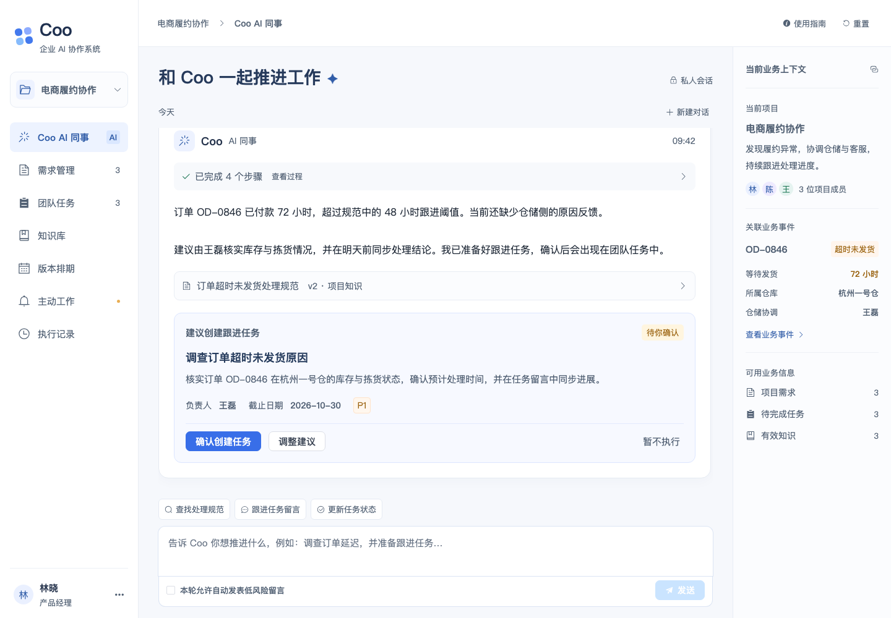
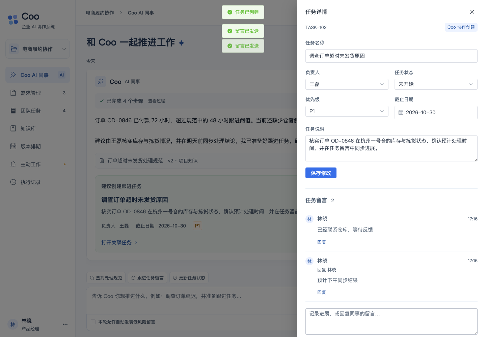
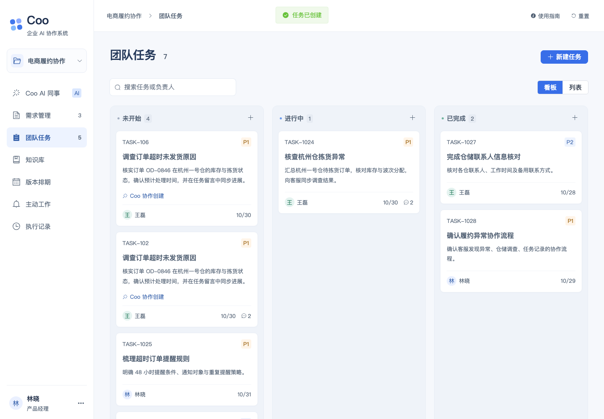

# 纯前端交互演示

入口：[http://127.0.0.1:3000/demo](http://127.0.0.1:3000/demo)。这是同一 Vue 应用内的独立演示路由，全部使用本地假数据，无需登录、后端、模型或 API Key。

```bash
pnpm --dir frontend demo
```

## 可以点击体验

- Coo：展开处理步骤、查看知识来源、调整任务建议、确认或拒绝操作；预设对话展示查知识、任务留言和状态变更。
- 任务：看板/列表切换、任务创建、详情编辑、状态/截止日期变更、留言与回复；Coo 确认创建的任务同步出现在这里。
- 需求：创建本地需求，播放预设分析结果，再交给 Coo 跟进。
- 知识：搜索、阅读、分段预览、创建草稿、演示停启用/发布、召回结果样例。
- 主动工作：添加模拟履约事件，播放调查步骤，查看建议，确认后关联到任务。
- 排期与执行记录：查看与任务共享的进度、排期和演示运行记录。
- 重置：清空当前演示改动并恢复初始样例。

所有 AI 回复和执行步骤均为预设脚本，不是真实模型推理。演示数据只保存在当前页面内存中，刷新即重置，关闭页面后不继续执行。正式业务页面仍执行原有登录和项目权限检查。演示路由不加载正式业务布局或调用会话检查接口。

## 建议体验顺序

1. 进入 Coo，点击初始建议中的「调整建议」，修改负责人/说明，再确认创建。
2. 打开关联任务，留言并回复，修改任务状态。切换任务看板或版本排期查看联动。
3. 点击「主动工作 → 模拟一条履约异常 → 播放调查」，观察过程并确认跟进任务。
4. 进入知识库查看来源与召回样例，再创建需求并播放分析。

## 代码位置

- `frontend/src/demo/state.ts`：演示数据与本地确认逻辑。
- `frontend/src/demo/FrontendDemo.vue`：演示页面与本地交互。
- `frontend/src/demo/DemoRunCard.vue`：演示步骤、来源与建议卡片。
- `frontend/e2e/frontend-demo.spec.ts`：无后端环境的浏览器交互验证，并断言业务 API 请求数为 0。

此入口仅用于讨论产品布局与交互，不代表正式系统的模型质量、业务数据或权限验证结果。

## 本轮验证

- 前端单元测试 45 项通过，TypeScript 类型检查与生产构建通过。
- 仅启动 Vite 的浏览器测试通过：确认任务、留言/回复、事件调查与确认、知识样例、重置；业务 API 请求数为 0，页面脚本错误为 0。
- 同时检查 1440px 与 720px 窗口，演示页面不产生横向溢出。







## 可读性调整

2026-10-29：正文调整为约 16px，表单/按钮约 15px，辅助信息最低 13px；加深文字与状态色，删除非必要微型说明，界面文案按正常产品页面呈现。底层仍是本地内存状态，不调用业务或模型接口。浏览器检查覆盖全部导航页、任务与知识弹窗、重置和窄窗口布局，同时断言相关提示文案不再出现在界面。
