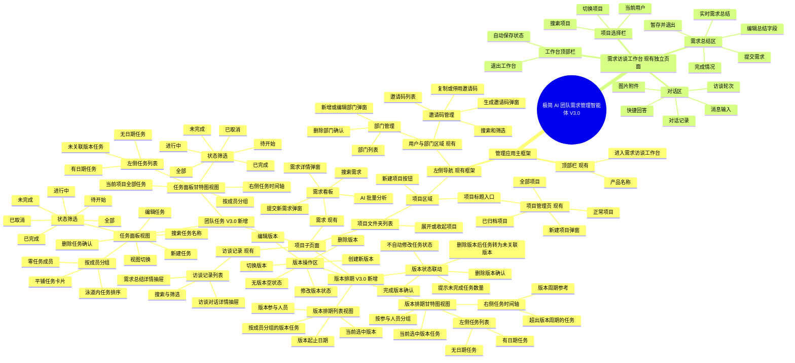
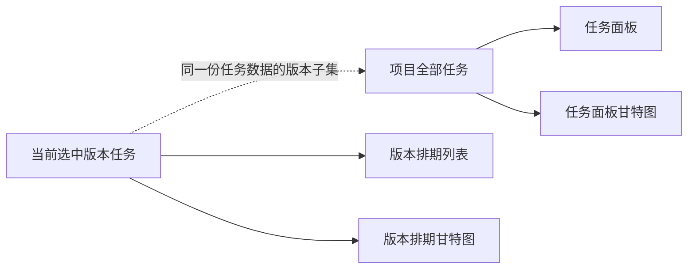

# 极简 AI 团队需求管理智能体 V3.0 页面结构脑图

> 文档状态：页面结构基线已冻结
> 基线版本：V3.0-R3
> 更新日期：2026-08-21
> 参考范围：当前 `frontend/v2.0` 前端页面、团队任务与版本排期 V3.0-R3 需求基线
> 标记说明：现有为当前前端已存在页面；V3.0 新增为本次确定增加的页面或交互。项目知识库延期至 V4.0，不属于本基线。



## V3.0 建议导航顺序

项目文件夹展开后，建议按以下顺序展示子入口：

```text
项目名称
├── 需求
├── 访谈记录
├── 团队任务
└── 版本排期
```

其中：

- “需求”和“访谈记录”沿用当前前端页面；
- “团队任务”进入项目全部任务的任务面板，页面内切换任务面板与任务面板甘特图；
- “版本排期”进入当前项目的多版本管理，页面内切换版本排期列表与版本排期甘特图；
- “项目知识库”不属于 V3.0，计划在 V4.0 中独立定义后再加入导航；
- 点击项目文件夹仍只负责展开或收起子选项，不切换中间页面；
- 点击左侧子选项时，顶部栏和左侧导航保持不变，只切换中间内容区。

## 两个甘特图的边界



| 对比项 | 任务面板甘特图 | 版本排期甘特图 |
|---|---|---|
| 所属模块 | 团队任务 | 版本排期 |
| 数据范围 | 当前项目全部任务 | 当前选中版本任务 |
| 是否包含未关联版本任务 | 包含 | 不包含 |
| 主要分组 | 项目成员 | 当前版本参与人员 |
| 无日期任务 | 左侧显示，时间轴不画任务条 | 左侧显示，时间轴不画任务条 |
| 数据同步 | 与任务面板同步 | 与版本排期列表及任务面板同步 |

## 页面级弹层与确认交互

V3.0 使用以下页面级弹窗与确认交互：

- 新建任务；
- 编辑任务；
- 新建版本；
- 编辑版本；
- 完成版本确认；
- 删除版本确认。

其中新建与编辑任务、新建与编辑版本沿用弹窗；删除任务、完成版本和删除版本使用二次确认。完成版本确认显示未完成任务数量，删除版本确认显示受影响任务数量。

## 设计基线待修订项

- 现有最终 UI 需要按 V3.0-R3 重新导出后才能冻结；
- 补齐四种任务状态与 P0～P3，甘特任务条统一蓝色；
- 删除甘特图拖拽图标和成员标题“…”入口；
- 补齐无版本空状态、完成版本确认和删除版本确认；
- 桌面 Web 最小内容宽度按 1280px 设计，任务面板和甘特图允许横向滚动；
- 通用校验、加载、失败和禁用状态在页面与交互说明中统一定义。
