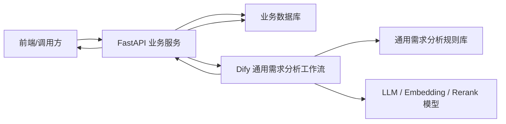
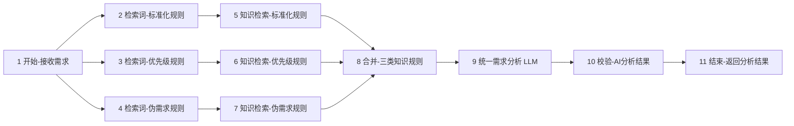
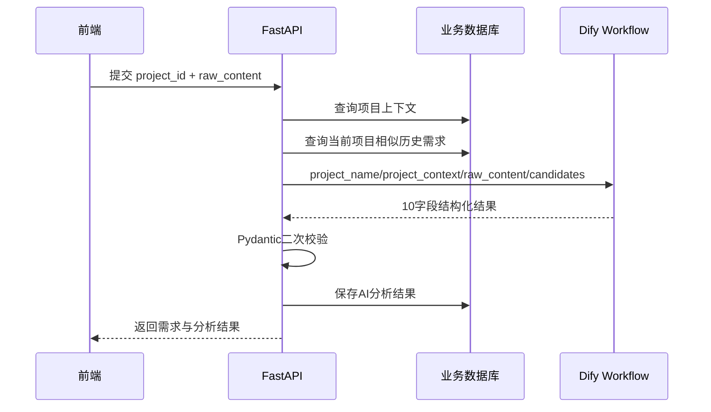

# 通用需求分析智能体 Dify 设计文档 V1.0

**文档状态：** 已完成搭建  
**编制日期：** 2026-07-22  
**适用范围：** 软件产品、内部系统、AI 应用、运营工具及其他项目的需求分析  
**关联项目：** 极简 AI 团队需求管理智能体  

---

## 1. 文档目的

本文档记录通用需求分析智能体在 Dify 中的完整设计，包括设计目标、知识库、工作流节点、输入输出、Prompt、结构化校验、异常处理、测试方法和跨项目复用机制。

该智能体不绑定某一个具体产品。极简 AI 团队需求管理系统是首个接入项目，未来其他项目可以通过传入各自的项目背景与历史候选需求，复用同一套分析能力。

## 2. 建设目标

智能体接收自然语言需求后，自动完成以下任务：

1. 将口语化、碎片化需求整理为标准需求文案；
2. 提炼需求背后的业务目标；
3. 判断需求类型：新功能、缺陷或优化；
4. 判定 P0/P1/P2/P3 优先级；
5. 识别是否为伪需求并生成依据；
6. 与当前项目的历史候选需求进行查重；
7. 引用实际使用的知识库规则，实现判断可追溯；
8. 生成适合在产品页面展示的 AI 分析总结；
9. 返回固定 JSON，供 FastAPI 直接校验并写入数据库。

## 3. 设计原则

### 3.1 通用规则与项目事实分离

- 知识库只存放跨项目通用的分析方法；
- 项目名称、目标用户、核心流程、现有能力和业务约束通过 `project_context` 动态传入；
- 历史需求候选通过 `candidate_requirements` 动态传入；
- 不把某一个项目的业务事实写入通用规则库。

### 3.2 项目数据隔离

- 每次调用只使用当前项目的上下文和历史候选需求；
- 查重不得跨项目进行；
- Dify 不直接访问业务数据库；
- FastAPI 根据 `project_id` 查询项目资料与候选需求，再调用 Dify；
- `project_id`、需求 ID、时间戳等可信字段由后端维护，不由模型生成。

### 3.3 结构化与可追溯

- LLM 使用低温度参数，降低随机发挥；
- 使用结构化输出 Schema 强制字段、类型和枚举；
- 使用代码节点进行第二次一致性校验；
- 所有判断通过 `reference_rule` 引用知识库规则；
- 校验失败不写入数据库，避免污染业务数据。

## 4. 总体架构



职责划分：

| 模块 | 主要职责 |
| --- | --- |
| 前端 | 提交需求、展示分析结果和 AI 总结 |
| FastAPI | 鉴权、项目隔离、数据查询、调用 Dify、Pydantic 校验、数据库写入 |
| Dify | RAG 检索、需求理解、分类、分级、真伪判断、查重判断、结构化输出 |
| SQLite/业务数据库 | 持久化项目、需求、分析结果和操作日志 |
| RAG 知识库 | 存放跨项目通用的规则文档 |

## 5. Dify 应用类型与模型配置

### 5.1 应用类型

使用 **Workflow 工作流应用**，通过后端 API 调用，不依赖多轮对话状态。

### 5.2 当前模型配置

| 用途 | 当前配置 | 说明 |
| --- | --- | --- |
| 文档嵌入 | `text-embedding-v2` | 将规则文档转为向量 |
| 检索重排 | `qwen3-rerank` | 对全文与向量候选结果进行相关性重排 |
| 需求分析 | `deepseek-v4-flash` | 统一完成标准化、分类、分级、真伪和查重判断 |

建议 LLM 参数：

- Temperature：`0.1`；
- 最大输出：约 `2500～4000 tokens`；
- 开启结构化输出；
- 不开启自由文本作为最终业务结果。

模型可以更换，但更换后必须重新进行回归测试。嵌入模型一旦更换，知识库通常需要重新索引。

## 6. RAG 知识库设计

### 6.1 知识库名称

`通用需求分析规则库`

### 6.2 知识文档

1. `01-需求优先级判定标准-P0-P3.md`
2. `02-伪需求识别判定标准.md`
3. `03-需求标准化整理规范.md`

固定 JSON Schema 不上传到知识库，配置在 LLM 节点的结构化输出中。

### 6.3 分段设置

| 配置项 | 建议值 |
| --- | --- |
| 分段模式 | 通用 |
| 分段标识符 | `\n## ` |
| 最大分段长度 | `1200 characters` |
| 重叠长度 | `100 characters` |
| 删除 URL/邮箱 | 关闭 |
| 清理连续换行 | 关闭 |
| Q&A 分段 | 关闭 |
| 摘要自动生成 | 关闭 |

分段目标是让标题、规则编号、适用条件、排除条件和示例尽量位于同一个知识块中。

### 6.4 索引与召回

- 索引方式：高质量；
- 检索方式：混合检索；
- 排序方式：Rerank 模型；
- Rerank：`qwen3-rerank`；
- 标准化规则 Top K：`4`；
- 优先级规则 Top K：`5`；
- 伪需求规则 Top K：`5`；
- Score 阈值初始值：`0.30`。

若召回为空，可先降至 `0.20`；若仍为空，暂时关闭阈值检查知识库索引状态。若无关内容过多，可提高至 `0.35`。

## 7. 工作流输入设计

开始节点名称：`开始-接收需求`

| 变量名 | 类型 | 必填 | 说明 |
| --- | --- | --- | --- |
| `project_name` | String | 否 | 当前项目名称 |
| `project_context` | Paragraph/String | 是 | 当前项目定位、用户、核心流程、现有能力、阶段、目标与约束 |
| `raw_content` | Paragraph/String | 是 | 用户提交的原始需求 |
| `candidate_requirements` | Paragraph/String | 否 | 当前项目的历史相似需求候选，使用 JSON 数组字符串 |

`candidate_requirements` 无候选时必须传：

```json
[]
```

不建议传空字符串。候选项至少包含 `id` 和 `standard_content`。

## 8. 工作流节点设计

最终工作流共 11 个节点：



### 8.1 三个检索词模板节点

节点类型均为“模板转换”，输入均引用 `开始-接收需求.raw_content`。

#### 标准化检索词

重点检索：

- `standard_content` 编写规则；
- `business_goal` 提炼规则；
- BUG、NEW_FEATURE、OPTIMIZATION 分类规则；
- 信息不完整与口语化需求的处理规则。

#### 优先级检索词

重点检索：

- 核心流程与业务影响；
- 用户范围和发生频率；
- 是否存在绕行方案；
- 安全、合规、数据、营收与交付风险；
- P0/P1/P2/P3 的排除与降级规则。

#### 伪需求检索词

重点检索：

- FAKE-S1 至 FAKE-S4；
- FAKE-W1 至 FAKE-W6；
- FAKE-NOT；
- 伪需求、低优先级和重复需求之间的区别。

模板节点只负责构造检索问题，不调用 LLM，不产生模型 Token 费用。

### 8.2 三个知识检索节点

三个节点均检索同一个通用规则库，但分别使用不同查询文本，从而提高三类规则同时被召回的稳定性。

输出变量均为：`result Array[Object]`。

### 8.3 合并知识规则节点

节点名称：`合并-三类知识规则`  
节点类型：代码  

输入：

- `standard_rules`；
- `priority_rules`；
- `fake_rules`。

处理逻辑：

1. 合并三个 `Array[Object]`；
2. 根据 segment ID、document ID 或内容进行去重；
3. 保留知识检索对象原有结构与元数据；
4. 输出 `combined_context Array[Object]`。

该节点解决 LLM 节点只能设置一个专用上下文的问题。LLM 的“上下文”应引用 `合并-三类知识规则.combined_context`。

### 8.4 统一需求分析 LLM

节点名称：`统一需求分析 LLM`

输入内容：

- `project_name`；
- `project_context`；
- `raw_content`；
- `candidate_requirements`；
- 合并后的通用规则上下文。

分析顺序：

1. 理解当前项目；
2. 提取需求事实；
3. 生成标准化需求；
4. 提炼业务目标；
5. 判断需求类型；
6. 判断优先级；
7. 判断是否为伪需求；
8. 判断是否重复；
9. 记录引用规则；
10. 生成页面 AI 分析总结。

关键约束：

- 禁止虚构项目事实与业务数据；
- 通用知识只提供方法，不代表当前项目现状；
- 不得跨项目查重；
- P0 必须有重大事故或风险事实；
- 信息不足时保守判断并引用 `PROJECT-CONTEXT-MISSING`；
- 最终只返回结构化结果，不输出内部分析过程。

### 8.5 AI 结果校验节点

节点名称：`校验-AI分析结果`  
节点类型：代码  

输入：

- `result`：引用 `统一需求分析 LLM.structured_output`；
- `candidate_requirements`：引用开始节点对应变量。

校验内容：

- 10 个字段是否齐全；
- 是否存在未知字段；
- `type` 与 `priority` 是否属于固定枚举；
- `is_fake` 与 `is_duplicate` 是否为 Boolean；
- 文本字段是否非空；
- `is_duplicate=false` 时强制清空 `related_id`；
- `is_duplicate=true` 时，`related_id` 必须存在于候选列表中；
- 防止模型虚构关联需求 ID。

### 8.6 结束节点

节点名称：`结束-返回分析结果`

将校验节点的 10 个变量分别配置为顶层输出，不返回拼接文本，也不直接返回 LLM 的普通 `text`。

## 9. 结构化输出设计

固定 Schema 文件：`dify-rag/04-Dify固定输出-JSON-Schema.json`

输出字段：

| 字段 | 类型 | 说明 |
| --- | --- | --- |
| `standard_content` | String | 标准化需求文案 |
| `business_goal` | String | 底层业务目标 |
| `type` | Enum String | NEW_FEATURE / BUG / OPTIMIZATION |
| `priority` | Enum String | P0 / P1 / P2 / P3 |
| `is_fake` | Boolean | 是否为伪需求 |
| `fake_reason` | String | 真伪判定事实与规则依据 |
| `is_duplicate` | Boolean | 是否重复 |
| `related_id` | String | 重复需求 ID，无则为空字符串 |
| `reference_rule` | String | 实际引用的规则编号和摘要 |
| `analysis_summary` | String | 页面展示用 AI 分析总结 |

`analysis_summary` 建议控制在 80～200 个汉字，使用 1～3 句话概括问题、价值、类型、优先级、真伪和查重结论，不展示内部推理过程。

示例：

```json
{
  "standard_content": "面向教务老师，在每周集中排课场景下，支持一次选择多个课程与教师完成批量排课，并在提交前自动检测教师时间冲突。",
  "business_goal": "降低教务老师的人工排课耗时，减少教师时间冲突和排课错误。",
  "type": "NEW_FEATURE",
  "priority": "P2",
  "is_fake": false,
  "fake_reason": "原文明确描述了目标用户、使用场景和效率问题；依据 FAKE-NOT，判定为真实需求。",
  "is_duplicate": false,
  "related_id": "",
  "reference_rule": "NORMALIZE-RULE-V1.0；TYPE-NEW；PRI-P2；FAKE-NOT",
  "analysis_summary": "该需求主要解决教务老师集中排课耗时较长、容易产生时间冲突的问题，能够降低人工操作成本和排课错误。综合判断为新增功能、P2 优先级，属于具有明确场景和价值的真实需求，未发现完整重复需求。"
}
```

## 10. 数据库对应设计

`requirement` 表中的 AI 分析字段应与 Dify 输出同名：

```text
standard_content
business_goal
type
priority
is_fake
fake_reason
is_duplicate
related_id
reference_rule
analysis_summary
```

以下字段不由 Dify 输出：

```text
id
project_id
raw_content
manual_modify
created_time
updated_time
```

这些字段由 FastAPI 和数据库维护，避免模型覆盖可信数据。

## 11. 后端调用流程



后端必须将 `candidate_requirements` 限定为当前 `project_id`，并控制候选数量，避免输入过长。

## 12. 异常处理

| 异常 | 处理策略 |
| --- | --- |
| 知识检索为空 | LLM 保守判断，`reference_rule` 标记未召回明确规则 |
| 项目上下文不足 | 引用 `PROJECT-CONTEXT-MISSING`，建议人工复核 |
| Embedding SSL/网络失败 | 重试失败文档索引；检查 Dify 容器外网与 DashScope 连接 |
| LLM 超时或限流 | 工作流失败，由后端记录并允许重新分析 |
| 结构化输出失败 | 不使用普通 text 兜底写库，直接失败重试 |
| 代码校验失败 | 终止流程，不覆盖数据库旧结果 |
| related_id 不在候选列表 | 判为非法输出并终止写入 |
| 后端 Pydantic 校验失败 | 记录原始错误，需求状态标记为分析失败 |

核心分析 LLM 与校验代码节点建议采用“失败即停止”，不要用默认假结果继续写库。

## 13. 测试与验收

### 13.1 必测场景

1. 明确的新功能需求；
2. 已有功能报错的 BUG；
3. 可用但体验较差的优化需求；
4. 核心业务完全阻断的 P0；
5. 高价值、有绕行方案的 P1；
6. 普通功能增强的 P2；
7. 个性偏好或边缘想法的 P3；
8. 明确真实需求；
9. 强伪需求；
10. 与候选需求完全重复；
11. 只有部分能力重合但存在增量价值；
12. 空候选列表；
13. 项目上下文不足；
14. 同一需求放入不同项目背景，验证优先级差异；
15. 非法 related_id，验证代码节点能否拦截。

### 13.2 验收标准

- 结构化输出字段完整率：100%；
- 枚举和 Boolean 类型正确率：100%；
- 非重复需求 `related_id` 为空：100%；
- 重复需求 `related_id` 来自候选列表：100%；
- 页面总结自然、简洁且不含内部推理；
- 不虚构规则编号、项目数据和候选需求 ID；
- 相同输入在低温度下结果基本稳定；
- Dify 校验失败时不污染数据库。

## 14. 跨项目接入规范

新增项目无需复制 Dify 工作流，只需完成：

1. 在业务系统创建 `project_id`；
2. 维护该项目的 `project_name` 与 `project_context`；
3. 后端按项目查询历史候选需求；
4. 调用同一个 Dify Workflow；
5. 将分析结果写回对应项目需求记录。

建议 `project_context` 至少包含：

- 项目定位；
- 目标用户；
- 核心业务流程；
- 当前已有能力；
- 当前产品阶段；
- 当前业务目标；
- 安全、隐私、合规及数据约束。

## 15. 后续优化方向

1. 为项目上下文建立后台维护页面和版本记录；
2. 后端增加项目内向量查重，提高候选召回质量；
3. 保存 AI 原始结果与人工修正结果，形成评测集；
4. 建立 P0、伪需求和重复需求专项回归测试；
5. 统计规则命中、人工修正率和分析失败率；
6. 知识库升级后支持批量重新分析；
7. 根据真实修正数据持续调整规则，而不是依赖提高模型自由度；
8. 未来需要自动同步外部文档时，再评估知识流水线，不对当前普通知识库做不可逆转换。

## 16. 关联文件

- `dify-rag/01-需求优先级判定标准-P0-P3.md`
- `dify-rag/02-伪需求识别判定标准.md`
- `dify-rag/03-需求标准化整理规范.md`
- `dify-rag/04-Dify固定输出-JSON-Schema.json`
- `dify-rag/README.md`

---

**结论：** 当前 Dify 应用已经形成“通用规则库 + 动态项目上下文 + 三路 RAG 检索 + 单 LLM 统一判断 + 双层结构化校验”的完整方案。该方案既能服务极简 AI 团队需求管理系统，也能通过项目隔离机制复用于后续其他项目。
